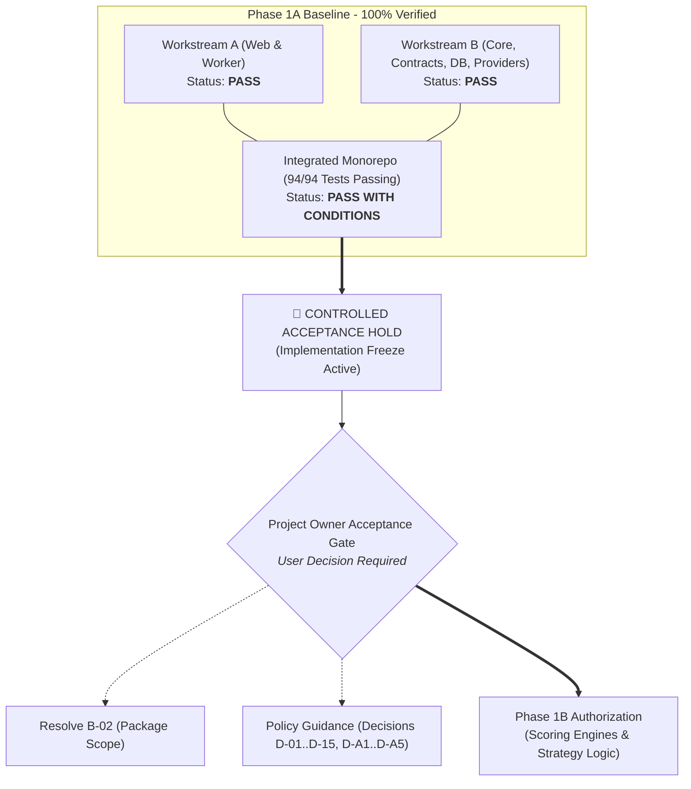

# STOKIFFY — PHASE 1A ACCEPTANCE HOLD REPORT
## Formal Phase 1A Acceptance Hold & Monorepo Implementation Freeze

**Author:** Antigravity (Principal Software Architect & Monorepo Infrastructure Owner)  
**Role:** Workstream A Exclusive Owner (`apps/web/**`, `apps/worker/**`, and Root Monorepo Infrastructure)  
**Task Cycle:** Task Cycle 11A — Formal Phase 1A Acceptance Hold & Implementation Freeze  
**Mode:** GOVERNANCE HOLD & REPOSITORY FREEZE  
**Target:** Controlled Project Hold Awaiting Final Project Owner Review and Phase 1B Authorization  
**Status:** **ACTIVE ACCEPTANCE HOLD — IMPLEMENTATION FROZEN**  
**Date:** November 17, 2026  

---

## 1. Executive Summary: Active Acceptance Hold

In accordance with Task Cycle 11A instructions, the Stokiffy project is officially placed into a **controlled acceptance hold and strict implementation freeze**.

All technical foundations across all six workspaces (`apps/web`, `apps/worker`, `packages/core`, `packages/contracts`, `packages/db`, and `packages/data-providers`) have been verified, stabilized, synchronized, and independently audited.

No further development, configuration modifications, package installations, database operations, or refactoring will occur until the project owner reviews both independent readiness reports and grants formal authorization.

---

## 2. Current Verified Project Status

The Stokiffy monorepo technical foundation stands in a clean, reproducible, and deterministic state:

| Audit Dimension | Status | Verification Summary |
| :--- | :---: | :--- |
| **Workspace Graph** | **PASS** | 6 workspaces + root project discovered; DAG verified acyclic; zero circular dependencies; zero `file:` dependencies. |
| **Lockfile Synchronization** | **PASS** | `pnpm-lock.yaml` (165,246 bytes) matches all manifests; `@types/node: ^22.0.0` resolves to `22.20.5` in `db` and `data-providers`; zero stale `^26.6.6` importer specifiers. |
| **Clean Compilation** | **PASS** | `pnpm turbo run build --force` succeeds across all 6 workspaces with exit code 0 (9.589s). |
| **Static Type Safety** | **PASS** | `pnpm turbo run typecheck --force` passes across all 6 workspaces with 0 diagnostic errors (3.198s). |
| **Automated Test Suite** | **PASS** | `pnpm turbo run test --force` passes **94 of 94 tests (100% pass rate)** across 8 test suites (3.773s). |
| **Linting & Code Quality** | **PASS** | `apps/web` passes full ESLint (`next lint`) with 0 warnings/errors; `apps/worker` passes compiler type analysis (`tsc --noEmit`). |
| **Prisma ORM Integration** | **PASS** | Prisma Client 5.22.0 generated in 139ms; schema validates with zero errors. |
| **Policy Neutrality** | **PASS** | Zero proprietary scoring formulas; all 20 canonical investment strategy decisions remain strictly frozen. |

---

## 3. Reports Received and Reports Outstanding

### 3.1 Reports Received and Verified

1. **Antigravity Cycle 9 Lockfile Report:**  
   [`apps/web/PHASE_1A_LOCKFILE_SYNCHRONIZATION_HANDOFF_REPORT.md`](file:///Users/sg/Dev/PROJECTS/Stokiffy/apps/web/PHASE_1A_LOCKFILE_SYNCHRONIZATION_HANDOFF_REPORT.md)  
   - Result: `COMPLETE — LOCKFILE REMEDIATED AND VERIFIED`.  
   - Proved lockfile importer synchronization (`^22.0.0` -> `22.20.5`) and cleared OpenCode to resume verification.
2. **Antigravity Cycle 10A Workstream A Readiness Report:**  
   [`apps/web/PHASE_1A_FINAL_ACCEPTANCE_READINESS_REPORT.md`](file:///Users/sg/Dev/PROJECTS/Stokiffy/apps/web/PHASE_1A_FINAL_ACCEPTANCE_READINESS_REPORT.md)  
   - Result: `Workstream A: PASS; Integrated Monorepo: PASS WITH CONDITIONS`.  
   - Independently verified root monorepo, web application, worker daemon, and integration pipelines.
3. **OpenCode Post-Sync Final Acceptance Report (Cycle 7):**  
   [`packages/core/PHASE_1A_POST_SYNC_FINAL_ACCEPTANCE_REPORT.md`](file:///Users/sg/Dev/PROJECTS/Stokiffy/packages/core/PHASE_1A_POST_SYNC_FINAL_ACCEPTANCE_REPORT.md)  
   - Result: `COMPLETE — READY FOR PACKAGE ACCEPTANCE` (80/80 package tests passing).
4. **OpenCode Cycle 10B Final Readiness Report (Now Received):**  
   [`packages/core/PHASE_1A_FINAL_PACKAGE_ACCEPTANCE_READINESS_REPORT.md`](file:///Users/sg/Dev/PROJECTS/Stokiffy/packages/core/PHASE_1A_FINAL_PACKAGE_ACCEPTANCE_READINESS_REPORT.md)  
   - Result: `PASS — ALL FOUR PACKAGES TECHNICALLY ACCEPTED`.  
   - Confirms independent package verification, Decimal.js safety, repository ownership enforcement, and provider neutrality across `core`, `contracts`, `db`, and `data-providers`.

### 3.2 Outstanding Action

- **Formal Project Owner Acceptance & Phase 1B Authorization:**  
  Both agents (Antigravity and OpenCode) have submitted their final technical readiness reports. The sole outstanding action is the **Project Owner's formal review, baseline acceptance, and explicit Phase 1B authorization**.

---

## 4. Confirmation of Implementation Freeze

Antigravity explicitly confirms that a strict implementation freeze is in effect:

1. **No Source Modifications:** Zero changes to `apps/**`, `packages/**`, or `docs/**`.
2. **No Configuration Edits:** Zero changes to `package.json`, `pnpm-workspace.yaml`, `pnpm-lock.yaml`, `turbo.json`, or TypeScript/lint configs.
3. **No Dependency Actions:** No `pnpm install`, package additions, removals, or lockfile regeneration.
4. **No Database Actions:** No Prisma migrations (`prisma migrate`), no database schema modifications, and zero connections to Neon or any external database.
5. **No VCS Operations:** Repository remains in non-Git mode; zero Git commands (`git init`, commit, branch, tag, push) executed.
6. **No Deployment:** Zero build artifacts deployed to Vercel, Docker, or staging environments.
7. **No Feature Development:** Phase 1B implementation has **NOT** begun.

---

## 5. Outstanding Owner Decisions (Tracked Without Resolution)

The following architectural and governance decisions are preserved intact for the Project Owner's review:

### 5.1 B-02: Package Naming Convention
- **Current State:** 5 workspaces use `@stock-assistant/*` while the worker uses `@stokiffy/worker`. The monorepo builds and links cleanly.
- **Classification:** Non-blocking for Phase 1A foundation acceptance.
- **Required Owner Decision:** Select target convention prior to Phase 1B:
  - Option A: Unify all packages under `@stokiffy/*`.
  - Option B: Unify all packages under `@stock-assistant/*`.
  - Option C: Retain the current hybrid structure.

### 5.2 B-03: Database-Level Audit Immutability
- **Current State:** `AuditRepository` enforces append-only semantics in application code (`create()`, `findManyByUser()`, `findManyByEntity()`). True database-level immutability (PostgreSQL row-level security, `REVOKE UPDATE, DELETE`, or write-once triggers) is intentionally deferred.
- **Classification:** Non-blocking for Phase 1A / Phase 1B. Mandatory prior to live production deployment.
- **Required Owner Action:** Authorize infrastructure hardening / DDL migration strategy for production provisioning.

### 5.3 B-04 / D-15: Live Market Data Provider Selection
- **Current State:** Interfaces (`MarketDataProvider`, `FinancialStatementProvider`) are provider-neutral. Ingestion is fully operational using `MockDataProvider` and local CSV files (`CSVIngestionEngine`).
- **Classification:** Non-blocking for Phase 1A / Phase 1B. Required when live data ingestion is scheduled (Phase 2).
- **Required Owner Decision:** Formally select live market data vendor (e.g. Zerodha Kite, Upstox, Yahoo Finance) and define trading universe.

### 5.4 Documented Technical Debt (TD-01 to TD-04)
- **TD-01 (CSV Parser Eager Memory Loading):** In `packages/data-providers`, `parser.ts` splits file buffer into memory; refactor to streaming parser deferred to Phase 1B (OpenCode ownership).
- **TD-02 (Worker ESLint Configuration):** `apps/worker` currently lints via `tsc --noEmit`; standalone ESLint setup deferred to Phase 1B (Antigravity ownership).
- **TD-03 (Package-Level Lint Scripts):** `packages/*` declare no `"lint"` scripts in manifests; addition of `"lint": "tsc --noEmit"` deferred to Phase 1B (OpenCode ownership).
- **TD-04 (Node Type Version Alignment):** Apps declare `^20.17.0` while packages declare `^22.0.0`; cleanly resolved by pnpm without conflict.

---

## 6. Confirmation: All 20 Canonical Decisions Remain Pending

Antigravity explicitly certifies that **zero financial scoring, investment algorithms, or automated decision logic exist in the codebase**. All 20 canonical investment decisions remain strictly frozen as **`PENDING USER DECISION`**:

- **D-01:** Debt-to-Equity Boundary Formulation (`< 1.0` vs `<= 1.0`) — **PENDING**
- **D-02:** Current Ratio Boundary Definition (`= 1.0` edge cases) — **PENDING**
- **D-03:** Financial History Depth Requirement (3 vs 5 vs 10 years) — **PENDING**
- **D-04:** Red Flag Hard-Block Override Policy & Audit Logging — **PENDING**
- **D-05:** Promoter Pledge Percentage Threshold — **PENDING**
- **D-06:** Related Party Transactions (RPT) Materiality Cutoff — **PENDING**
- **D-07:** Auditor Qualification Severity Scale — **PENDING**
- **D-08:** DCF Growth Rate Caps & Asset Haircuts — **PENDING**
- **D-09:** Kelly Criterion Fractional Sizing Cap — **PENDING**
- **D-10:** Portfolio Target Volatility & Risk Budgeting Limits — **PENDING**
- **D-11:** Cross-Asset Correlation Lookback Period & Limits — **PENDING**
- **D-12:** Red-Flag Grace Period & Mandatory Liquidation Timeline — **PENDING**
- **D-13:** Take-Profit Scaling Tranches & Targets — **PENDING**
- **D-14:** Strategy Configuration Externalization & Versioning — **PENDING**
- **D-15:** Primary Market Data Provider & Trading Universe — **PENDING**
- **D-A1:** Stage A Screener Thresholds & Mathematical Formula — **PENDING**
- **D-A2:** Stage B Trend Pass Mark & Institutional Holding Rules — **PENDING**
- **D-A3:** Stage C Business Model & Moat Questionnaire Rubric — **PENDING**
- **D-A4:** PEG Valuation Growth Rate Fallback Formula — **PENDING**
- **D-A5:** Data Quality Assessment Gating & Missing Data Coercion — **PENDING**

---

## 7. Confirmation: Ownership Compliance & Working Tree Preservation

- **Zero Modifications Outside Ownership:** Antigravity has modified **zero files** under `packages/**` and **zero files** under `docs/**`.
- **Zero Modifications in Current Cycle:** In Task Cycle 11A, no existing source files, test fixtures, package manifests, or configuration files were modified. Only this hold report (`apps/web/PHASE_1A_ACCEPTANCE_HOLD_REPORT.md`) was authored.
- **Working Tree Preserved:** All accumulated work across all six workspaces remains 100% intact and reproducible.

---

## 8. Conditions Required Before Phase 1B Authorization

Phase 1B (Investment Engine Scaffolding, Scoring Pipelines & Core Logic) may **ONLY** begin after the following conditions are satisfied:

1. **Formal Owner Acceptance:** Explicit acceptance by the project owner of the Phase 1A foundation based on the final reports from Antigravity (Cycle 10A) and OpenCode (Cycle 10B).
2. **Owner Decision on B-02:** Guidance on monorepo package naming convention (`@stock-assistant/*` vs `@stokiffy/*`) to establish a permanent import standard.
3. **Owner Policy Guidance on Stage A (D-A1, D-01..D-05):** Authorization of the specific financial thresholds and calculation rules required before implementing Stage A screening engines.
4. **Explicit Phase 1B Mandate:** A written prompt or directive from the project owner authorizing the commencement of Phase 1B.

---

## 9. Stop Condition

In strict accordance with Task Cycle 11A instructions:

### **EXECUTION HAS STOPPED.**

Antigravity will not run implementation commands, generate code, edit files, or begin Phase 1B.

The workspace is on standby awaiting formal review and explicit authorization from the project owner.
