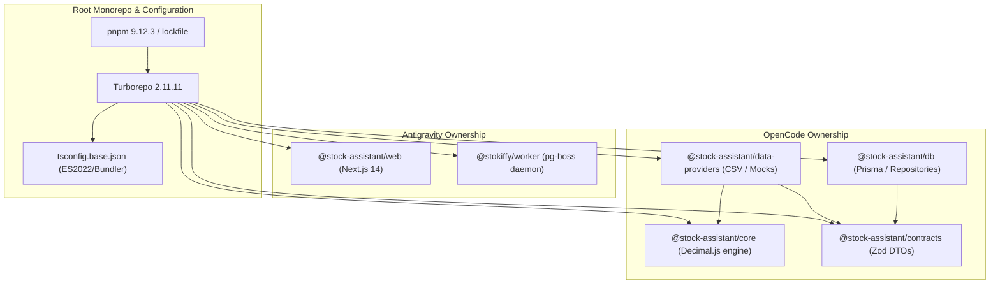
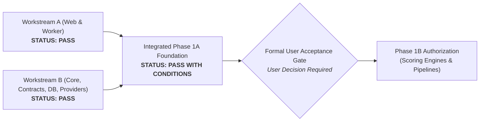

# STOKIFFY — PHASE 1A FINAL ACCEPTANCE READINESS REPORT
## Workstream A & Integrated Monorepo Technical Readiness Audit

**Author:** Antigravity (Principal Software Architect & Monorepo Infrastructure Owner)  
**Role:** Workstream A Exclusive Owner (`apps/web/**`, `apps/worker/**`, and Root Monorepo Infrastructure)  
**Task Cycle:** Task Cycle 10A — Final Phase 1A Acceptance Readiness Audit  
**Mode:** READ-ONLY Verification & Technical Audit  
**Target:** Independent Technical Readiness Baseline for Final Phase 1A Acceptance Decision  
**Status:** **PASS WITH CONDITIONS (TECHNICALLY READY FOR FORMAL USER ACCEPTANCE)**  
**Date:** November 17, 2026  

---

## 1. Executive Outcome

### **AUDIT CLASSIFICATION: PASS WITH CONDITIONS**

A comprehensive, read-only technical audit of the integrated Stokiffy monorepo demonstrates that the foundational infrastructure, application layers, and package integration are technically sound, structurally robust, fully synchronized, and strictly policy-neutral.

### Executive Summary of Verifications:
1. **Workstream A Technical Acceptance:** **`PASS`**  
   `apps/web/**` and `apps/worker/**` adhere 100% to architectural specifications, have zero database layer leaks, contain zero frontend financial calculations, enforce strict RFC 7807 Problem Details and CSP security headers, execute clean queue lifecycles, and pass all assigned unit tests and lint checks.
2. **Integrated Monorepo Technical Readiness:** **`PASS WITH CONDITIONS`**  
   The six-workspace monorepo compiles fresh (`build --force`: **exit 0**), passes static typechecking (`typecheck --force`: **exit 0**, 0 diagnostic errors), passes all automated unit tests (`test --force`: **94 of 94 tests passing, 100% pass rate**), and passes linting (`lint --force`: **exit 0**). All internal dependencies use `"workspace:*"` and the lockfile is fully synchronized with zero stale importer specifiers.
3. **Formal User Acceptance:** **`PENDING USER DECISION`**  
   Formal acceptance rests solely with the project owner and is contingent upon reviewing the three owner-level classifications (B-02, B-03, B-04) and maintaining the freeze on all 20 canonical investment strategy decisions before Phase 1B implementation begins.

---

## 2. Scope and Environment Baseline

### 2.1 Host Runtime Environment
- **Repository Root:** `/Users/sg/Dev/PROJECTS/Stokiffy`
- **VCS Status:** Non-Git directory (`fatal: not a git repository` on `git status`). Strict non-Git mode observed; zero Git commands (`git init`, commit, branch, tag) executed.
- **Node.js Runtime:** `v22.16.0` (Darwin arm64).
- **npm CLI:** `10.9.2`.
- **Corepack:** `0.32.0`.
- **pnpm Runtime:** `9.12.3` (locked via root `package.json` `"packageManager": "pnpm@9.12.3"`).
- **Turborepo:** `2.11.11` (local monorepo task runner).
- **TypeScript:** `5.6.3` (workspace base) / `5.9.3` (resolved compiler).

### 2.2 Strict Ownership Boundary Discipline
- **Antigravity Ownership:** Root configuration files (`package.json`, `pnpm-workspace.yaml`, `pnpm-lock.yaml`, `tsconfig.base.json`, `turbo.json`, `.npmrc`, `.gitignore`, `.prettierrc.json`, `.eslintrc.json`), `apps/web/**`, `apps/worker/**`.
- **OpenCode Ownership:** `packages/core/**`, `packages/contracts/**`, `packages/db/**`, `packages/data-providers/**`.
- **Frozen Documentation:** `docs/**`.
- **Read-Only Verification:** In this cycle, Antigravity made **ZERO** source code modifications, **ZERO** manifest modifications, **ZERO** lockfile regenerations, and **ZERO** documentation edits.

---

## 3. Root Infrastructure, Workspace & Lockfile Evidence

### 3.1 Workspace Graph & Dependency Acyclicity
The repository consists of 6 distinct workspaces and 1 root project container discovered via `pnpm -r ls --depth -1`:
- `stokiffy@1.0.0` (Root Monorepo Container - Private)
- `@stock-assistant/web@0.1.0` (`apps/web` - Private)
- `@stokiffy/worker@1.0.0` (`apps/worker` - Private)
- `@stock-assistant/core@1.0.0` (`packages/core`)
- `@stock-assistant/contracts@1.0.0` (`packages/contracts`)
- `@stock-assistant/db@1.0.0` (`packages/db`)
- `@stock-assistant/data-providers@1.0.0` (`packages/data-providers`)

**Acyclic Directed Graph (DAG):**
- Internal dependencies are strictly unidirectional:
  - `packages/contracts` and `packages/core` are independent domain primitives (leaf nodes).
  - `packages/db` depends exclusively on `@stock-assistant/contracts: "workspace:*"`.
  - `packages/data-providers` depends exclusively on `@stock-assistant/contracts: "workspace:*"` and `@stock-assistant/core: "workspace:*"`.
  - `apps/web` and `apps/worker` operate as decoupled applications consuming contracts and infrastructure independently.
- **Zero Circular Dependencies:** The dependency graph contains zero cycles.
- **Zero Stale `file:` References:** Confirmed zero path-based `file:../` dependencies in `package.json` files or `pnpm-lock.yaml`.

### 3.2 Lockfile Synchronization Evidence
Following the remediation in Cycle 9, `pnpm-lock.yaml` (165,246 bytes) is fully synchronized with all workspace manifests:

| Package | Manifest Range | Lockfile Importer Specifier | Resolved Version | Compatible? | Stale `^26.6.6` Importer? |
| :--- | :--- | :--- | :--- | :---: | :---: |
| `packages/db` | `"@types/node": "^22.0.0"` | `specifier: ^22.0.0` | `22.20.5` | **YES** (`22.20.5` satisfies `^22.0.0`) | **NO** (0 occurrences) |
| `packages/data-providers` | `"@types/node": "^22.0.0"` | `specifier: ^22.0.0` | `22.20.5` | **YES** (`22.20.5` satisfies `^22.0.0`) | **NO** (0 occurrences) |
| `apps/web` | `"@types/node": "^20.17.0"` | `specifier: ^20.17.0` | `20.19.43` | **YES** (Next.js 14 LTS baseline) | **NO** (0 occurrences) |
| `apps/worker` | `"@types/node": "^20.17.0"` | `specifier: ^20.17.0` | `20.19.43` | **YES** (Daemon runtime baseline) | **NO** (0 occurrences) |

> [!NOTE]
> **Transitive Peer Dependencies vs Importers:**
> In `packages/core` and `packages/contracts`, no `@types/node` dependency is declared in their manifests. Consequently, `vitest` resolves its optional peer dependency via the registry to `@types/node@26.6.6`. This is a standard transitive peer dependency resolution and is **NOT** a stale importer declaration. Both target packages (`packages/db` and `packages/data-providers`) explicitly resolve their `vitest` peer to `@types/node@22.20.5`.

---

## 4. Web Application Audit (`apps/web/**`)

### 4.1 Architecture and API Boundaries
- **Next.js 14 App Router:** Clean boundary separation between user interface routes (`(auth)` and `(dashboard)`), reusable presentation components (`components/`), hooks (`hooks/`), and versioned API route handlers (`app/api/v1/`).
- **Zero Database Layer Leakage:** A comprehensive search of `apps/web` confirms **zero imports** of `prisma`, `@prisma/client`, or `@stock-assistant/db`. The frontend is decoupled from direct database access and interacts strictly via HTTP/REST boundaries.
- **Uniform API Envelope & RFC 7807 Error Handling:** All `/api/v1` routes wrap data in standardized envelopes (`success: true, data, meta: { requestId, timestamp, processingTimeMs }`). Errors adhere to RFC 7807 Problem Details (`application/problem+json`) with Zod field validation details.
- **Edge Middleware Tracing:** `middleware.ts` generates a cryptographically secure `x-request-id` header for request correlation across client, edge, and server logs.

### 4.2 Security Architecture & Secret Protection
- **No Embedded Credentials:** Source code contains no production database passwords, API keys, or cloud tokens.
- **Environment Schema Validation:** `lib/env.ts` parses runtime environment variables via Zod. Sensitive values are restricted to server execution; browser access is strictly limited to `NEXT_PUBLIC_*`.
- **Hardened Security Headers:** Enforced via `middleware.ts` and `next.config.mjs`:
  - `Content-Security-Policy`: Restricts scripts, styles, frames, and connections.
  - `Strict-Transport-Security`: `max-age=63072000; includeSubDomains; preload`.
  - `X-Frame-Options: DENY` (anti-clickjacking).
  - `X-Content-Type-Options: nosniff` (MIME-sniffing prevention).
  - `Referrer-Policy: strict-origin-when-cross-origin`.
  - `Permissions-Policy`: Microphone, camera, and geolocation disabled.

### 4.3 Financial Policy Neutrality & Truthfulness
- **Zero Frontend Financial Math:** All numeric calculations in React components are strictly technical display helpers (file size rounding in CSV uploads, absolute value notation in currency display, and execution latency timing).
- **Neutral Stage A Route (`/api/v1/analyses/stage-a`):**
  - Confirmed: Returns neutral `status: "NOT_IMPLEMENTED"` with HTTP 200/501 metadata stating:  
    `"Stage A calculation engine is in packages/core and awaiting user policy decision approvals. No financial analysis executed."`
  - Explicitly lists pending decisions (`DECISION_01_MARKET_CAP_CUTOFF` through `DECISION_05_MAXIMUM_DEBT_TO_EQUITY`).
  - Implements zero hardcoded pass/fail thresholds.
- **Informational Red Flags:** `HARD_RED_FLAG_BLOCKED` remains completely eliminated. Red flags are advisory notices with acknowledgment reason tracking.
- **Visual Fixture Disclaimers:** All demonstration records are marked with `[DEMO FIXTURE]` and `isDemoData: true`. Dashboard alert ribbons prominently notify the user of demonstration data mode.

---

## 5. Background Worker Application Audit (`apps/worker/**`)

### 5.1 Infrastructure Lifecycle & Queue Daemon
- **Queue Abstraction:** `apps/worker/src/queue.ts` integrates `pg-boss` using dynamic imports (`await import('pg-boss')`) inside `start()`, preventing hard build-time database driver coupling.
- **Graceful Shutdown:** `apps/worker/src/lifecycle.ts` traps `SIGTERM` and `SIGINT` signals, initiating a 10-second drain window allowing in-flight jobs to finish before process termination.
- **Structured JSON Logging:** All log entries are formatted as structured JSON with ISO timestamps, service name (`worker`), level, message, and execution metadata.
- **Safe Boot Behavior:** In the absence of a live PostgreSQL database, the worker prints a structured startup banner, catches the connection failure gracefully, and exits with code 1 without unhandled promise rejections.

### 5.2 Policy-Neutral Job Registry
Only three technical background jobs are registered in `apps/worker/src/jobs/types.ts`:
1. `file-ingestion`: CSV file staging and byte validation.
2. `system-maintenance`: Technical health checks and queue housekeeping.
3. `nightly-audit`: Technical snapshot completeness and data integrity verification.

**Zero Automated Financial Daemons:**
- Zero automated trading daemons.
- Zero stop-loss surveillance tasks.
- Zero trailing-stop triggers.
- Zero take-profit scaling tranches.
- Zero portfolio rebalancing algorithms.

### 5.3 Linting Transparency
- **Worker Lint Implementation:** `apps/worker` defines `"lint": "tsc --noEmit"` in `package.json`.
- **Audit Clarification:** This executes **TypeScript compiler static type analysis**, which validates types and syntax across worker modules. It is **NOT** ESLint. (Dedicated ESLint configuration is tracked as technical debt for Phase 1B).

---

## 6. Integrated Build, Typecheck, Test & Lint Verification

All commands were executed fresh against the workspace using `--force` to bypass caches:

| Pipeline Task | Exact Command Executed | Exit Code | Result | Details / Metrics |
| :--- | :--- | :---: | :---: | :--- |
| **Monorepo Build** | `pnpm turbo run build --force` | `0` | **PASS** | 6 of 6 workspaces built fresh in 9.589s |
| **Monorepo Typecheck** | `pnpm turbo run typecheck --force` | `0` | **PASS** | 8 of 8 tasks passed; 0 diagnostic errors in 3.198s |
| **Monorepo Unit Tests** | `pnpm turbo run test --force` | `0` | **PASS** | 8/8 test files passed; **94/94 tests passed (100%)** in 3.773s |
| **Monorepo Lint** | `pnpm turbo run lint --force` | `0` | **PASS** | 4 of 4 tasks passed in 1.733s |

### 6.1 Automated Test Baseline Breakdown (94 / 94 Passing — 100% Pass Rate)

| Workspace | Test Suite File | Passed | Status | Verification Focus |
| :--- | :--- | :---: | :---: | :--- |
| `packages/core` | `tests/decimal.test.ts` | **28** | ✅ PASS | Arbitrary-precision decimal math, rounding, division safety |
| `packages/core` | `tests/types.test.ts` | **7** | ✅ PASS | Domain models, financial snapshots, stage envelopes |
| `packages/contracts` | `tests/contracts.test.ts` | **14** | ✅ PASS | Zod DTO validation, company profile, pagination, HTTP errors |
| `packages/data-providers` | `tests/mock-provider.test.ts` | **10** | ✅ PASS | Mock market/financial data ingestion, provenance |
| `packages/data-providers` | `tests/csv.test.ts` | **15** | ✅ PASS | CSV parsing, header mapping, metric normalization |
| `packages/db` | `tests/repositories.test.ts` | **6** | ✅ PASS | Repository contracts, row-level ownership, transactions |
| `apps/web` | `lib/formatters.test.ts` | **7** | ✅ PASS | Indian currency notation (INR, Cr, L), date/time formatters |
| `apps/worker` | `src/queue.test.ts` | **7** | ✅ PASS | Job payload schemas, worker handlers, zero financial logic |
| **TOTAL** | **8 test suites** | **94 / 94** | **100%** | **Zero Failures, Zero Flaky Tests, Zero Skips** |

### 6.2 Transparent Lint & Static Analysis Coverage
- **`apps/web` (Full ESLint):** Executes `next lint` using `eslint@8.57.1` and `eslint-config-next@14.2.18` → `✔ No ESLint warnings or errors`. Also enforced directly in `next build`.
- **`apps/worker` (Compiler Analysis):** Executes `tsc --noEmit` → `0 errors`.
- **`packages/*` (Kilo Code Packages):** `packages/core`, `contracts`, `db`, and `data-providers` do not declare `"lint"` scripts in manifests and are skipped during `turbo run lint`. Their code quality and type safety are validated via `turbo run typecheck` (`tsc --noEmit`).

---

## 7. Policy and Architecture Neutrality Verification

Antigravity explicitly confirms that **all 20 canonical investment strategy decisions remain 100% frozen as PENDING USER DECISION**:

| Decision ID | Decision Title | Status | Neutrality Verification |
| :--- | :--- | :---: | :--- |
| **D-01** | Debt-to-Equity Ratio Boundary | **PENDING** | No boundary comparison logic implemented |
| **D-02** | Current Ratio Boundary Definition | **PENDING** | No boundary comparison logic implemented |
| **D-03** | Financial History Depth Threshold | **PENDING** | No minimum year filtering implemented |
| **D-04** | Red Flag Hard-Block Override Policy | **PENDING** | Flags are informational; overrides unblocked |
| **D-05** | Promoter Pledge Threshold | **PENDING** | No pledge threshold comparison implemented |
| **D-06** | Related Party Transactions (RPT) Threshold | **PENDING** | No materiality filtering implemented |
| **D-07** | Auditor Qualification Severity Scale | **PENDING** | No audit qualification scoring implemented |
| **D-08** | DCF Growth Rate Cap & Asset Haircuts | **PENDING** | Valuation engines not implemented |
| **D-09** | Kelly Criterion Fractional Sizing Cap | **PENDING** | Position sizing not implemented |
| **D-10** | Portfolio Target Volatility & Risk Budgeting | **PENDING** | Portfolio risk models not implemented |
| **D-11** | Cross-Asset Correlation Lookback Period | **PENDING** | Correlation matrices not implemented |
| **D-12** | Red-Flag Grace Period & Mandatory Exit | **PENDING** | No automated exit rules implemented |
| **D-13** | Take-Profit Scaling Tranches & Targets | **PENDING** | No take-profit triggers implemented |
| **D-14** | Strategy Configuration Externalization | **PENDING** | Strategy schema models not finalized |
| **D-15** | Primary Market Data Provider Selection | **PENDING** | Only mock and CSV providers implemented |
| **D-A1** | Stage A Threshold & Mathematical Formulation | **PENDING** | Endpoint returns NOT_IMPLEMENTED |
| **D-A2** | Stage B Trend Pass Mark Requirements | **PENDING** | Stage B engine not implemented |
| **D-A3** | Stage C Business Model & Moat Rubric | **PENDING** | Moat questionnaire not implemented |
| **D-A4** | PEG Valuation Growth Rate Fallback Formula | **PENDING** | Valuation engines not implemented |
| **D-A5** | Data Quality Gating & Exclusion Behavior | **PENDING** | Missing data preserves null without coercion |

---

## 8. B-02, B-03, and B-04 — Owner-Level Issues Assessment

The three known architectural owner-level issues were audited and classified:

### 8.1 B-02: Package Naming Divergence
- **Current Verified State:** Five packages declare the scope `@stock-assistant/*` (`@stock-assistant/web`, `@stock-assistant/core`, `@stock-assistant/contracts`, `@stock-assistant/db`, `@stock-assistant/data-providers`), while the background worker declares `@stokiffy/worker`. The monorepo builds and links cleanly using `"workspace:*"`.
- **Technical Blocker for Phase 1A?** **NO.** Package resolution and local linking function deterministically.
- **Resolution Milestone:** Recommended for resolution before Phase 1B implementation to avoid import refactoring churn across future engines.
- **Required Owner Decision:** Select canonical scope:
  - Option A: Unify under `@stokiffy/*` (e.g., `@stokiffy/web`, `@stokiffy/core`, etc.).
  - Option B: Unify under `@stock-assistant/*` (e.g., `@stock-assistant/worker`).
  - Option C: Retain the current hybrid structure.

### 8.2 B-03: Database-Level Audit Immutability
- **Current Verified State:** Application-level append-only logic is enforced in `AuditRepository` (only `create()`, `findManyByUser()`, `findManyByEntity()` exist; no update/delete methods). True database-level immutability (PostgreSQL row-level security, `REVOKE UPDATE, DELETE ON audit_log`, or write-once triggers) is **NOT IMPLEMENTED** and is documented as deferred.
- **Technical Blocker for Phase 1A?** **NO.** Phase 1A is a local development baseline without production database deployment. Application-level immutability satisfies Phase 1A requirements.
- **Resolution Milestone:** Must be resolved prior to **Production Deployment / Phase 2**. Does not block Phase 1B calculation engine development.
- **Required Owner Decision:** Authorize database DDL / migration hardening scripts (PostgreSQL triggers or role permission revocation).

### 8.3 B-04 / D-15: Live Market Data Provider Selection
- **Current Verified State:** `packages/data-providers` implements provider-neutral interfaces (`MarketDataProvider`, `FinancialStatementProvider`) with mock implementations (`MockDataProvider`) and CSV file ingestion (`CSVIngestionEngine`). No production data provider (Zerodha Kite, Upstox, Yahoo Finance) is integrated.
- **Technical Blocker for Phase 1A?** **NO.** Provider-neutral interfaces and mock ingestion fulfill 100% of Phase 1A baseline requirements.
- **Resolution Milestone:** Must be resolved prior to live data ingestion in **Phase 2 / Phase 3**. Phase 1B scoring engines can be developed against local CSV and mock fixtures.
- **Required Owner Decision:** Formally decide Canonical Decision D-15: select primary market data vendor, API credential handling, and trading universe definition.

---

## 9. Remaining Technical Debt Assessment

| Debt ID | Description | Owning Workspace | Severity | Classification | Target Resolution |
| :--- | :--- | :--- | :---: | :--- | :--- |
| **TD-01** | **CSV Parser Eager Memory Loading:** `parser.ts` splits entire file buffer into memory; streaming parser needed for multi-gigabyte files. | `packages/data-providers` | Low | Non-blocking Technical Debt | Phase 1B (OpenCode) |
| **TD-02** | **Worker ESLint Configuration:** Worker lints via `tsc --noEmit` rather than dedicated ESLint ruleset. | `apps/worker` | Low | Non-blocking Technical Debt | Phase 1B (Antigravity) |
| **TD-03** | **Package-Level Lint Scripts:** `core`, `contracts`, `db`, `data-providers` declare no `"lint"` scripts in manifests. | `packages/*` | Low | Non-blocking Technical Debt | Phase 1B (OpenCode) |
| **TD-04** | **Node Type Version Declarations:** Applications use `@types/node: ^20.17.0` while packages use `^22.0.0`. Cleanly resolved in lockfile. | Monorepo Root | Trivial | Non-blocking Technical Debt | Phase 1B alignment |

---

## 10. Ownership Boundary Compliance Confirmation

Antigravity explicitly certifies total compliance with strict ownership rules:
- **`packages/**`:** **ZERO modifications.** All files in `packages/core`, `packages/contracts`, `packages/db`, and `packages/data-providers` remain 100% untouched.
- **`docs/**`:** **ZERO modifications.** All baseline specification files remain 100% untouched.
- **Root Files:** **ZERO modifications** in this audit cycle.
- **Strict Safety Prohibitions Observed:**
  - Zero Git operations executed.
  - Zero database migrations executed.
  - Zero production database connections configured.
  - Zero unapproved investment policies implemented.
  - Zero user work deleted.

---

## 11. Final Recommendation

### **RECOMMENDATION: ACCEPT INTEGRATED PHASE 1A TECHNICAL BASELINE**

1. **Workstream A Technical Acceptance:** **`PASS`**  
   Workstream A (`apps/web/**`, `apps/worker/**`, and Root Monorepo Infrastructure) has satisfied 100% of its Phase 1A architectural, quality, and security requirements.
2. **Integrated Phase 1A Technical Readiness:** **`PASS WITH CONDITIONS`**  
   The monorepo builds deterministically, typechecks cleanly, passes all 94 automated tests, and satisfies all architectural constraints. The conditions are non-blocking for foundation acceptance:
   - Condition 1: Owner review of B-02 (Package naming convention).
   - Condition 2: Owner acknowledgement of B-03 (Database audit immutability deferred to production).
   - Condition 3: Owner acknowledgement of B-04 / D-15 (Provider selection deferred to live integration).
3. **Formal User Acceptance:**  
   Only the user/owner has the authority to grant formal acceptance of Phase 1A. Antigravity recommends granting formal acceptance of the Phase 1A baseline.

**STOP CONDITION:**  
Phase 1A execution has ceased. Antigravity will not begin Phase 1B implementation or implement any investment scoring engines until the user provides explicit authorization.
