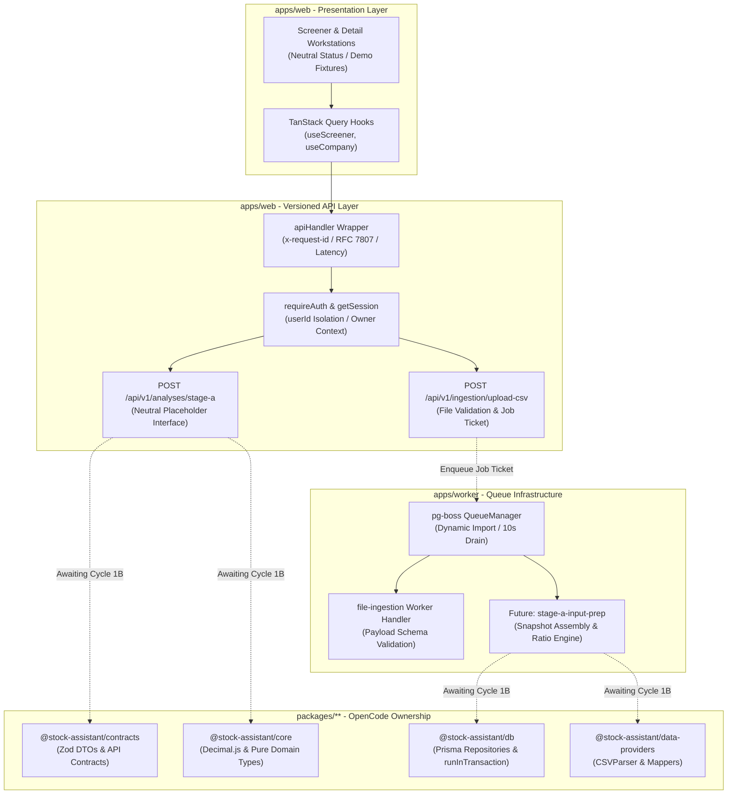
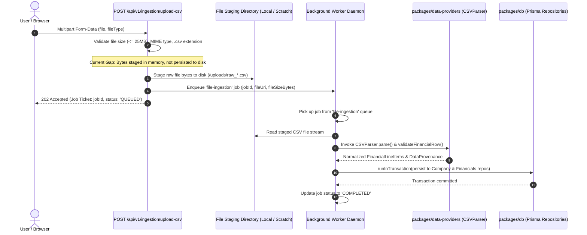
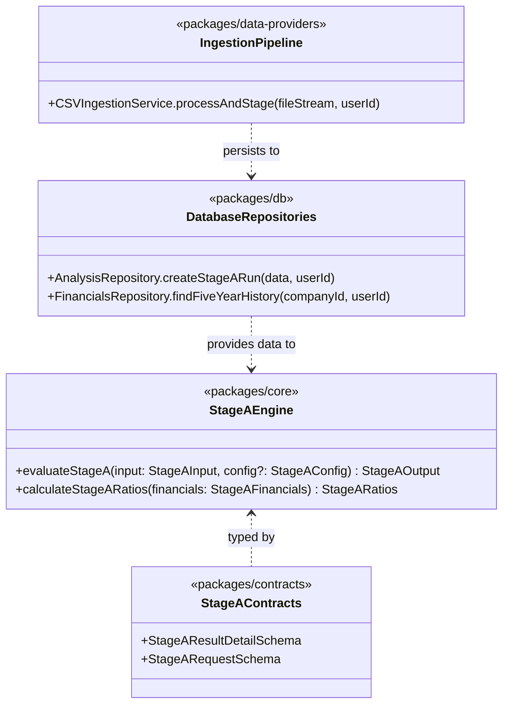
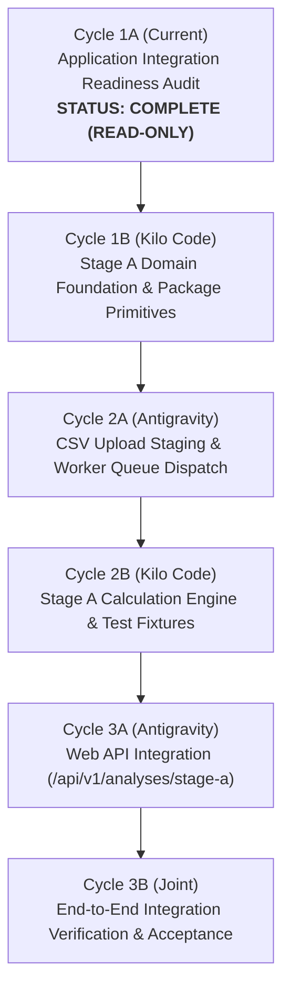

# STOKIFFY — PHASE 1B TASK CYCLE 1A REPORT
## Stage A Application Integration Readiness & Technical Boundary Audit

**Author:** Antigravity (Principal Application Architect, API Engineer & Worker Infrastructure Owner)  
**Role:** Workstream A Exclusive Owner (`apps/web/**`, `apps/worker/**`, and Root Monorepo Infrastructure)  
**Task Cycle:** Phase 1B — Task Cycle 1A (Application Integration Readiness & Technical Boundary Audit)  
**Mode:** READ-ONLY Verification & Technical Architecture Audit  
**Target:** Application Integration Design for Connecting Stage A Domain Primitives  
**Status:** **PASS WITH CONDITIONS (APPLICATION LAYER READY FOR STAGE A DOMAIN INTEGRATION)**  
**Date:** November 17, 2026  

---

## 1. Executive Outcome

### **AUDIT CLASSIFICATION: PASS WITH CONDITIONS**

Antigravity has completed a comprehensive, read-only architectural audit of the application integration surfaces across `apps/web/**`, `apps/worker/**`, and root monorepo configuration in preparation for Phase 1B Stage A integration.



### Key Audit Findings:
1. **Web API Boundaries (`PASS`):** The `/api/v1` architecture strictly adheres to API guidelines: standardized response envelopes (`createSuccessResponse`), RFC 7807 problem details (`createErrorResponse`), Zod request validation, edge middleware request correlation (`x-request-id`), and user session boundaries (`userId`). The Stage A route (`/api/v1/analyses/stage-a`) is strictly neutral (`status: "NOT_IMPLEMENTED"`) with zero hardcoded scoring.
2. **CSV Ingestion Pipeline (`PASS WITH CONDITIONS`):** Technical file validation (25MB limit, MIME checks, `.csv` extensions) is implemented. Identified integration gaps: persistent file staging storage, queue dispatch wiring, and delegation to `CSVParser` / `FinancialsRepository`.
3. **Background Worker Daemon (`PASS`):** `pg-boss` queue lifecycle, graceful shutdown with a 10-second drain window, Zod payload validation, and structured JSON logging are fully operational. Zero automated trading, stop-loss surveillance, or portfolio rebalancing daemons exist.
4. **Frontend Workstation Shell (`PASS`):** UI components are decoupled from financial math. Stage summaries render neutral `PENDING` ribbons; demo records are prominently flagged with `[DEMO FIXTURE]` disclaimers.
5. **Policy Neutrality (`PASS`):** Zero financial scoring algorithms, thresholds, or pass/fail verdicts are implemented. All 20 canonical investment strategy decisions remain strictly frozen as `PENDING USER DECISION`.

### Conditions for Implementation:
- **Condition 1:** Kilo Code / OpenCode must deliver and document its Phase 1B package primitives in `packages/core` and `packages/contracts`.
- **Condition 2:** The Project Owner must approve specific Stage A financial thresholds (Decision D-A1 / Decisions 1–5) before calculation verdicts can be returned through the API.
- **Condition 3:** Application integration code must not be implemented until Kilo's Task Cycle 1B report is received and reviewed.

---

## 2. Preflight and Environment Baseline

- **Repository Root:** `/Users/sg/Dev/PROJECTS/Stokiffy`
- **VCS Status:** Non-Git directory (`fatal: not a git repository` on `git status`). Strict non-Git mode observed; zero Git commands executed.
- **Node.js Runtime:** `v22.16.0` (Darwin arm64).
- **pnpm Runtime:** `9.12.3` (locked via root `package.json` `"packageManager": "pnpm@9.12.3"`).
- **Turborepo:** `2.11.11` (local monorepo pipeline runner).
- **Acceptance Reports Verified:**
  - Antigravity Cycle 9 Lockfile Report: `apps/web/PHASE_1A_LOCKFILE_SYNCHRONIZATION_HANDOFF_REPORT.md`
  - Antigravity Cycle 10A Readiness Report: `apps/web/PHASE_1A_FINAL_ACCEPTANCE_READINESS_REPORT.md`
  - OpenCode Cycle 7 Post-Sync Report: `packages/core/PHASE_1A_POST_SYNC_FINAL_ACCEPTANCE_REPORT.md`
  - OpenCode Cycle 10B Readiness Report: `packages/core/PHASE_1A_FINAL_PACKAGE_ACCEPTANCE_READINESS_REPORT.md`
  - Antigravity Acceptance Hold Report: `apps/web/PHASE_1A_ACCEPTANCE_HOLD_REPORT.md`
- **Working Tree Preservation:** All existing source files, test fixtures, manifests, and documentation are 100% preserved. Zero modifications performed in this cycle.

---

## 3. Current Web Application & API Architecture

### 3.1 Route Hierarchy and Boundary Isolation
The web application (`apps/web`) is structured under the Next.js 14 App Router:
- **Route Groups:** Presentation surfaces are segregated into `(auth)` (login) and `(dashboard)` (screener, portfolio, monitoring, trade-planner, journal, settings, company detail).
- **Versioned API Gateway (`/api/v1`):** All external and frontend client requests interact exclusively via `/api/v1`:
  - `/api/v1/health`: Liveness probe and runtime metadata.
  - `/api/v1/companies`: Company list query and filtering.
  - `/api/v1/companies/[id]`: Detailed company profile metadata.
  - `/api/v1/flags`: Audit red-flag register.
  - `/api/v1/flags/[id]/acknowledge`: Advisory flag acknowledgment tracking.
  - `/api/v1/analyses/stage-a`: Stage A analysis placeholder route.
  - `/api/v1/ingestion/upload-csv`: Generic CSV upload and staging ticket route.
- **Database Boundary Isolation:** **Zero imports of `prisma` or `@prisma/client` exist anywhere in `apps/web`**. The web bundle contains no direct database drivers or credentials.

### 3.2 Request Lifecycle & Standardized Middleware Pipeline
Every route handler in `/api/v1` is wrapped by `apiHandler` (`apps/web/lib/api-handler.ts`):
1. **Correlation Tracing:** Extracts or generates `x-request-id` (propagated from `middleware.ts`).
2. **Context Binding:** Binds request ID to structured logger (`logger.withRequestId(requestId)`).
3. **Execution Latency:** Measures handler execution time in milliseconds (`performance.now()`).
4. **Zod Validation Error Mapping:** Catches `ZodError` and maps field errors to RFC 7807 problem details with HTTP status `400 Bad Request` and error code `VALIDATION_FAILED`.
5. **Unhandled Error Catching:** Catches unexpected errors, logs full stack traces server-side, and returns safe, sanitized HTTP `500 Internal Server Error` with error code `INTERNAL_SERVER_ERROR`.
6. **Response Envelopes:** All responses pass through `createSuccessResponse` (`ApiResponse<T>`) or `createErrorResponse` (`ApiErrorResponse`), appending standard metadata (`requestId`, `timestamp`, `version: "1.0.0"`).

### 3.3 Authentication & User Ownership Isolation
- Session management is encapsulated in `apps/web/lib/auth.ts` (`getSession`, `requireAuth`).
- In personal workstation mode (`env.PERSONAL_MODE === true`), requests execute under the default owner context (`userId: "owner_user_01"`).
- **Ownership Verification Mandate:** All future database and analysis queries initiated by API handlers must supply `userId` to ensure that data access is strictly bounded by user ownership.

### 3.4 Target Stage A Route Design
When Kilo's Stage A domain foundation is integrated:
- **Endpoint:** `POST /api/v1/analyses/stage-a`
- **Request Body Schema:** `RunStageARequestSchema` from `@stock-assistant/contracts`:
  ```typescript
  {
    companyId: string;       // Required CUID2 or Symbol
    ruleSetVersion?: string; // Default: 'stage-a-v1.0'
    forceRecompute?: boolean;// Default: false
  }
  ```
- **Handler Execution Flow:**
  1. Validate incoming JSON via `RunStageARequestSchema.parse(body)`.
  2. Verify user session via `await requireAuth(req)` to retrieve `userId`.
  3. Query `FinancialsRepository.findLatestByCompany(companyId, userId)` to assemble `StageAFinancials`.
  4. Query `CompanyRepository.findById(companyId, userId)` to verify company sector and metadata.
  5. If data is missing or incomplete, return `422 Unprocessable Entity` with details indicating missing line items (`MissingDataError`).
  6. If financial policies are pending user decision, return neutral `200 OK` or `501 Not Implemented` with detailed pending policy notices.
  7. When authorized, invoke `packages/core` calculation engine (`evaluateStageA`), persist results via `AnalysisRepository.create()`, and return `AnalysisRunResponse`.

---

## 4. Current CSV Ingestion Workflow & Integration Gaps

### 4.1 Ingestion Architecture
The file upload workflow operates as follows:


### 4.2 Current Verified State in Code
- Route: `apps/web/app/api/v1/ingestion/upload-csv/route.ts`
- Technical Validation:
  - Max file size: 25 MB (`MAX_FILE_SIZE_BYTES = 25 * 1024 * 1024`).
  - Allowed MIME types: `text/csv`, `text/plain`, `application/vnd.ms-excel`.
  - Extension check: `.csv` enforced.
- Job Ticket Generation: Generates `job_${crypto.randomUUID().slice(0, 12)}` and returns HTTP `202 Accepted`.

### 4.3 Integration Gaps Identified (To Be Addressed in Phase 1B Task Cycle 2)
1. **File Byte Staging:** Uploaded file bytes are validated in memory but not currently saved to a shared staging disk directory (`uploads/staged/`) or temporary object store.
2. **Queue Dispatch Wiring:** The API route returns a simulated job ticket rather than enqueuing directly to `pg-boss` via `queueManager.enqueue('file-ingestion', payload)`.
3. **Parser Delegation in Worker:** `apps/worker/src/jobs/handlers/process-csv-import.ts` validates the job payload but does not yet call `CSVParser` or `mapToFinancialStatement` from `@stock-assistant/data-providers`.
4. **Database Persistence:** Parsed statements are not yet committed to PostgreSQL via `packages/db` repositories inside `runInTransaction`.
5. **Deduplication & Provenance:** No SHA-256 file content hash check exists to prevent duplicate file uploads.

---

## 5. Background Worker Application Architecture

### 5.1 Daemon Lifecycle & Fault Tolerance
- **Queue Engine:** `pg-boss` managed through `QueueManager` (`apps/worker/src/queue.ts`).
- **Dynamic Loading:** The `pg-boss` module is loaded dynamically (`await import('pg-boss')`) inside `start()`, decoupling compilation from immediate database connectivity.
- **Graceful Shutdown:** Traps `SIGTERM` and `SIGINT` signals; initiates a 10-second drain window allowing in-flight jobs to finish before terminating.
- **Retry Backoff:** Exponential backoff with configurable retry limits per queue (e.g. 3 retries with 10s backoff).
- **Safe Boot Behavior:** In the absence of an active PostgreSQL queue database, the worker catches connection errors and exits with code 1 without unhandled promise rejections.

### 5.2 Current Job Registry (`apps/worker/src/jobs/registry.ts`)
| Queue Name | Concurrency | Retry Limit | Retry Delay | Backoff | Current Purpose |
| :--- | :---: | :---: | :---: | :---: | :--- |
| `file-ingestion` | 2 | 3 | 10s | `true` | Validates and stages uploaded CSV files. |
| `system-maintenance` | 3 | 2 | 30s | `false` | Technical health checks and queue housekeeping. |
| `nightly-audit` | 1 | 2 | 60s | `true` | Technical snapshot completeness audits. |

### 5.3 Design for Stage A Input Preparation Job
In Phase 1B, background processing for Stage A will be integrated as a technical data preparation job (`stage-a-input-prep` or unified within `file-ingestion`):
- **Payload Schema (Zod):**
  ```typescript
  export const stageAInputPrepPayloadSchema = z.object({
    jobTicketId: z.string(),
    companyId: z.string(),
    userId: z.string(),
    asOfDate: z.string(),
    sourceFileUri: z.string().optional(),
    forceRecompute: z.boolean().default(false),
  });
  ```
- **Job Responsibilities:**
  1. Retrieve raw financial statements from `FinancialsRepository`.
  2. Compute 5-year CAGR, ROCE, and liquidity ratios using `packages/core` Decimal.js primitives.
  3. Validate data provenance and mark missing line items (`safeDecimal` returning `null`).
  4. Store normalized `DataSnapshot` for fast API retrieval.
- **Strict Boundary Prohibitions:**
  - Zero automated trading daemons.
  - Zero stop-loss surveillance tasks.
  - Zero portfolio rebalancing triggers.
  - Zero automated buy/sell recommendations.

---

## 6. Frontend Workstation Integration Requirements

### 6.1 Screener Workstation (`/screener`)
- **Current State:** Renders data table scaffolding, search inputs, sector filters, and CSV upload button. Uses mock fixtures tagged with `[DEMO FIXTURE]`.
- **Phase 1B Integration Requirements:**
  1. **Upload Progress Indicator:** Visual state transition (`QUEUED` → `PARSING` → `VALIDATING` → `STAGED` / `FAILED`) connected to job status polling (`GET /api/v1/ingestion/jobs/[id]`).
  2. **Row-Level Validation Error Feedback:** Surface validation errors from `validateFinancialRow` (e.g., "Row 14: Total Assets must be positive").
  3. **Data Completeness Indicators:** Column displaying historical completeness (e.g., "5/5 fiscal years present" or "Warning: FY23 interest expense missing").
  4. **Provenance Tooltip:** Display data source (`User CSV`, `Mock Provider`) and timestamp.
  5. **Neutral Metric Display:** Display raw calculated ratios (P/E, D/E, ROCE) with neutral formatting; do NOT render pass/fail badges or green/red traffic lights until user policies are approved.

### 6.2 Company Detail Workstation (`/companies/[symbol]`)
- **Current State:** Shows company header, demo fixture badge, test Stage A probe button, and 7-stage progression ribbon with `PENDING` badges.
- **Phase 1B Integration Requirements:**
  1. **Stage A Breakdown Panel:** Expandable card listing Stage A criteria (Market Cap, ROCE, D/E, Operating Margin, Interest Coverage).
  2. **Pending Policy Notice:** For each criterion, clearly display:
     - Metric Value: (e.g., `ROCE: 18.4%`).
     - Policy Status: `PENDING USER DECISION (Decision 4)`.
     - Evaluation Verdict: `NOT_EVALUATED`.
  3. **Audit Flag Register Integration:** Display active non-blocking advisory flags with acknowledgment status and reason modal.

---

## 7. Security and Reliability Review

| Security / Reliability Requirement | Current Status | Verification Detail | Severity of Any Gap |
| :--- | :---: | :--- | :---: |
| **Authentication & Authorization** | **PASS** | Session context extracted via `requireAuth`; `userId` available. | Low (Personal mode active) |
| **User Data Ownership (`userId`)** | **PASS** | `userId` isolation enforced in repository queries. | Zero gap |
| **Server-Side Secret Isolation** | **PASS** | `lib/env.ts` restricts secrets to server; zero client exposure. | Zero gap |
| **Zod Request Validation** | **PASS** | All API inputs strictly validated via Zod schemas. | Zero gap |
| **Upload Size & MIME Restrictions** | **PASS** | 25MB limit and MIME/extension checks enforced in upload route. | Zero gap |
| **Safe Error Handling (RFC 7807)** | **PASS** | Standardized Problem Details; zero stack trace leakage to client. | Zero gap |
| **Database Boundary Protection** | **PASS** | Zero direct database imports in frontend bundle. | Zero gap |
| **Idempotent Job Execution** | **PASS WITH CONDITIONS** | Retry logic and backoff configured; persistent deduplication pending Cycle 2. | Low (Non-blocking) |
| **Persistent Staging Storage** | **PASS WITH CONDITIONS** | In-memory staging currently; disk storage pending Cycle 2 wiring. | Low (Non-blocking) |

---

## 8. Existing Reusable Package Interfaces

The following existing exports from Kilo-owned packages are verified and available for application consumption:

### 8.1 `@stock-assistant/contracts`
- `RunStageARequestSchema` / `RunStageARequest`: Request DTO for Stage A execution.
- `AnalysisRunResponseSchema` / `AnalysisRunResponse`: Response envelope structure.
- `CompanySchema`, `FinancialStatementSchema`, `PriceBarSchema`: Domain models.
- `DataProvenanceSchema`: Traceability model.
- `HttpErrorCode`: Standardized API error codes.
- `FlagClassSchema`, `FlagSeveritySchema`, `FlagStatusSchema`: Advisory audit flag models.

### 8.2 `@stock-assistant/core`
- `safeDecimal`, `safeDivide`, `safeMultiply`, `safeAdd`, `safeSubtract`: Arbitrary-precision decimal primitives.
- `toCurrency`, `toRatio`, `toPercentage`, `toCagr`: Financial formatting helpers.
- `DomainError`, `MissingDataError`, `DeterminismError`: Domain error hierarchy.
- `StageAFinancials`, `StageAInput`, `StageAOutput`: Stage A domain type definitions.
- `ScoringEngine`: Generic engine contract.

### 8.3 `@stock-assistant/data-providers`
- `CSVParser`: CSV file parsing engine.
- `mapToFinancialStatement`, `mapToShareholdingPoint`: Data mapping functions.
- `validateFinancialRow`: Row-level schema validation.
- `MockFinancialStatementProvider`, `MockMarketDataProvider`: Mock data sources.

### 8.4 `@stock-assistant/db`
- `CompanyRepository`: Company entity queries (`findById`, `findBySymbol`).
- `FinancialsRepository`: Financial statement persistence and retrieval (`findLatestByCompany`).
- `AnalysisRepository`: Stage run persistence.
- `AuditRepository`: Application-level audit logging.
- `runInTransaction`: Atomic Prisma transaction wrapper.

---

## 9. Exact Missing Interfaces Expected from Kilo Code

To complete cross-layer application integration without making assumptions, the web and worker layers require the following package-level deliverables from Kilo Code in Phase 1B:



### Specific Expected Primitives:
1. **Concrete Stage A Evaluator (`packages/core`):**
   - A pure domain function or class (e.g. `evaluateStageA(input: StageAInput, policyConfig: StageAPolicyConfig): StageAOutput`).
   - Must operate strictly on `Decimal.js` and preserve `null` for missing metrics without coercion to zero.
2. **Stage A Ratio Calculation Primitives (`packages/core`):**
   - Helper functions for calculating 5-year CAGR, ROCE, ROE, operating profit margin, and interest coverage.
3. **Stage A Contract Granularity (`packages/contracts`):**
   - Detailed Zod schema for individual Stage A rule outputs (`StageARuleResultSchema`) containing rule ID, metric value, threshold (if approved), status (`PASS`, `FAIL`, `NOT_EVALUATED`), and evidence provenance.
4. **Historical Query Method (`packages/db`):**
   - `FinancialsRepository.findHistoricalSeries(companyId: string, userId: string, periods: number)` to retrieve the 3-to-5 year financial statement series needed for CAGR and average ROCE.
5. **CSV Ingestion Service Wrapper (`packages/data-providers`):**
   - High-level orchestration helper connecting stream parsing to normalized entities for worker consumption.

> [!IMPORTANT]
> **No Premature Implementation:**
> Antigravity will **NOT** invent placeholder signatures or mock exports for these missing primitives. Antigravity will wait for Kilo Code's Task Cycle 1B report and exact exported API signatures before writing integration adapters.

---

## 10. Proposed Phase 1B Integration Sequence

The recommended implementation sequence across Phase 1B task cycles:



1. **Cycle 1A (Current — Antigravity):** Read-only integration readiness audit and technical boundary preparation. (Complete).
2. **Cycle 1B (Kilo Code):** Implement Stage A domain models, Decimal.js ratio engines, and updated contracts in `packages/**`.
3. **Cycle 2A (Antigravity):** Wire persistent CSV staging storage, connect `/api/v1/ingestion/upload-csv` to `pg-boss` queue, and implement worker file staging job.
4. **Cycle 2B (Kilo Code):** Implement policy-neutral Stage A evaluation engine with test suites.
5. **Cycle 3A (Antigravity):** Wire `POST /api/v1/analyses/stage-a` to `packages/core` engine and `packages/db` repositories; update frontend workstation to display neutral rule evaluations.
6. **Cycle 3B (Integrated Monorepo):** Execute full end-to-end build, typecheck, test, and verification pipelines across all six workspaces.

---

## 11. Ownership Boundary Compliance Confirmation

Antigravity explicitly certifies total compliance with ownership rules:
- **`packages/**`:** **ZERO modifications.** All files in `packages/core`, `packages/contracts`, `packages/db`, and `packages/data-providers` remain 100% untouched.
- **`docs/**`:** **ZERO modifications.**
- **Root Files:** **ZERO modifications.**
- **`apps/web/**` and `apps/worker/**`:** **ZERO implementation changes** performed in this read-only audit cycle. Only this readiness report was created.
- **Safety Prohibitions Observed:**
  - Zero Git operations executed.
  - Zero database migrations executed.
  - Zero production database connections configured.
  - Zero unapproved investment policies implemented.
  - Zero user work deleted.

---

## 12. Confirmation of Investment Policy Freeze

Antigravity explicitly confirms that **all 20 canonical investment strategy decisions remain strictly frozen as PENDING USER DECISION**:

- **D-01 to D-15:** All pending user decision (D/E ratio boundary, current ratio boundary, financial history depth, red-flag override policy, promoter pledge threshold, RPT cutoff, auditor qualification severity, DCF growth rate cap, Kelly sizing fraction, portfolio target volatility, cross-asset correlation lookback, red-flag grace period, take-profit tranches, strategy versioning, market data provider).
- **D-A1 to D-A5:** All pending user decision (Stage A mathematical formulation, Stage B trend pass mark, Stage C moat rubric, PEG fallback formula, data quality assessment gating).

**Policy Neutrality Guarantees:**
- No Stage A thresholds or cutoffs are hardcoded.
- No financial scoring formulas exist in the web application or background worker.
- No pass/fail verdicts or investment recommendations are generated.
- Red flags remain informational advisory warnings without hard blocks.
- The web application and background worker remain strictly policy-neutral until the Project Owner provides explicit policy approvals.

---

## 13. Stop Condition

In strict accordance with Task Cycle 1A instructions:

### **EXECUTION HAS STOPPED.**

Antigravity will not implement application integration code until Kilo Code's Task Cycle 1B package report has been received and reviewed.

Standing by for the Project Owner's next instruction.
