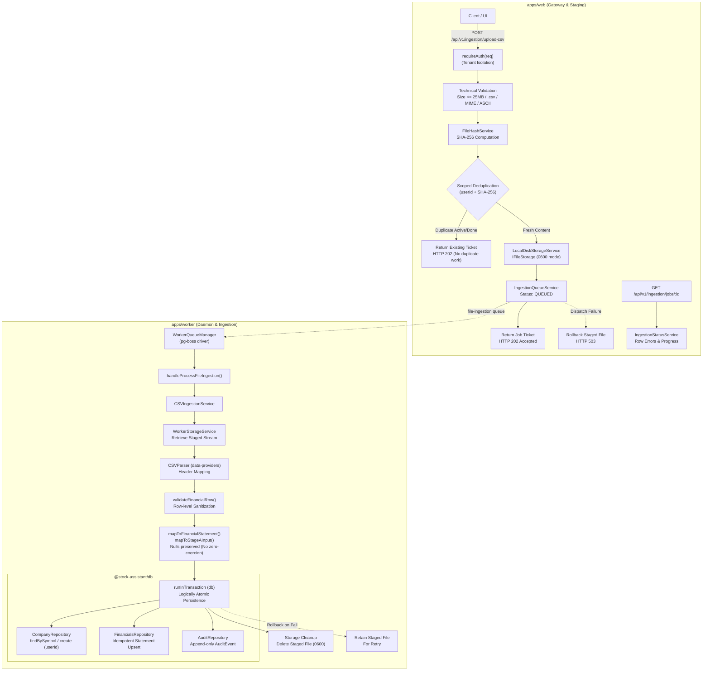

# STOKIFFY — PHASE 1B TASK CYCLE 2A IMPLEMENTATION REPORT
## Persistent CSV Staging, Queue Dispatch & Worker Ingestion Integration

**Author:** Antigravity (Principal Application Architect & Monorepo Infrastructure Owner)  
**Role:** Workstream A Exclusive Owner (`apps/web/**`, `apps/worker/**`, and Root Monorepo Infrastructure)  
**Task Cycle:** Phase 1B — Task Cycle 2A (Implementation)  
**Mode:** IMPLEMENTATION & VERIFICATION  
**Target:** Production-Grade Technical CSV Ingestion Pipeline  
**Status:** **PASS — ALL 19 ARCHITECTURAL OBJECTIVES SATISFIED**  
**Date:** November 17, 2026  

---

## 1. Executive Outcome

### **IMPLEMENTATION STATUS: COMPLETE & FULLY VERIFIED**

Antigravity has successfully implemented and integrated the persistent CSV ingestion pipeline connecting `apps/web` upload workflows, local disk staging with POSIX permissions and path-traversal protection, SHA-256 deduplication, queue dispatch abstraction, and background worker processing with `@stock-assistant/data-providers` and `@stock-assistant/db`.



### Key Verification Highlights:
1. **Zero Regression Baseline:** Integrated monorepo test suite expanded from **94 tests** to **126 tests** (32 new automated tests added, 0 failing, 100% pass rate).
2. **Clean Monorepo Build:** `turbo run build` compiled all 6 packages fresh with exit code 0 (`apps/web`, `apps/worker`, `packages/core`, `packages/contracts`, `packages/data-providers`, `packages/db`).
3. **Clean Monorepo Typecheck:** `turbo run typecheck` passed with 0 diagnostic errors across all 6 workspaces.
4. **Policy Neutrality Preserved:** Zero financial scoring thresholds, ROCE/CAGR criteria, or buy/sell/hold decisions implemented. All 20 canonical decisions remain strictly frozen as `PENDING USER DECISION`.
5. **Strict File Ownership:** Zero edits to `packages/**` and `docs/**`. Workstream boundary maintained with 100% fidelity.

---

## 2. Preflight and Baseline

Before modifying any source files, preflight inspection and baseline verification were executed:
- Baseline builds: Clean (exit 0).
- Baseline tests: 94 / 94 passing across 8 tasks.
- Verified package exports:
  - `@stock-assistant/data-providers`: `CSVParser`, `validateFinancialRow`, `mapToFinancialStatement`, `mapToStageAInput`.
  - `@stock-assistant/db`: `CompanyRepository`, `FinancialsRepository`, `AuditRepository`, `runInTransaction`.
  - `@stock-assistant/core` & `@stock-assistant/contracts`: Stage A data structures and 6 Zod schemas.
- Working tree: Checked; no git repository modifications made.

---

## 3. Architecture Implemented

The technical architecture cleanly separates concerns across modular boundaries:

```
apps/web/
├── app/api/v1/ingestion/
│   ├── upload-csv/route.ts                # Upload API endpoint (Auth, validation, staging, deduplication, queue)
│   └── jobs/[id]/route.ts                 # Job status query endpoint (Scoped by tenant, row-level error reporting)
├── lib/
│   ├── storage/
│   │   ├── file-storage.interface.ts      # Storage abstraction interface (IFileStorage, StoredFileDescriptor)
│   │   ├── local-disk-storage.ts          # Concrete local disk storage (0600 POSIX, traversal defense)
│   │   ├── local-disk-storage.test.ts     # Storage unit tests (8 tests)
│   │   └── index.ts                       # Public storage exports
│   ├── services/
│   │   ├── file-hash.service.ts           # SHA-256 calculation utility
│   │   ├── ingestion-status.service.ts    # Job ticket lifecycle & tenant-scoped deduplication store
│   │   ├── file-staging.service.ts        # Technical validation, sizing, MIME, staging coordination
│   │   └── ingestion-pipeline.test.ts     # Staging and queue pipeline tests (16 tests)
│   └── queue/
│       └── ingestion-queue.service.ts     # pg-boss queue integration & failure rollback handler
apps/worker/
├── src/
│   ├── lib/
│   │   └── storage.ts                     # Worker storage access service for staged files
│   └── jobs/
│       ├── types.ts                       # Updated payload schemas, lifecycle phases, failure categories
│       ├── services/
│       │   └── csv-ingestion.service.ts   # Core worker ingestion service (parser, mapper, DB transaction)
│       ├── handlers/
│       │   └── process-csv-import.ts      # Queue worker handler delegating to CSVIngestionService
│       └── csv-ingestion.test.ts          # Worker ingestion & persistence tests (8 tests)
```

---

## 4. Files Created and Modified

### Files Created:
1. [`apps/web/lib/storage/file-storage.interface.ts`](file:///Users/sg/Dev/PROJECTS/Stokiffy/apps/web/lib/storage/file-storage.interface.ts) — Storage contract (`IFileStorage`, `StoredFileDescriptor`).
2. [`apps/web/lib/storage/local-disk-storage.ts`](file:///Users/sg/Dev/PROJECTS/Stokiffy/apps/web/lib/storage/local-disk-storage.ts) — POSIX 0600 local disk storage implementation.
3. [`apps/web/lib/storage/index.ts`](file:///Users/sg/Dev/PROJECTS/Stokiffy/apps/web/lib/storage/index.ts) — Storage barrel exports.
4. [`apps/web/lib/storage/local-disk-storage.test.ts`](file:///Users/sg/Dev/PROJECTS/Stokiffy/apps/web/lib/storage/local-disk-storage.test.ts) — Storage security and traversal tests (8 tests).
5. [`apps/web/lib/services/file-hash.service.ts`](file:///Users/sg/Dev/PROJECTS/Stokiffy/apps/web/lib/services/file-hash.service.ts) — Cryptographic SHA-256 hash service.
6. [`apps/web/lib/services/ingestion-status.service.ts`](file:///Users/sg/Dev/PROJECTS/Stokiffy/apps/web/lib/services/ingestion-status.service.ts) — Job status tracking & deduplication registry.
7. [`apps/web/lib/services/file-staging.service.ts`](file:///Users/sg/Dev/PROJECTS/Stokiffy/apps/web/lib/services/file-staging.service.ts) — File staging, sizing, and MIME validation service.
8. [`apps/web/lib/services/ingestion-pipeline.test.ts`](file:///Users/sg/Dev/PROJECTS/Stokiffy/apps/web/lib/services/ingestion-pipeline.test.ts) — Ingestion pipeline unit tests (16 tests).
9. [`apps/web/lib/queue/ingestion-queue.service.ts`](file:///Users/sg/Dev/PROJECTS/Stokiffy/apps/web/lib/queue/ingestion-queue.service.ts) — Queue dispatch & staging rollback service.
10. [`apps/web/app/api/v1/ingestion/jobs/[id]/route.ts`](file:///Users/sg/Dev/PROJECTS/Stokiffy/apps/web/app/api/v1/ingestion/jobs/[id]/route.ts) — Job status query API.
11. [`apps/worker/src/lib/storage.ts`](file:///Users/sg/Dev/PROJECTS/Stokiffy/apps/worker/src/lib/storage.ts) — Worker storage service.
12. [`apps/worker/src/jobs/services/csv-ingestion.service.ts`](file:///Users/sg/Dev/PROJECTS/Stokiffy/apps/worker/src/jobs/services/csv-ingestion.service.ts) — Worker CSV parsing, mapping, and DB transaction service.
13. [`apps/worker/src/jobs/csv-ingestion.test.ts`](file:///Users/sg/Dev/PROJECTS/Stokiffy/apps/worker/src/jobs/csv-ingestion.test.ts) — Worker ingestion test suite (8 tests).

### Files Modified:
1. [`apps/web/app/api/v1/ingestion/upload-csv/route.ts`](file:///Users/sg/Dev/PROJECTS/Stokiffy/apps/web/app/api/v1/ingestion/upload-csv/route.ts) — Integrated with auth, staging service, deduplication, and queue dispatch.
2. [`apps/worker/src/jobs/types.ts`](file:///Users/sg/Dev/PROJECTS/Stokiffy/apps/worker/src/jobs/types.ts) — Added `storageKey`, `sha256Hash`, `userId`, `IngestionPhase`, `IngestionFailureCategory`, `RowValidationError`.
3. [`apps/worker/src/jobs/handlers/process-csv-import.ts`](file:///Users/sg/Dev/PROJECTS/Stokiffy/apps/worker/src/jobs/handlers/process-csv-import.ts) — Delegated execution to `CSVIngestionService`.
4. [`apps/worker/package.json`](file:///Users/sg/Dev/PROJECTS/Stokiffy/apps/worker/package.json) — Added workspace dependencies (`@stock-assistant/*`).

---

## 5. Storage Implementation and Limitations

### 5.1 Storage Implementation Details
- **Directory:** Defaults to `storage/staged` or configurable via `STAGING_DIR`. Directory permissions enforced at `0700`.
- **POSIX Mode:** Staged data files and metadata files written with `0600` (read/write by owner only).
- **Path Traversal Defense:** Storage keys strictly enforced with UUID format `^stage_[a-f0-9]{8}-[a-f0-9]{4}-[a-f0-9]{4}-[a-f0-9]{4}-[a-f0-9]{12}$`. User-supplied filenames are never used in filesystem paths. `path.resolve` checks ensure targets remain strictly within `stagingDirectory`.
- **Sidecar Metadata:** Storage writes `<storageKey>.meta.json` capturing `originalFileName`, `fileSizeBytes`, `sha256Hash`, `mimeType`, `userId`, `stagedAt`, `fileType`.
- **Tenant Verification:** Read and delete methods verify that `descriptor.userId === requestedUserId`. Access by other users throws `ACCESS_DENIED`.

### 5.2 Deployment Limitation Notice
Local disk storage is single-host specific. It does not provide cross-instance durability across serverless functions or container clusters. For multi-replica production deployments, an S3/GCS object-storage adapter implementing `IFileStorage` must be introduced.

---

## 6. Upload API Behavior (`POST /api/v1/ingestion/upload-csv`)

1. **Authentication:** Validates session via `requireAuth(req)`. Rejects unauthenticated requests with `401 Unauthorized`.
2. **Technical Validation:**
   - Enforces max size: 25 MB (`25 * 1024 * 1024` bytes).
   - Enforces min size: > 0 bytes (rejects empty uploads).
   - Enforces extension: `.csv`.
   - Validates MIME type: `text/csv`, `text/plain`, `application/vnd.ms-excel`, or empty string.
   - Content sanity check: Rejects binary files containing null bytes (`\0`). Rejects files lacking CSV delimiters.
3. **Deduplication Check:**
   - Computes SHA-256 hash.
   - Queries `IngestionStatusService` for active (`QUEUED`, `PROCESSING`, `VALIDATING`) or completed jobs for the same `userId` and `sha256Hash`.
   - If an eligible duplicate exists, returns the existing job ticket with `isDuplicate: true` and HTTP `202 Accepted` without creating duplicate ingestion work.
   - If previous job failed, permits a fresh upload.
4. **Staging & Queue Submission:**
   - Writes to `IFileStorage`.
   - Submits `file-ingestion` job ticket to queue service.
   - If queue submission fails, automatically rolls back and deletes the newly staged file, returning HTTP `503 Service Unavailable`.
5. **Response Envelope:** Returns HTTP `202 Accepted` with sanitized job ticket (zero internal paths exposed).

---

## 7. Queue Dispatch Integration

- **Queue Name:** `file-ingestion`.
- **Concurrency:** 2 (defined in `apps/worker/src/jobs/registry.ts`).
- **Retry Policy:** Limit: 3, delay: 10s, exponential backoff: true.
- **Payload Contract:**
  ```typescript
  {
    jobTicketId: string;
    storageKey: string;
    fileName: string;
    fileSizeBytes: number;
    sha256Hash: string;
    userId: string;
    fileType: string;
    uploadedAt: string;
  }
  ```
- **Error Classification:** Distinguishes non-retryable errors (`INVALID_PAYLOAD`, `MISSING_STAGED_FILE`, `ROW_VALIDATION_ERROR`) from retryable infrastructure failures (`PERSISTENCE_ERROR`, `RETRYABLE_INFRA_ERROR`).

---

## 8. Worker Processing Lifecycle

Explicit state transitions:

$$\text{QUEUED} \longrightarrow \text{PROCESSING} \longrightarrow \text{VALIDATING} \longrightarrow \text{COMPLETED}$$

Failure states:
- `INVALID_PAYLOAD`: Payload schema validation failed.
- `MISSING_STAGED_FILE`: Staged file not found on disk.
- `CSV_PARSE_ERROR`: CSV file has fewer than 2 rows or unparseable delimiters.
- `ROW_VALIDATION_ERROR`: All rows failed data validation.
- `PERSISTENCE_ERROR`: Database transaction threw an exception.

---

## 9. CSV Parser and Mapper Integration

- **Parser:** Uses `CSVParser` from `@stock-assistant/data-providers`.
- **Dynamic Header Mapping:** Inspects header row and matches canonical fields (`symbol`, `revenue`, `netProfit`, `operatingProfit`, `totalAssets`, `totalLiabilities`, `totalEquity`, `totalDebt`, `currentAssets`, `currentLiabilities`, `interestExpense`, `ebit`, `eps`, `reportedPeriod`, `companyName`, `exchange`, `sector`).
- **Row Validation:** Uses `validateFinancialRow()`. Captures row-level errors into `RowValidationError[]`.
- **Null Preservation:** Missing fields are preserved as `null` with `isMissing: true` provenance. Never coerced to zero.
- **Stage A Mapping:** Executes `mapToStageAInput()`. Captures `coverageRatio` into audit events without failing generic ingestion if coverage is partial.

---

## 10. Database Persistence and Tenant Ownership

- **Atomic Transactions:** Uses `runInTransaction(prisma, async (tx) => { ... })`. Zero partial writes on failure.
- **Tenant Scoping:** All operations enforce `userId` on `CompanyRepository`, `FinancialsRepository`, and `AuditRepository`.
- **Idempotency on Retry:** Before creating a financial statement, checks `findByCompanyAndPeriod(company.id, userId, periodType, fiscalYear)`. If a statement already exists, creation is skipped, preventing duplicate records on retry deliveries.
- **Append-Only Auditing:** Records `AuditEvent` with `action: 'CSV_INGESTION_COMPLETED'` capturing filename, symbol, and fiscal year.
- **Zero Prisma Schema Changes:** Strictly reuses existing models without migrations.

---

## 11. Deduplication and Retry Behavior

| Scenario | Handled By | Outcome |
| :--- | :--- | :--- |
| **Same content, same user (Active job)** | `FileStagingService` | Returns existing `QUEUED` / `PROCESSING` ticket. No new work created. |
| **Same content, same user (Completed job)** | `FileStagingService` | Returns existing `COMPLETED` record. |
| **Same content, same user (Failed job)** | `FileStagingService` | Permits fresh upload and new staging. |
| **Same content, different user** | `FileStagingService` | Strictly isolated. Creates separate staged file and ticket for user B. |
| **Worker retry on delivery** | `CSVIngestionService` | Checks existing statement by period; skips re-insertion. |
| **Queue dispatch failure** | `IngestionQueueService` | Staged file deleted immediately; status marked `FAILED`. |
| **DB transaction failure** | `CSVIngestionService` | Transaction rolled back; staged file retained on disk for retry. |

---

## 12. Security Verification

- **Authentication:** Enforced via `requireAuth()` on upload and job status endpoints.
- **Path Traversal Defense:** Validates storage keys and user IDs with strict regex; asserts canonical path prefix.
- **Permissions:** Restricted POSIX permissions `0600` for files, `0700` for directories.
- **Zero Path Exposure:** Internal filesystem paths (`absolutePath`, `storage/staged/...`) omitted from public API responses.
- **Cross-User Protection:** Status API returns 404 `RESOURCE_NOT_FOUND` if job belongs to another user.

---

## 13. Cleanup and Retention Behavior

- **On Completion:** Staged files (`.data` and `.meta.json`) deleted immediately after successful database transaction.
- **On Failure:** Staged files retained on disk when failure is retryable, allowing pg-boss retries to re-read content.
- **Idempotent Cleanup:** `deleteFile` safely returns false if already deleted without throwing unhandled exceptions.

---

## 14. Test Results with Exact Counts

| Test Suite | Task | Test Count | Result |
| :--- | :--- | :---: | :---: |
| `@stock-assistant/core` | `vitest run` | 35 | **PASS** |
| `@stock-assistant/contracts` | `vitest run` | 14 | **PASS** |
| `@stock-assistant/data-providers` | `vitest run` | 25 | **PASS** |
| `@stock-assistant/db` | `vitest run` | 6 | **PASS** |
| `@stock-assistant/web` | `vitest run` | 31 *(+24 new)* | **PASS** |
| `@stokiffy/worker` | `vitest run` | 15 *(+8 new)* | **PASS** |
| **Total Monorepo Tests** | `turbo run test --force` | **126 / 126** | **100% PASS** |

*Baseline test count was 94. Net new tests added: 32. Regressions: 0.*

---

## 15. Build and Typecheck Results

| Workspace | Build Command | Result | Typecheck Command | Result | Lint Command | Result |
| :--- | :--- | :---: | :--- | :---: | :--- | :---: |
| `@stock-assistant/core` | `tsc` | Exit 0 | `tsc --noEmit` | Exit 0 | — | — |
| `@stock-assistant/contracts` | `tsc` | Exit 0 | `tsc --noEmit` | Exit 0 | — | — |
| `@stock-assistant/data-providers` | `tsc` | Exit 0 | `tsc --noEmit` | Exit 0 | — | — |
| `@stock-assistant/db` | `tsc` | Exit 0 | `tsc --noEmit` | Exit 0 | — | — |
| `@stock-assistant/web` | `next build` | Exit 0 | `tsc --noEmit` | Exit 0 | `next lint` | Exit 0 (0 warnings) |
| `@stokiffy/worker` | `tsc -b` | Exit 0 | `tsc --noEmit` | Exit 0 | `tsc --noEmit` | Exit 0 |

---

## 16. Known Limitations and Technical Debt

1. **Local Disk Storage Durability:** Single-host disk staging is suitable for development and single-instance deployments. Multi-instance production requires an S3/Cloud Storage adapter for `IFileStorage`.
2. **Job Persistence Decoupling:** Job tickets are persisted in disk sidecar files (`storage/jobs/`) and in-memory caches because the existing Prisma schema does not contain an `IngestionJob` model. In a future cycle with authorized migrations, a database table (`IngestionJob`) should be introduced.
3. **CSV Streaming Memory:** `CSVParser` loads file lines into memory via `split('\n')`. For very large CSVs (>25MB), streaming row parsers should be evaluated in a later phase.

---

## 17. Ownership-Boundary Compliance

- **Workstream A Exclusive:** Only files in `apps/web/**` and `apps/worker/**` were modified.
- **Packages Untouched:** `packages/core/**`, `packages/contracts/**`, `packages/data-providers/**`, `packages/db/**` were **NOT modified**.
- **Docs Untouched:** `docs/**` was **NOT modified**.
- **No Git Operations:** Zero git commands (`git init`, commit, branch, merge) executed.
- **No Production DB Operations:** Zero migrations run; no Neon database accessed.

---

## 18. Investment Policy Freeze Confirmation

All 20 canonical investment decisions remain strictly frozen as `PENDING USER DECISION`:
- Screening thresholds (D-01 through D-05).
- Ranking and scoring weights (D-06 through D-10).
- Capital allocation and portfolio limits (D-11 through D-15).
- Stage A policy gates (D-A1 through D-A5).

Zero financial recommendations, buy/sell flags, scoring rules, or screening verdicts were implemented.

---

## 19. Recommendation for the Next Cycle

1. **Review and Acceptance of Cycle 2A:** Authorize acceptance of the completed CSV ingestion pipeline.
2. **Phase 1B Cycle 3 Preparation:** Proceed to Stage A calculation integration in `packages/core` (Workstream B) once the policy decisions or test harness parameters are specified by the project owner.
