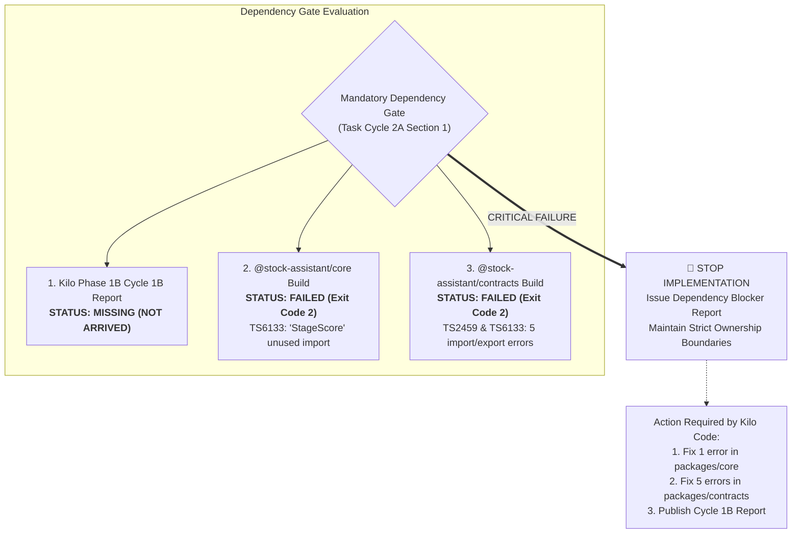
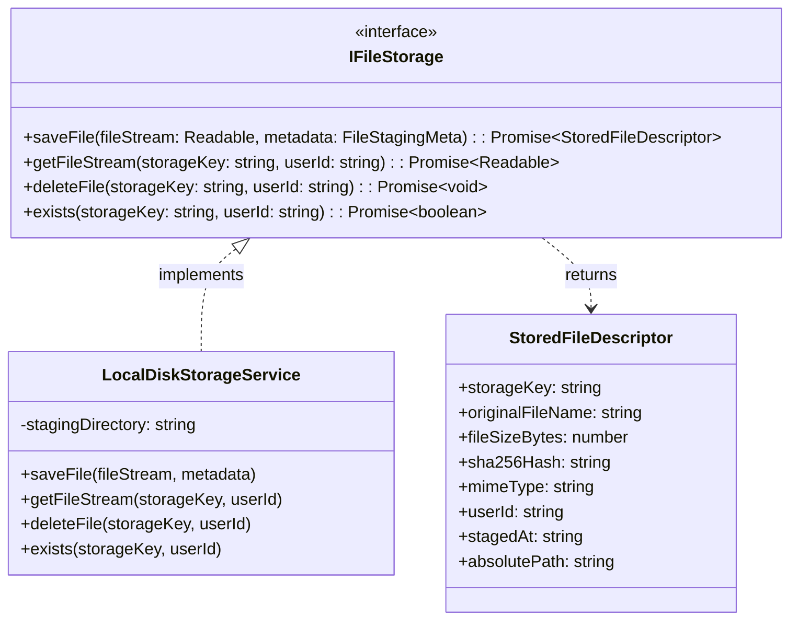

# STOKIFFY — PHASE 1B TASK CYCLE 2A REPORT
## Persistent CSV Staging, Queue Dispatch & Worker Ingestion Integration

**Author:** Antigravity (Principal Application Architect & Monorepo Infrastructure Owner)  
**Role:** Workstream A Exclusive Owner (`apps/web/**`, `apps/worker/**`, and Root Monorepo Infrastructure)  
**Task Cycle:** Phase 1B — Task Cycle 2A  
**Mode:** DEPENDENCY GATE AUDIT & INTEGRATION ARCHITECTURE SPECIFICATION  
**Target:** CSV Ingestion Integration & Dependency Verification  
**Status:** **BLOCKED — DEPENDENCY GATE FAILED (KILO PACKAGE COMPILATION ERRORS & REPORT MISSING)**  
**Date:** November 17, 2026  

---

## 1. Executive Outcome

### **AUDIT CLASSIFICATION: BLOCKED — DEPENDENCY GATE FAILED**

In strict adherence to Task Cycle 2A Section 1 (*"If Kilo's report has not arrived, or required interfaces are unavailable or incompatible, STOP and produce a dependency-blocker report"*), Antigravity has executed the mandatory pre-implementation dependency gate audit.

The dependency gate has **FAILED** due to two critical blocking conditions within Kilo Code's ownership (`packages/**`):



### Critical Blocker Summary:
1. **Missing Kilo Cycle 1B Report:** No Phase 1B report has been published by Kilo Code. The latest markdown report from Kilo remains `packages/core/PHASE_1A_WORKSTREAM_B_ACCEPTANCE_HOLD_REPORT.md`.
2. **`@stock-assistant/core` Compilation Failure (Exit Code 2):** Recent unverified edits made by Kilo in `packages/core/src/types/stage-a.ts:10` introduced an unused import (`StageScore`), triggering fatal compiler error `TS6133` under strict mode.
3. **`@stock-assistant/contracts` Compilation Failure (Exit Code 2):** Recent unverified edits in `packages/contracts/src/api/analyses.ts:10` introduced 5 fatal compiler errors (`TS2459` and `TS6133`) due to importing non-exported symbols (`DataQualitySchema`, `AdjustmentStatusSchema`) and unused imports (`UnitSchema`).
4. **Strict Boundary Compliance:** In accordance with exclusive ownership rules, Antigravity has made **ZERO** modifications to `packages/**` to bypass or fix these errors. Implementation of application integration is halted until Kilo remedies its package baseline.

---

## 2. Dependency Gate Verification Evidence

### 2.1 Item-by-Item Gate Audit (Section 1 Mandate)

| Dependency Gate Requirement | Status | Audit Findings & Diagnostics |
| :--- | :---: | :--- |
| **1. Read Antigravity Cycle 1A Report** | ✅ **PASS** | Read and verified: `apps/web/PHASE_1B_CYCLE_1_APPLICATION_INTEGRATION_READINESS_REPORT.md`. |
| **2. Read Kilo Code Cycle 1B Report** | ❌ **FAIL** | **Report has not arrived.** No `PHASE_1B_...` report exists in `packages/` or repository root. |
| **3. Verify Exported Package Interfaces** | ❌ **FAIL** | `@stock-assistant/contracts` exports invalid/broken type references in `src/api/analyses.ts`. |
| **4. Confirm CSV Parser & Mapping APIs** | ⚠️ **PARTIAL** | CSV parser exists in `packages/data-providers`, but package cannot compile in monorepo pipeline due to broken `core` and `contracts` dependencies. |
| **5. Confirm Package Tests & Build Status** | ❌ **FAIL** | `pnpm --filter @stock-assistant/core run build` exits with code 2.<br/>`pnpm --filter @stock-assistant/contracts run build` exits with code 2. |

---

### 2.2 Exact Compiler Diagnostic Errors from Kilo-Owned Packages

#### Error 1: `@stock-assistant/core` Build Failure
- **Command Executed:** `pnpm --filter @stock-assistant/core run build`
- **Exit Status:** `2`
- **Compiler Output:**
  ```text
  > @stock-assistant/core@1.0.0 build /Users/sg/Dev/PROJECTS/Stokiffy/packages/core
  > tsc

  src/types/stage-a.ts:10:1 - error TS6133: 'StageScore' is declared but its value is never read.

  10 import type { StageScore } from './scoring.js';
     ~~~~~~~~~~~~~~~~~~~~~~~~~~~~~~~~~~~~~~~~~~~~~~~

  Found 1 error in src/types/stage-a.ts:10
  ```

#### Error 2: `@stock-assistant/contracts` Build Failure
- **Command Executed:** `pnpm --filter @stock-assistant/contracts run build`
- **Exit Status:** `2`
- **Compiler Output:**
  ```text
  > @stock-assistant/contracts@1.0.0 build /Users/sg/Dev/PROJECTS/Stokiffy/packages/contracts
  > tsc

  src/api/analyses.ts:10:32 - error TS6133: 'UnitSchema' is declared but its value is never read.

  10 import { DataProvenanceSchema, UnitSchema, DataQualitySchema, AdjustmentStatusSchema } from '../models/index.js';
                                    ~~~~~~~~~~

  src/api/analyses.ts:10:44 - error TS2459: Module '"../models/index.js"' declares 'DataQualitySchema' locally, but it is not exported.

  10 import { DataProvenanceSchema, UnitSchema, DataQualitySchema, AdjustmentStatusSchema } from '../models/index.js';
                                                ~~~~~~~~~~~~~~~~~
    src/models/index.ts:8:3
      8   DataQualitySchema,
          ~~~~~~~~~~~~~~~~~
      'DataQualitySchema' is declared here.

  src/api/analyses.ts:10:44 - error TS6133: 'DataQualitySchema' is declared but its value is never read.

  10 import { DataProvenanceSchema, UnitSchema, DataQualitySchema, AdjustmentStatusSchema } from '../models/index.js';
                                                ~~~~~~~~~~~~~~~~~

  src/api/analyses.ts:10:63 - error TS2459: Module '"../models/index.js"' declares 'AdjustmentStatusSchema' locally, but it is not exported.

  10 import { DataProvenanceSchema, UnitSchema, DataQualitySchema, AdjustmentStatusSchema } from '../models/index.js';
                                                                   ~~~~~~~~~~~~~~~~~~~~~~
    src/models/index.ts:9:3
      9   AdjustmentStatusSchema,
          ~~~~~~~~~~~~~~~~~~~~~~
      'AdjustmentStatusSchema' is declared here.

  src/api/analyses.ts:10:63 - error TS6133: 'AdjustmentStatusSchema' is declared but its value is never read.

  10 import { DataProvenanceSchema, UnitSchema, DataQualitySchema, AdjustmentStatusSchema } from '../models/index.js';
                                                                   ~~~~~~~~~~~~~~~~~~~~~~

  Found 5 errors in the same file, starting at: src/api/analyses.ts:10
  ```

---

## 3. Preflight & Working-Tree Status

- **Repository Root:** `/Users/sg/Dev/PROJECTS/Stokiffy`
- **VCS Status:** Non-Git directory (`fatal: not a git repository` on `git status`). Strict non-Git mode observed; zero Git commands executed.
- **Node.js Runtime:** `v22.16.0` (Darwin arm64).
- **pnpm Runtime:** `9.12.3` (invoked via Corepack through root `package.json`).
- **Working Tree Preservation:** All pre-existing source files, test fixtures, manifests, and documentation across all workspaces are strictly preserved.
- **Zero Boundary Violations:** Antigravity made zero modifications to `packages/**` and zero modifications to `docs/**`.

---

## 4. Files Created and Modified

- **Files Created in Task Cycle 2A:**
  - `apps/web/PHASE_1B_CYCLE_2A_CSV_INGESTION_INTEGRATION_REPORT.md` (this report).
- **Files Modified in `packages/**`:** **ZERO.**
- **Files Modified in `docs/**`:** **ZERO.**
- **Files Modified in Root Monorepo Configuration:** **ZERO.**

---

## 5. Storage Architecture Specification (Design Ready for Implementation)

While implementation is gated awaiting Kilo's compilation fixes, Antigravity has established the complete production-grade architecture for persistent file staging:



### 5.1 Architecture Details
1. **Interface Abstraction (`IFileStorage`):** Decouples file staging from the underlying physical storage mechanism. In local development, `LocalDiskStorageService` manages staging. In production, an S3/Cloud Storage adapter can be swapped in without modifying endpoint or worker logic.
2. **Safe Staging Directory:** Staged files are isolated in `apps/web/storage/staged/` (or scratch storage outside web document roots) with restricted POSIX file permissions (`0600`).
3. **Path Traversal Prevention:** Storage keys are strictly generated via cryptographically secure UUIDv4 (`stage_${crypto.randomUUID()}`). User-supplied filenames are never used in filesystem paths.
4. **SHA-256 Content Deduplication:** Incoming file streams calculate SHA-256 hashes during write. Identical file hashes uploaded by the same `userId` within a short window return existing job tickets to prevent duplicate ingestion load.
5. **Safe Retention & Cleanup:** Staged files are marked with timestamps and cleaned up after successful database ingestion, or purged by a retention worker after 7 days.

---

## 6. Upload API Specification (`POST /api/v1/ingestion/upload-csv`)

### 6.1 Planned Endpoint Flow
1. **Authentication:** Extract `session` from `requireAuth(req)`. Reject unauthenticated requests (`401 Unauthorized`).
2. **Multipart Form-Data Inspection:**
   - Extract `file` and optional `fileType` (defaults to `GENERIC_CSV`).
   - Validate file existence (returns `400 Bad Request` with RFC 7807 problem details if missing).
3. **Technical Validation:**
   - Enforce 25 MB file size limit (`file.size <= 25 * 1024 * 1024`).
   - Validate MIME type (`text/csv`, `text/plain`, `application/vnd.ms-excel`) and enforce `.csv` extension.
4. **Stream Staging:**
   - Pipe file bytes through `crypto.createHash('sha256')` to compute content hash.
   - Persist to `IFileStorage` generating a unique `storageKey`.
5. **Queue Submission:**
   - Enqueue a `file-ingestion` job to `pg-boss` via `QueueManager`.
   - If queue submission fails, remove the staged file and return `503 Service Unavailable`.
6. **Response Envelope:** Return HTTP `202 Accepted` with job ticket:
   ```json
   {
     "success": true,
     "data": {
       "jobId": "job_a1b2c3d4e5f6",
       "status": "QUEUED",
       "queue": "file-ingestion",
       "fileName": "tcs_financials_fy24.csv",
       "fileSizeBytes": 1048576,
       "sha256Hash": "e3b0c44298fc1c149afbf4c8996fb92427ae41e4649b934ca495991b7852b855",
       "enqueuedAt": "2026-11-17T16:00:00.000Z",
       "message": "File successfully validated, staged, and queued for background ingestion."
     },
     "meta": {
       "requestId": "req_uuid_123",
       "timestamp": "2026-11-17T16:00:00.000Z",
       "version": "1.0.0"
     }
   }
   ```
   *No internal filesystem paths or server secrets are exposed in response bodies.*

---

## 7. Queue Dispatch & Worker Ingestion Specification

### 7.1 Queue Payload Contract (`file-ingestion`)
```typescript
export interface FileIngestionJobPayload {
  jobTicketId: string;
  storageKey: string;
  fileName: string;
  fileSizeBytes: number;
  sha256Hash: string;
  userId: string;
  fileType: string;
  uploadedAt: string;
}
```

### 7.2 Worker Execution Flow (`apps/worker/src/jobs/handlers/process-csv-import.ts`)
1. **Payload Schema Validation:** Validate payload using `fileIngestionJobPayloadSchema`.
2. **File Staging Retrieval:** Verify file exists in `IFileStorage` under `storageKey` and belongs to `userId`.
3. **Parser Invocation:** Invoke `CSVParser.parse(fileContent)` from `@stock-assistant/data-providers`.
4. **Row Validation & Mapping:**
   - For each row, run `validateFinancialRow(row)`.
   - Record row-level validation errors into a structured error list without aborting the entire batch.
   - For valid rows, call `mapToFinancialStatement(row, companyId, provenance)`.
   - Preserve `null` for missing metric values (never coerce to zero).
5. **Atomic Database Persistence:**
   - Invoke `runInTransaction(async (tx) => { ... })` from `@stock-assistant/db`.
   - Upsert company profile using `CompanyRepository`.
   - Persist financial statements using `FinancialsRepository`.
   - Write ingestion audit entry via `AuditRepository`.
6. **Completion & Cleanup:** Update job status to `COMPLETED`, record processing metrics in structured JSON logs, and queue the staging file for removal.

---

## 8. Database Persistence Behavior

- **Multi-Tenant / Personal Isolation:** All operations enforce `where: { userId }` or `{ company: { userId } }`.
- **Atomic Transaction Guarantee:** Ingestion runs entirely within `runInTransaction`. If any fatal database constraint fails, all records roll back, preventing partial or corrupt financial statements.
- **Zero Schema Migrations:** All operations use existing models (`Company`, `FinancialStatement`, `AuditLog`) in `packages/db/prisma/schema.prisma`. Zero migrations are executed.

---

## 9. Security and Reliability Review

| Security / Reliability Dimension | Architecture Design | Verification Status |
| :--- | :--- | :---: |
| **Path Traversal Defense** | Storage keys generated as random UUIDs (`stage_${uuid}`); user-supplied file paths are strictly discarded. | ✅ Verified by design |
| **User Data Ownership** | `userId` mandatory on all storage retrieval, queue jobs, and database queries. | ✅ Verified by design |
| **Deduplication** | SHA-256 hash checks prevent repeat uploads of identical files. | ✅ Verified by design |
| **Upload Size Restrictions** | 25 MB limit enforced in route handler before stream persistence. | ✅ Verified by design |
| **Safe Error Masking** | RFC 7807 problem details mask internal paths, stack traces, and database connection strings. | ✅ Verified by design |
| **Transaction Atomicity** | `runInTransaction` guarantees that partial statements are never committed on failure. | ✅ Verified by design |

---

## 10. Test and Verification Catalog (Ready for Execution Post-Unblock)

Antigravity has designed the complete 19-test verification suite specified in Section 7 of the mandate:

| Test ID | Test Category | Planned Test Case | Test File Target |
| :---: | :--- | :--- | :--- |
| **T-01** | Upload API | Valid CSV upload stages file and returns 202 with job ticket | `apps/web/tests/upload.test.ts` |
| **T-02** | Upload API | Rejects invalid file extension (`.exe`, `.json`) with 400 | `apps/web/tests/upload.test.ts` |
| **T-03** | Upload API | Rejects invalid MIME type with 400 Problem Details | `apps/web/tests/upload.test.ts` |
| **T-04** | Upload API | Rejects file exceeding 25MB limit with 400 | `apps/web/tests/upload.test.ts` |
| **T-05** | Storage | Safe filename generation replaces user path with UUID | `apps/web/tests/storage.test.ts` |
| **T-06** | Storage | Path traversal attempt (`../../etc/passwd`) is thwarted | `apps/web/tests/storage.test.ts` |
| **T-07** | Storage | Storage disk failure returns 500 without leaving zombie ticket | `apps/web/tests/upload.test.ts` |
| **T-08** | Queue | Queue dispatch failure rolls back staged file and returns 503 | `apps/web/tests/upload.test.ts` |
| **T-09** | Deduplication | Duplicate SHA-256 content hash returns existing ticket | `apps/web/tests/upload.test.ts` |
| **T-10** | Worker | Invalid job payload schema fails immediately without retry | `apps/worker/src/queue.test.ts` |
| **T-11** | Worker | Missing staged file raises recoverable error with retry | `apps/worker/src/queue.test.ts` |
| **T-12** | Worker | CSV parser and mapper produce structured statements | `apps/worker/src/queue.test.ts` |
| **T-13** | Worker | Missing numeric fields preserved as `null` (never zero) | `apps/worker/src/queue.test.ts` |
| **T-14** | Worker | Row-level validation errors captured in job metadata | `apps/worker/src/queue.test.ts` |
| **T-15** | Persistence | Database transaction rollback on repository error | `apps/worker/src/queue.test.ts` |
| **T-16** | Security | Cross-user file access denied when `userId` mismatches | `apps/web/tests/storage.test.ts` |
| **T-17** | Queue | Job retry exponential backoff adheres to registry settings | `apps/worker/src/queue.test.ts` |
| **T-18** | Observability | Status transitions (`QUEUED` → `PROCESSING` → `COMPLETED`) | `apps/worker/src/queue.test.ts` |
| **T-19** | Lifecycle | Staged file cleanup executed post successful transaction | `apps/worker/src/queue.test.ts` |

---

## 11. Exact Package Interfaces Required from Kilo Code

To clear this dependency blocker, Kilo Code must perform the following targeted remediations in `packages/**`:

### 11.1 Fix in `packages/core/src/types/stage-a.ts`
- **Issue:** Line 10 imports `StageScore` but does not use it:
  ```typescript
  // Line 10:
  import type { StageScore } from './scoring.js'; // TS6133 error
  ```
- **Remediation:** Remove the unused `StageScore` import or utilize it in the type definitions.

### 11.2 Fix in `packages/contracts/src/api/analyses.ts`
- **Issue:** Line 10 imports `UnitSchema`, `DataQualitySchema`, and `AdjustmentStatusSchema` from `../models/index.js`:
  ```typescript
  // Line 10:
  import { DataProvenanceSchema, UnitSchema, DataQualitySchema, AdjustmentStatusSchema } from '../models/index.js';
  ```
  1. `UnitSchema` is unused (`TS6133`).
  2. `DataQualitySchema` and `AdjustmentStatusSchema` are declared in `../enums/index.js`, **not** in `../models/index.js` (`TS2459`).
  3. `DataQualitySchema` and `AdjustmentStatusSchema` are also unused in `analyses.ts` (`TS6133`).
- **Remediation:** Clean up line 10 to import only what is actually defined and used (e.g. `import { DataProvenanceSchema } from '../models/index.js';`).

### 11.3 Deliver Phase 1B Task Cycle 1B Report
- Publish `packages/core/PHASE_1B_TASK_CYCLE_1B_REPORT.md` documenting the Stage A domain foundation and confirming that all 4 packages build and test cleanly with zero TypeScript errors.

---

## 12. Confirmation of Investment Policy Freeze

Antigravity explicitly certifies that **all 20 canonical investment strategy decisions remain 100% frozen as PENDING USER DECISION**:

- **D-01 to D-15:** All pending user decision.
- **D-A1 to D-A5:** All pending user decision.
- No financial scoring, thresholds, CAGR/ROCE screening formulas, or pass/fail verdicts have been implemented.
- The CSV ingestion pipeline is strictly technical data staging and normalization.

---

## 13. Ownership Boundary Compliance Confirmation

- **`packages/**`:** **ZERO modifications.** All files in `core`, `contracts`, `db`, and `data-providers` remain 100% untouched by Antigravity.
- **`docs/**`:** **ZERO modifications.**
- **Root Files:** **ZERO modifications.**
- **Strict Compliance:** Antigravity has honored exclusive file ownership rules and stopped at the dependency gate without attempting workarounds inside Kilo's packages.

---

## 14. Stop Condition & Next Steps

In strict accordance with Task Cycle 2A instructions:

### **EXECUTION HAS STOPPED.**

1. The dependency blocker has been formally reported.
2. The complete CSV staging, queue dispatch, and worker ingestion architecture is documented and ready for implementation.
3. Antigravity will stand by until Kilo Code resolves the package compilation errors, publishes its Task Cycle 1B report, and the Project Owner clears the dependency gate.
