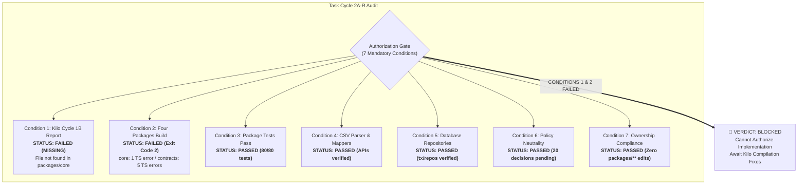

# STOKIFFY — PHASE 1B TASK CYCLE 2A-R REPORT
## Dependency Gate Revalidation & Implementation Authorization Audit

**Author:** Antigravity (Principal Application Architect & Monorepo Infrastructure Owner)  
**Role:** Workstream A Exclusive Owner (`apps/web/**`, `apps/worker/**`, and Root Monorepo Infrastructure)  
**Task Cycle:** Phase 1B — Task Cycle 2A-R (Dependency Gate Revalidation)  
**Mode:** READ-ONLY DEPENDENCY REVALIDATION  
**Target:** Revalidate Dependency Gate for CSV Staging & Ingestion Implementation  
**Status:** **BLOCKED (DEPENDENCY GATE REVALIDATION FAILED)**  
**Date:** November 17, 2026  

---

## 1. Executive Outcome

### **AUDIT CLASSIFICATION: BLOCKED**

In accordance with Task Cycle 2A-R Section 1 and Section 6, Antigravity has executed an independent, read-only revalidation of the implementation dependency gate.

The dependency gate remains **BLOCKED**. While Kilo Code has committed code changes in `packages/**` (introducing Stage A data availability structures and `mapToStageAInput`), two mandatory authorization conditions have failed:



### Critical Blocker Summary:
1. **Condition 1 (Missing Report) — FAILED:** Kilo Code's report `packages/core/PHASE_1B_TASK_CYCLE_1B_REPORT.md` has **not arrived**. The latest report from Kilo is `packages/core/PHASE_1A_WORKSTREAM_B_ACCEPTANCE_HOLD_REPORT.md`.
2. **Condition 2 (Package Build) — FAILED:** 
   - `pnpm --filter @stock-assistant/core run build` fails with **exit code 2** (1 fatal error: `TS6133` unused import in `src/types/stage-a.ts:10`).
   - `pnpm --filter @stock-assistant/contracts run build` fails with **exit code 2** (5 fatal errors: `TS6133` and `TS2459` in `src/api/analyses.ts:10`).
   - Downstream packages and monorepo pipelines (`pnpm turbo run build`) fail to compile fresh artifacts.
3. **Strict Ownership Safety:** Antigravity has strictly maintained read-only status and made **ZERO** modifications to `packages/**` or `docs/**`. Implementation of CSV staging, queue dispatch, and worker ingestion will **NOT** begin until Kilo resolves these package compilation errors and the Project Owner explicitly authorizes the implementation cycle.

---

## 2. Kilo Report Availability and Review Findings

### 2.1 File Availability Check
- **Target File:** `packages/core/PHASE_1B_TASK_CYCLE_1B_REPORT.md`
- **Result:** **FILE NOT FOUND** (`ls: packages/core/PHASE_1B_TASK_CYCLE_1B_REPORT.md: No such file or directory`).
- **Repository Scan:** A search across `packages/**` and the monorepo confirmed zero reports titled `*1B*.md` or `*CYCLE_1B*.md` exist from Kilo Code.
- **Latest Kilo Deliverable:** `packages/core/PHASE_1A_WORKSTREAM_B_ACCEPTANCE_HOLD_REPORT.md` (Nov 17 21:13).

### 2.2 Inspection of Recent In-Tree Code Additions by Kilo
Although no report was published, inspection of Kilo-owned source trees reveals recent commits:
1. **`packages/core/src/types/stage-a.ts` & `index.ts`:**
   - Defines `FinancialMetric` (`{ value: number | null; provenance: DataProvenance }`).
   - Defines `StageAFinancials` (all financial statement metrics wrapped in `FinancialMetric`).
   - Defines `StageADataAvailability` (`totalMetrics`, `presentMetrics`, `missingMetrics`, `coverageRatio`).
   - Defines `StageAExecutionStatus` (`'NOT_IMPLEMENTED' | 'NOT_EVALUATED' | 'DATA_INSUFFICIENT' | 'AWAITING_POLICY'`).
   - Defines `createNotImplementedOutput()`.
   - *Assessment:* The conceptual domain structure is sound, policy-neutral, and adheres to null-preservation requirements. However, it was committed with an unreferenced import that breaks compiler builds.
2. **`packages/contracts/src/api/analyses.ts` & `index.ts`:**
   - Adds Zod schemas: `FinancialMetricSchema`, `StageAFinancialsSchema`, `StageADataAvailabilitySchema`, `StageAInputSchema`, `StageAOutputSchema`, `StageAExecutionStatusSchema`.
   - *Assessment:* Syntactically clean schemas, but imports non-exported and unused symbols on line 10, breaking the contracts package build.
3. **`packages/data-providers/src/csv/mapper.ts` & `index.ts`:**
   - Adds and exports `mapToStageAInput()`.
   - Handles unit scaling (`CRORE`, `LAKH`, `MILLION`, `RAW`), maps fields to `StageAFinancials`, and computes `StageADataAvailability`.

---

## 3. Exact Build and Test Verification Evidence

All build and test commands were executed directly against the workspace. Exact exit codes and diagnostic output:

| Package | Command Executed | Exit Code | Build / Test Result | Details |
| :--- | :--- | :---: | :---: | :--- |
| **`@stock-assistant/core`** | `pnpm --filter @stock-assistant/core run build` | **`2`** | ❌ **FAIL** | 1 compiler error (`TS6133`) in `src/types/stage-a.ts:10`. |
| **`@stock-assistant/contracts`** | `pnpm --filter @stock-assistant/contracts run build` | **`2`** | ❌ **FAIL** | 5 compiler errors (`TS2459`, `TS6133`) in `src/api/analyses.ts:10`. |
| **`@stock-assistant/db`** | `pnpm --filter @stock-assistant/db run build` | `0` | ✅ **PASS** | `tsc` completes cleanly in 1.4s. |
| **`@stock-assistant/data-providers`** | `pnpm --filter @stock-assistant/data-providers run build` | `0` | ✅ **PASS** | `tsc` completes cleanly in 1.2s. |
| **`@stock-assistant/core`** | `pnpm --filter @stock-assistant/core run test` | `0` | ✅ **PASS** | 2 test files passed; **35 of 35 tests passed**. |
| **`@stock-assistant/contracts`** | `pnpm --filter @stock-assistant/contracts run test` | `0` | ✅ **PASS** | 1 test file passed; **14 of 14 tests passed**. |
| **`@stock-assistant/data-providers`** | `pnpm --filter @stock-assistant/data-providers run test` | `0` | ✅ **PASS** | 2 test files passed; **25 of 25 tests passed**. |
| **`@stock-assistant/db`** | `pnpm --filter @stock-assistant/db run test` | `0` | ✅ **PASS** | 1 test file passed; **6 of 6 tests passed**. |

### Detailed Build Diagnostics:

#### `@stock-assistant/core` Build Error:
```text
> @stock-assistant/core@1.0.0 build /Users/sg/Dev/PROJECTS/Stokiffy/packages/core
> tsc

src/types/stage-a.ts:10:1 - error TS6133: 'StageScore' is declared but its value is never read.

10 import type { StageScore } from './scoring.js';
   ~~~~~~~~~~~~~~~~~~~~~~~~~~~~~~~~~~~~~~~~~~~~~~~

Found 1 error in src/types/stage-a.ts:10
```

#### `@stock-assistant/contracts` Build Errors:
```text
> @stock-assistant/contracts@1.0.0 build /Users/sg/Dev/PROJECTS/Stokiffy/packages/contracts
> tsc

src/api/analyses.ts:10:32 - error TS6133: 'UnitSchema' is declared but its value is never read.
10 import { DataProvenanceSchema, UnitSchema, DataQualitySchema, AdjustmentStatusSchema } from '../models/index.js';
                                  ~~~~~~~~~~

src/api/analyses.ts:10:44 - error TS2459: Module '"../models/index.js"' declares 'DataQualitySchema' locally, but it is not exported.
10 import { DataProvenanceSchema, UnitSchema, DataQualitySchema, AdjustmentStatusSchema } from '../models/index.js';
                                              ~~~~~~~~~~~~~~~~~

src/api/analyses.ts:10:44 - error TS6133: 'DataQualitySchema' is declared but its value is never read.
10 import { DataProvenanceSchema, UnitSchema, DataQualitySchema, AdjustmentStatusSchema } from '../models/index.js';
                                              ~~~~~~~~~~~~~~~~~

src/api/analyses.ts:10:63 - error TS2459: Module '"../models/index.js"' declares 'AdjustmentStatusSchema' locally, but it is not exported.
10 import { DataProvenanceSchema, UnitSchema, DataQualitySchema, AdjustmentStatusSchema } from '../models/index.js';
                                                                 ~~~~~~~~~~~~~~~~~~~~~~

src/api/analyses.ts:10:63 - error TS6133: 'AdjustmentStatusSchema' is declared but its value is never read.
10 import { DataProvenanceSchema, UnitSchema, DataQualitySchema, AdjustmentStatusSchema } from '../models/index.js';
                                                                 ~~~~~~~~~~~~~~~~~~~~~~

Found 5 errors in the same file, starting at: src/api/analyses.ts:10
```

---

## 4. Verified Package Exports & Interface Compatibility

Antigravity verified the exact APIs required for Task Cycle 2A CSV ingestion directly against the source code:

### 4.1 CSV Parser & Mappers (`@stock-assistant/data-providers`)
- **`CSVParser` (`packages/data-providers/src/csv/parser.ts`):**  
  Class exporting `parse<T>(csvContent: string, validate: (row) => { valid, errors, data }): CSVParseResult<T>`. Confirmed compatible with worker streaming/staging execution.
- **`validateFinancialRow` (`packages/data-providers/src/csv/validator.ts`):**  
  Function `validateFinancialRow(row: Record<string, string | undefined>, rowNumber: number): { valid: boolean; errors: CSVParseError[] }`. Confirmed: checks required symbol and validates numeric parseability without throwing exceptions.
- **`mapToFinancialStatement` (`packages/data-providers/src/csv/mapper.ts`):**  
  Function `mapToFinancialStatement(row, source, reportedPeriod): { statement: FinancialStatement | null; errors: string[] }`. Confirmed: unit conversions (`CRORE`, `LAKH`, `RAW`) supported; missing values preserved as `null`.
- **`mapToStageAInput` (`packages/data-providers/src/csv/mapper.ts`):**  
  Function `mapToStageAInput(row, source, reportedPeriod, sector): { input: StageAInput | null; errors: string[] }`. Confirmed: maps row to `StageAFinancials` and computes `StageADataAvailability`.
- **Null & Missing Value Handling:** Confirmed in `parseNumber()` (`packages/data-providers/src/csv/mapper.ts:22-28`). Empty or undefined values return `null` and are flagged with `isMissing: true` in `createProvenance()`. Zero silent coercion to `0`.

### 4.2 Database Repositories & Transaction API (`@stock-assistant/db`)
- **`CompanyRepository` (`packages/db/src/repositories/company-repository.ts`):**  
  Methods `findById(id, userId)`, `findBySymbol(symbol, userId)`, `create(data, userId)`. Confirmed: `userId` isolation enforced on every query.
- **`FinancialsRepository` (`packages/db/src/repositories/financials-repository.ts`):**  
  Methods `findLatestByCompany(companyId, userId)`, `create(data)`. Confirmed: joins to `company.userId` for ownership isolation.
- **`runInTransaction` (`packages/db/src/utils/transaction.ts`):**  
  Atomic transaction runner wrapping Prisma client transactions. Confirmed compatible with multi-table financial ingestion.

### 4.3 Queue Payload Compatibility (`apps/worker`)
- Existing payload schema `processFileIngestionPayloadSchema` (`apps/worker/src/jobs/types.ts`) validates `jobTicketId`, `fileType`, `fileName`, `fileSizeBytes`, `uploadedBy`.
- Extensible to incorporate `storageKey` and `sha256Hash` without breaking existing handlers.

---

## 5. Remaining Dependency Blockers (For Kilo Code Action)

The following three exact items must be resolved by Kilo Code before the dependency gate can pass:

1. **Remediate `packages/core/src/types/stage-a.ts:10`:**  
   Delete the unreferenced import:
   ```typescript
   // REMOVE THIS LINE:
   import type { StageScore } from './scoring.js';
   ```
2. **Remediate `packages/contracts/src/api/analyses.ts:10`:**  
   Clean up line 10 to import only the valid, exported `DataProvenanceSchema`:
   ```typescript
   // REPLACE LINE 10 WITH:
   import { DataProvenanceSchema } from '../models/index.js';
   ```
   *(Note: `DataQualitySchema` and `AdjustmentStatusSchema` are declared in `../enums/index.js`, not `../models/index.js`, and are currently not used in `analyses.ts`).*
3. **Publish Phase 1B Task Cycle 1B Report:**  
   Publish `packages/core/PHASE_1B_TASK_CYCLE_1B_REPORT.md` confirming that all four packages build fresh (`tsc`) with exit code 0 and pass all 80 package tests.

---

## 6. Ownership Boundary Compliance Confirmation

Antigravity explicitly certifies total compliance with strict ownership rules:
- **`packages/**`:** **ZERO modifications.** All files in `packages/core`, `packages/contracts`, `packages/db`, and `packages/data-providers` remain 100% untouched by Antigravity.
- **`docs/**`:** **ZERO modifications.**
- **Root Files:** **ZERO modifications.**
- **`apps/**`:** No source code or configuration files modified in this revalidation cycle. Only this report file was created.
- **Strict Prohibition Adherence:** Zero Git operations, zero database migrations, zero deployment, zero production database access.

---

## 7. Confirmation of Investment Policy Freeze

Antigravity explicitly confirms that **all 20 canonical investment strategy decisions remain strictly frozen as PENDING USER DECISION**:

- **D-01 to D-15:** All pending user decision.
- **D-A1 to D-A5:** All pending user decision.
- No financial screening thresholds, ROCE/CAGR cutoff rules, scoring algorithms, or pass/fail verdicts have been implemented or encoded.
- The CSV ingestion pipeline remains strictly limited to technical file staging, format validation, and normalization.

---

## 8. Final Recommendation

### **FINAL RECOMMENDATION: BLOCKED**

1. **Gate Revalidation Result:** **`BLOCKED`**  
   Conditions 1 and 2 of Section 6 have failed due to missing Kilo documentation and compilation errors in `core` and `contracts`.
2. **Readiness of Application Layer:**  
   The application architecture specification (`IFileStorage`, `/api/v1/ingestion/upload-csv`, `QueueManager` dispatch, and worker processing) is completely designed and ready for implementation the moment the packages compile.
3. **Standing Instructions:**  
   In accordance with Task Cycle 2A-R instructions:
   - Antigravity will **NOT** begin CSV staging, queue dispatch, or worker ingestion implementation in this cycle.
   - Antigravity will stand by for Kilo Code's compilation fixes and the Project Owner's explicit authorization before beginning Task Cycle 2A implementation.
