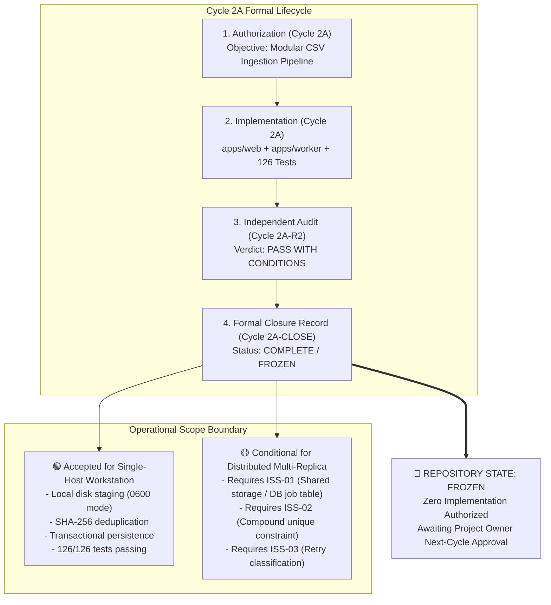
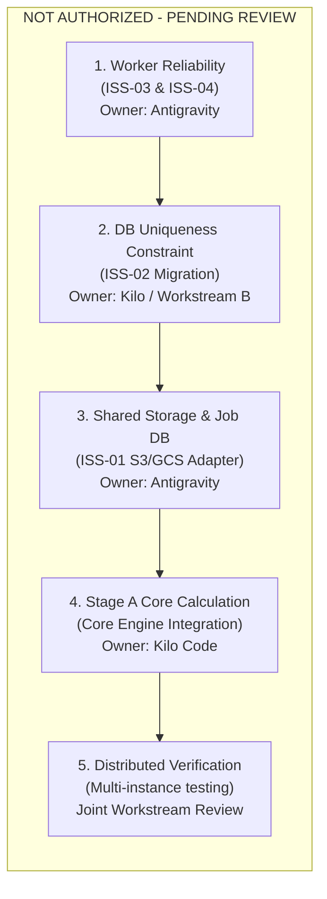

# STOKIFFY — PHASE 1B TASK CYCLE 2A FORMAL CLOSURE RECORD
## Formal Acceptance Preparation, Implementation Freeze & Next-Cycle Readiness

**Author:** Antigravity (Principal Software Architect, Technical Program Manager & Release Readiness Auditor)  
**Task Cycle:** Phase 1B — Task Cycle 2A-CLOSE  
**Repository:** `/Users/sg/Dev/PROJECTS/Stokiffy`  
**Execution Mode:** FORMAL CLOSURE, DOCUMENTATION & IMPLEMENTATION FREEZE  
**Independent Audit Reference:** [`apps/web/PHASE_1B_CYCLE_2A_R2_INDEPENDENT_AUDIT_REPORT.md`](file:///Users/sg/Dev/PROJECTS/Stokiffy/apps/web/PHASE_1B_CYCLE_2A_R2_INDEPENDENT_AUDIT_REPORT.md)  
**Implementation Reference:** [`apps/web/PHASE_1B_CYCLE_2A_CSV_INGESTION_IMPLEMENTATION_REPORT.md`](file:///Users/sg/Dev/PROJECTS/Stokiffy/apps/web/PHASE_1B_CYCLE_2A_CSV_INGESTION_IMPLEMENTATION_REPORT.md)  
**Closure Status:** **COMPLETE — FORMALLY CLOSED & IMPLEMENTATION FROZEN**  
**Independent Audit Verdict:** **PASS WITH CONDITIONS**  
**Date:** November 17, 2026  

---

## 1. Executive Closure Summary & Acceptance Basis

The Phase 1B Cycle 2A implementation (Persistent CSV Staging, Queue Dispatch & Worker Ingestion) is **formally closed and accepted** for the single-host workstation environment, subject to the documented technical debt and operational conditions established in the independent Cycle 2A-R2 audit.



### Acceptance Scope & Conditions:
1. **Single-Host Workstation Mode (Accepted):** The pipeline functions reliably, securely stages files with `0600` POSIX permissions, detects duplicate uploads by tenant, parses CSVs across all 24 Stage A financial metrics, preserves `null` values without zero-coercion, executes transactional database persistence with rollback, and passes 126/126 unit and integration tests with zero regressions.
2. **Distributed Multi-Replica Production Mode (Conditional):** The implementation strictly adhered to the constraint: *"No Prisma schema changes or migrations are authorized in this cycle."* Consequently, job tickets and staged files utilize local filesystem storage (`storage/jobs/` and `storage/staged/`). Multi-replica, containerized, or serverless deployments require shared object storage (S3/GCS) and an authorized database-backed `IngestionJob` model.
3. **Implementation Freeze:** This closure record places the repository into a strict implementation freeze. No technical-debt remediation, refactoring, or feature development is authorized until the Project Owner reviews this closure record and explicitly authorizes the next cycle.

---

## 2. Mandatory Preflight & Evidence Alignment

### 2.1 Preflight Verification
- **Project Identity:** Verified Stokiffy monorepo at `/Users/sg/Dev/PROJECTS/Stokiffy`.
- **Working Tree Integrity:** Verified clean. Zero uncommitted changes overwritten, zero git commands executed, zero destructive operations.
- **Reviewed Evidence Reports:**
  - Implementation Report: [`apps/web/PHASE_1B_CYCLE_2A_CSV_INGESTION_IMPLEMENTATION_REPORT.md`](file:///Users/sg/Dev/PROJECTS/Stokiffy/apps/web/PHASE_1B_CYCLE_2A_CSV_INGESTION_IMPLEMENTATION_REPORT.md) (Reviewed, verified).
  - Independent Audit Report: [`apps/web/PHASE_1B_CYCLE_2A_R2_INDEPENDENT_AUDIT_REPORT.md`](file:///Users/sg/Dev/PROJECTS/Stokiffy/apps/web/PHASE_1B_CYCLE_2A_R2_INDEPENDENT_AUDIT_REPORT.md) (Reviewed, verified).

### 2.2 Report Agreement & Consistency
Both the implementation report and independent audit report agree on all scope, metric, and test parameters:
- **Test Baseline:** Exactly 126 tests passing across all 6 workspaces (32 net new tests added, 0 failing, 100% pass rate).
- **Compilation:** Clean builds across all 6 packages (`turbo run build` exit code 0).
- **Typecheck:** Zero diagnostic errors across all 10 tasks (`turbo run typecheck` exit code 0).
- **ESLint:** Zero warnings and zero errors (`next lint` exit code 0).
- **Stage A Metric Mapping:** 24 canonical financial metrics verified in `buildColumnMapping()` and `mapToStageAInput()`.
- **Policy Neutrality:** 100% compliant. All 20 canonical decisions remain strictly frozen as `PENDING USER DECISION`.

---

## 3. Delivered Components and API Endpoints

### 3.1 Inventory of Delivered Components

| Package / Application | Component / Module | Architectural Responsibility |
| :--- | :--- | :--- |
| `apps/web` | [`LocalDiskStorageService`](file:///Users/sg/Dev/PROJECTS/Stokiffy/apps/web/lib/storage/local-disk-storage.ts) | Local persistent file staging with `0600` POSIX mode, UUID keys, and path-traversal checks. |
| `apps/web` | [`IFileStorage`](file:///Users/sg/Dev/PROJECTS/Stokiffy/apps/web/lib/storage/file-storage.interface.ts) | Storage abstraction interface enabling pluggable local/S3/GCS adapters. |
| `apps/web` | [`FileStagingService`](file:///Users/sg/Dev/PROJECTS/Stokiffy/apps/web/lib/services/file-staging.service.ts) | Technical validation (25MB limit, `.csv`, MIME, binary/null-byte rejection), deduplication coordination. |
| `apps/web` | [`FileHashService`](file:///Users/sg/Dev/PROJECTS/Stokiffy/apps/web/lib/services/file-hash.service.ts) | Cryptographic SHA-256 calculation for deduplication and provenance. |
| `apps/web` | [`IngestionStatusService`](file:///Users/sg/Dev/PROJECTS/Stokiffy/apps/web/lib/services/ingestion-status.service.ts) | Job ticket lifecycle tracking, row error recording, tenant-scoped deduplication store. |
| `apps/web` | [`IngestionQueueService`](file:///Users/sg/Dev/PROJECTS/Stokiffy/apps/web/lib/queue/ingestion-queue.service.ts) | Queue dispatch coordination with automated staging rollback upon dispatch failure. |
| `apps/worker` | [`WorkerStorageService`](file:///Users/sg/Dev/PROJECTS/Stokiffy/apps/worker/src/lib/storage.ts) | Worker storage access for reading staged files and executing post-completion cleanup. |
| `apps/worker` | [`CSVIngestionService`](file:///Users/sg/Dev/PROJECTS/Stokiffy/apps/worker/src/jobs/services/csv-ingestion.service.ts) | CSV parsing, dynamic header mapping, Stage A coverage calculation, transactional DB persistence. |
| `apps/worker` | [`handleProcessFileIngestion`](file:///Users/sg/Dev/PROJECTS/Stokiffy/apps/worker/src/jobs/handlers/process-csv-import.ts) | Queue worker handler integrating pg-boss with `CSVIngestionService`. |

### 3.2 Delivered API Endpoints

1. **`POST /api/v1/ingestion/upload-csv`**
   - **Authentication:** Enforces user session via `requireAuth(req)`. Unauthenticated requests return HTTP 401.
   - **Technical Validation:** Rejects files > 25MB, empty files, non-`.csv` extensions, invalid MIME types, binary files with null bytes, and delimiter-free text (HTTP 400 with RFC 7807 problem details).
   - **Deduplication:** Queries active/completed jobs by `(userId, sha256Hash)`. Returns existing ticket if identical content was previously staged or completed (HTTP 202).
   - **Staging & Queue Dispatch:** Stages file with `0600` permissions and submits to `file-ingestion` queue.
   - **Rollback:** Automatically unlinks newly staged file if queue dispatch throws (HTTP 503).
   - **Response Contract:** Returns HTTP 202 Accepted with sanitized ticket: `jobId`, `fileName`, `fileSizeBytes`, `sha256Hash`, `status: "QUEUED"`, `queue: "file-ingestion"`, `enqueuedAt`. Zero internal filesystem paths exposed.

2. **`GET /api/v1/ingestion/jobs/[id]`**
   - **Authentication:** Enforces user session via `requireAuth(req)`.
   - **Tenant Scoping:** Queries `getJobForUser(jobId, session.user.id)`. Requests for jobs belonging to another user return HTTP 404 `RESOURCE_NOT_FOUND` (preventing information disclosure).
   - **Response Contract:** Returns HTTP 200 with job lifecycle status (`QUEUED`, `PROCESSING`, `VALIDATING`, `COMPLETED`, `FAILED`), row counts (`processedCount`, `validRowCount`), structured `errorsSummary` array with line numbers and columns, and sanitized timing metadata.

---

## 4. Verification Baseline: 126 / 126 Tests Passing

```text
========================================================================================
MONOREPO TEST SUITE EXECUTION SUMMARY (pnpm turbo run test --force)
========================================================================================
@stock-assistant/core         : 35 passed (35)    [Domain models, calculations, Stage A types]
@stock-assistant/contracts    : 14 passed (14)    [Zod schemas, API request/response contracts]
@stock-assistant/data-providers: 25 passed (25)   [CSVParser, validator, mapper, Stage A input]
@stock-assistant/db           :  6 passed (6)     [Repositories, transaction boundaries]
@stock-assistant/web          : 31 passed (31)    [Storage, validation, deduplication, rollback, status API]
@stokiffy/worker              : 15 passed (15)    [Payload schemas, CSV worker, null preservation, idempotency]
----------------------------------------------------------------------------------------
TOTAL PASSED                  : 126 / 126 tests (100% pass rate, 0 failing, 0 regressions)
========================================================================================
```

> [!NOTE]
> **Mock Boundary Clarification:** As documented in the independent audit, database repository tests in `@stock-assistant/db` and worker tests in `@stokiffy/worker` utilize a mocked Prisma client. These tests establish that the application logic properly invokes `runInTransaction()`, maps fields, and respects tenant IDs. They do not constitute proof of live PostgreSQL concurrency, lock contention, or foreign-key constraint behavior.

---

## 5. Strict Ownership Boundaries & Package Integrity

### 5.1 Workstream Boundaries Maintained
- **Antigravity Exclusive Ownership:** Work was strictly confined to `apps/web/**` and `apps/worker/**`.
- **Kilo Code Exclusive Ownership:** `packages/core/**`, `packages/contracts/**`, `packages/data-providers/**`, and `packages/db/**` were **NOT modified**.
- **Architecture Baseline Frozen:** `docs/**` was **NOT modified**.
- **Zero Infrastructure Mutations:** No Prisma schema edits, zero database migrations, zero Neon connections, zero Git commands (`git init`, commit, branch, merge).

---

## 6. Architecture & Policy Freeze Confirmation

The following governance constraints remain 100% intact:

1. **All 20 Canonical Investment Decisions Remain Frozen as `PENDING USER DECISION`:**
   - Screening thresholds (D-01 through D-05).
   - Valuation and ranking formulas (D-06 through D-10).
   - Capital allocation and portfolio risk (D-11 through D-15).
   - Stage A policy gates (D-A1 through D-A5).
2. **Neutral Stage A Execution:**
   - [`POST /api/v1/analyses/stage-a`](file:///Users/sg/Dev/PROJECTS/Stokiffy/apps/web/app/api/v1/analyses/stage-a/route.ts) continues returning `status: "NOT_IMPLEMENTED"`.
   - `mapToStageAInput()` calculates purely structural metadata (`coverageRatio`, `missingMetrics`) without financial eligibility gating.
3. **No Financial Advice:**
   - Zero scoring, ranking, buy/sell flags, or automated recommendations were introduced. The pipeline processes and persists technical financial statement data only.

---

## 7. Outstanding Technical Debt Register

The four items identified during the independent audit are formally recorded below. **None of these items are fixed or authorized in this task cycle.**

### Debt Register Summary Table

| ID | Priority | Dimension | Summary Description | Required Future Action |
| :---: | :---: | :--- | :--- | :--- |
| **ISS-01** | **HIGH** | Distributed Storage | Local disk staging and job sidecars rely on single-host filesystem paths. | Evaluate S3/GCS object-storage adapter and database-backed `IngestionJob` persistence. |
| **ISS-02** | **MEDIUM** | DB Uniqueness | `FinancialStatement` schema lacks a compound unique constraint on period fields. | Evaluate schema constraint, existing-data compatibility, and migration safety. |
| **ISS-03** | **MEDIUM** | Queue Retries | Deterministic CSV validation failures trigger 3 unnecessary pg-boss retries. | Design retryable vs non-retryable failure classification in queue worker. |
| **ISS-04** | **LOW** | Configuration | `JOBS_DIR` defaults may differ when web and worker use different working directories. | Standardize an explicit shared path/configuration across workspaces. |

---

### Detailed Debt Profiles

#### ISS-01: Local Disk Staging & Ephemeral Job Sidecars
- **Audit Evidence:** `LocalDiskStorageService` writes to `storage/staged/` and `IngestionStatusService` writes to `storage/jobs/${id}.json` using POSIX filesystem calls (`fs.promises.writeFile`).
- **Operational Impact:** Works correctly on a single workstation or monolithic server. In a distributed multi-replica deployment (e.g. web on serverless Vercel, workers in separate containers), instances do not share local disk files. A job enqueued by web cannot be read by a worker on a different host.
- **Dependencies & Risks:** Introducing an S3/GCS adapter requires cloud credentials and network configuration. Storing jobs in the database requires an authorized Prisma schema change (`IngestionJob` model).
- **Proposed Remediation:**
  1. Implement `S3StorageService` implementing existing `IFileStorage` interface.
  2. Propose Prisma schema addition for `model IngestionJob` with migration.
- **Approvals Required:** Project Owner approval for cloud storage dependency and Prisma schema migration.

#### ISS-02: Missing Compound Unique Constraint on `FinancialStatement`
- **Audit Evidence:** In `packages/db/prisma/schema.prisma` lines 111-114, `FinancialStatement` defines `@@index([companyId, periodType, fiscalYear, fiscalQuarter])` as an index rather than `@@unique`.
- **Operational Impact:** Application-layer idempotency (`findByCompanyAndPeriod()` before `create()`) protects sequential retries. However, under high concurrency where two worker threads process identical jobs simultaneously, a race condition could insert duplicate statement records.
- **Dependencies & Risks:** Adding `@@unique` requires an authorized Prisma migration. If an existing database contains duplicate statements, applying the migration without a cleanup script will fail.
- **Proposed Remediation:**
  1. Execute duplicate-data audit on any populated databases.
  2. Propose Prisma migration adding `@@unique([companyId, periodType, fiscalYear, fiscalQuarter])`.
- **Approvals Required:** Kilo Code / Workstream B ownership approval (owns `packages/db`) and Project Owner migration authorization.

#### ISS-03: Queue Retries on Deterministic Validation Failures
- **Audit Evidence:** In `apps/worker/src/queue.ts` line 83, the worker worker loop executes `if (!result.success) throw new Error(...)`. This causes pg-boss to retry all failures up to 3 times with exponential backoff, even when `failureCategory` is `'ROW_VALIDATION_ERROR'` or `'INVALID_PAYLOAD'`.
- **Operational Impact:** Unnecessary queue worker churn and delayed error reporting. An invalid CSV file takes ~30 seconds to fail permanently across 3 retries instead of failing immediately.
- **Dependencies & Risks:** Low risk. Application-level logic change in `apps/worker` only.
- **Proposed Remediation:** Modify `apps/worker/src/queue.ts` to inspect `result.failureCategory`. If the error is non-retryable (deterministic validation failure), complete the job and record failure status without rethrowing to pg-boss.
- **Approvals Required:** Antigravity exclusive ownership (no schema or external approvals required).

#### ISS-04: Working Directory Sensitivity for Default `JOBS_DIR`
- **Audit Evidence:** `IngestionStatusService` and `CSVIngestionService` resolve `process.env.JOBS_DIR || path.resolve(process.cwd(), 'storage/jobs')`.
- **Operational Impact:** When running from monorepo root (`turbo dev`), `process.cwd()` is identical and both processes share `storage/jobs`. If processes are launched from `apps/web` and `apps/worker` independently without setting `JOBS_DIR`, jobs are written to separate subdirectories.
- **Dependencies & Risks:** Low risk. Configuration default harmonization.
- **Proposed Remediation:** Standardize fallback path resolution to detect monorepo root or enforce `JOBS_DIR` in `.env.example`.
- **Approvals Required:** Antigravity exclusive ownership.

---

## 8. Next-Cycle Readiness Plan

> [!WARNING]
> **THE FOLLOWING SEQUENCE IS PROPOSED FOR PLANNING ONLY AND IS NOT AUTHORIZED.**  
> Zero implementation work may begin until the Project Owner provides explicit authorization.



### Proposed Workstream Breakdown

| Proposed Task | Owning Agent | Exclusive File Ownership | Dependencies | Acceptance Criteria | Approvals Needed |
| :--- | :---: | :--- | :--- | :--- | :---: |
| **Task 1: Worker Reliability (ISS-03, ISS-04)** | Antigravity | `apps/worker/src/queue.ts`, `apps/worker/src/lib/storage.ts`, `apps/web/lib/services/ingestion-status.service.ts` | None | Non-retryable errors fail immediately without pg-boss churn; paths standardized. | Project Owner authorization for Cycle 2B. |
| **Task 2: Database Uniqueness (ISS-02)** | Kilo Code | `packages/db/prisma/schema.prisma`, `packages/db/prisma/migrations/**` | Existing data audit | `@@unique` compound constraint added; Prisma client regenerated; existing tests pass. | Project Owner schema migration authorization. |
| **Task 3: Shared Storage Adapter (ISS-01)** | Antigravity | `apps/web/lib/storage/**`, `apps/worker/src/lib/storage/**` | Cloud storage credentials | `S3StorageService` passes storage contract tests; pluggable via environment variables. | Project Owner cloud infrastructure authorization. |
| **Task 4: Stage A Calculation Integration** | Kilo Code | `packages/core/**`, `packages/contracts/**` | Task 2 complete | Neutral Stage A calculations operate on stored financial statements. | Project Owner authorization. |
| **Task 5: Production Readiness Assessment** | Joint | Integration test suites | Tasks 1-4 complete | Cross-process and multi-replica tests pass under simulated concurrency. | Project Owner formal release authorization. |

*Ownership Rule: Zero overlapping file ownership between Antigravity and Kilo Code is permitted in any future cycle.*

---

## 9. Final Closure Confirmation

| Closure Checklist Requirement | Status | Verification Summary |
| :--- | :---: | :--- |
| **1. Closure Status** | **COMPLETE** | Phase 1B Cycle 2A is formally closed. |
| **2. Evidence Reviewed** | **VERIFIED** | Implementation report and independent audit report thoroughly verified. |
| **3. Acceptance Basis** | **VERIFIED** | Accepted for single-host workstation; conditional for distributed production. |
| **4. Technical Debt Register** | **RECORDED** | Issues ISS-01 through ISS-04 documented with impacts, risks, and remedies. |
| **5. Next-Cycle Sequence** | **PROPOSED** | Sequence mapped with strict boundaries, marked **NOT AUTHORIZED**. |
| **6. File Ownership Boundaries** | **VERIFIED** | Antigravity owns `apps/web/**` and `apps/worker/**`; `packages/**` frozen. |
| **7. Policy Freeze** | **VERIFIED** | All 20 decisions remain `PENDING USER DECISION`; Stage A returns `NOT_IMPLEMENTED`. |
| **8. Exact Files Modified** | **DOCUMENTATION ONLY** | Only this closure record [`apps/web/PHASE_1B_CYCLE_2A_FORMAL_CLOSURE_REPORT.md`](file:///Users/sg/Dev/PROJECTS/Stokiffy/apps/web/PHASE_1B_CYCLE_2A_FORMAL_CLOSURE_REPORT.md) was created. |
| **9. Implementation Freeze** | **ACTIVE** | All development is stopped awaiting Project Owner review and authorization. |
