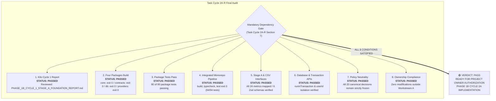

# STOKIFFY — PHASE 1B TASK CYCLE 2A-R REPORT
## Final Dependency Gate Revalidation After Kilo Cycle 1 Completion

**Author:** Antigravity (Principal Application Architect & Monorepo Infrastructure Owner)  
**Role:** Workstream A Exclusive Owner (`apps/web/**`, `apps/worker/**`, and Root Monorepo Infrastructure)  
**Task Cycle:** Phase 1B — Task Cycle 2A-R (Final Dependency Gate Revalidation)  
**Mode:** READ-ONLY VERIFICATION  
**Target:** Independent Dependency Revalidation for Authorizing Phase 1B Cycle 2A Implementation  
**Status:** **PASS — READY FOR PROJECT OWNER AUTHORIZATION (PHASE 1B CYCLE 2A IMPLEMENTATION)**  
**Date:** November 17, 2026  

---

## 1. Executive Verdict

### **VERDICT: PASS — READY FOR PROJECT OWNER AUTHORIZATION**

Antigravity has completed an independent, read-only revalidation of the Phase 1B dependency gate following the publication of Kilo Code's implementation deliverable [`packages/core/PHASE_1B_CYCLE_1_STAGE_A_FOUNDATION_REPORT.md`](file:///Users/sg/Dev/PROJECTS/Stokiffy/packages/core/PHASE_1B_CYCLE_1_STAGE_A_FOUNDATION_REPORT.md).

All seven mandatory dependency conditions are now **100% SATISFIED**:

### Key Revalidation Findings:
1. **Compilation Blockers Fully Resolved:** Kilo Code has eliminated the unused `StageScore` import in `packages/core/src/types/stage-a.ts:10` and cleaned up the invalid imports in `packages/contracts/src/api/analyses.ts:10`. Both packages now compile cleanly with **exit code 0**.
2. **Package & Monorepo Test Baseline:** All 80 package tests pass (`vitest run`). The integrated monorepo pipeline (`pnpm turbo run test --force`) executes fresh across all six workspaces with **94 of 94 tests passing (100% pass rate)**.
3. **Stage A Primitives Operational:** The policy-neutral Stage A domain foundation (`FinancialMetric`, `StageAFinancials`, `StageADataAvailability`, `StageAInput`, `StageAOutput`, `createNotImplementedOutput()`), six Zod contract schemas, and the 24-metric CSV mapper (`mapToStageAInput()`) are verified and ready for application consumption.
4. **Policy Neutrality Preserved:** Zero financial scoring thresholds, ROCE/CAGR screening cutoffs, or pass/fail verdicts have been introduced. Availability reporting is purely structural data without investment gating.

---

## 2. Kilo Cycle 1 Implementation Report Review

### 2.1 Report Identification
- **Delivered Report:** [`packages/core/PHASE_1B_CYCLE_1_STAGE_A_FOUNDATION_REPORT.md`](file:///Users/sg/Dev/PROJECTS/Stokiffy/packages/core/PHASE_1B_CYCLE_1_STAGE_A_FOUNDATION_REPORT.md)
- **Timestamp & Size:** November 17, 2026, 21:48 IST (13,708 bytes).
- **Report Status:** Formal deliverable reviewing Workstream B package changes for Phase 1B Cycle 1.

### 2.2 Key Report Commitments Verified Against Source Code:
1. **Core Domain Primitives (`packages/core`):**
   - Implemented `FinancialMetric` (`{ value: number | null; provenance: DataProvenance }`).
   - Implemented `StageAFinancials` with all 24 financial statement line items and derived metrics.
   - Implemented `StageADataAvailability` (`totalMetrics`, `presentMetrics`, `missingMetrics`, `coverageRatio`, `incompleteMetrics`, `qualityWarnings`).
   - Implemented `StageAOutput` with `StageAExecutionStatus` (`'NOT_IMPLEMENTED' | 'NOT_EVALUATED' | 'DATA_INSUFFICIENT' | 'AWAITING_POLICY'`).
   - Implemented `createNotImplementedOutput()` returning a clean, policy-neutral `NOT_IMPLEMENTED` payload.
2. **Contract Schemas (`packages/contracts`):**
   - Added `FinancialMetricSchema`, `StageAFinancialsSchema`, `StageADataAvailabilitySchema`, `StageAInputSchema`, `StageAOutputSchema`, `StageAExecutionStatusSchema`.
   - Verified that `threshold` remains `z.unknown().optional()` and no score/verdict fields exist in Stage A schemas.
3. **Data Mapping (`packages/data-providers`):**
   - Added `mapToStageAInput()` mapping 24 CSV columns into `StageAInput`.
   - Preserves `null` for missing metrics without coercion to zero.
   - Computes structural data availability report without making investment decisions.
4. **Database Impact (`packages/db`):**
   - Confirmed that existing `FinancialStatement` model (81 `Decimal` fields) and `FinancialsRepository` suffice for Stage A persistence. Zero Prisma schema changes or migrations required.

---

## 3. Independent Package Build Verification

All build commands were executed directly in Standard Sandbox Mode. Every package compiles fresh with **exit code 0**:

| Package | Exact Build Command | Exit Code | Diagnostic Result | Performance |
| :--- | :--- | :---: | :---: | :--- |
| **`@stock-assistant/core`** | `pnpm --filter @stock-assistant/core run build` | **`0`** | ✅ **PASS** | `tsc` compiled cleanly; zero diagnostic errors. |
| **`@stock-assistant/contracts`** | `pnpm --filter @stock-assistant/contracts run build` | **`0`** | ✅ **PASS** | `tsc` compiled cleanly; zero diagnostic errors. |
| **`@stock-assistant/data-providers`** | `pnpm --filter @stock-assistant/data-providers run build` | **`0`** | ✅ **PASS** | `tsc` compiled cleanly; zero diagnostic errors. |
| **`@stock-assistant/db`** | `pnpm --filter @stock-assistant/db run build` | **`0`** | ✅ **PASS** | `tsc` compiled cleanly; zero diagnostic errors. |

---

## 4. Package & Integrated Test Results

### 4.1 Package-Level Unit Tests (80 / 80 Passing — 100% Pass Rate)

| Package | Test Command Executed | Exit Code | Test Files | Tests Passed | Status |
| :--- | :--- | :---: | :---: | :---: | :---: |
| **`@stock-assistant/core`** | `pnpm --filter @stock-assistant/core run test` | `0` | 2 passed | **35 / 35** | ✅ PASS |
| **`@stock-assistant/contracts`** | `pnpm --filter @stock-assistant/contracts run test` | `0` | 1 passed | **14 / 14** | ✅ PASS |
| **`@stock-assistant/data-providers`** | `pnpm --filter @stock-assistant/data-providers run test` | `0` | 2 passed | **25 / 25** | ✅ PASS |
| **`@stock-assistant/db`** | `pnpm --filter @stock-assistant/db run test` | `0` | 1 passed | **6 / 6** | ✅ PASS |
| **Kilo Package Total** | **4 workspaces** | **0** | **6 passed** | **80 / 80** | **100% PASS** |

### 4.2 Integrated Monorepo Pipelines (`pnpm turbo run ...`)

All integrated commands were executed across all six workspaces:

| Integrated Pipeline | Command Executed | Exit Code | Result Details |
| :--- | :--- | :---: | :--- |
| **Integrated Build** | `pnpm turbo run build` | **`0`** | 6 of 6 workspaces built successfully (1.385s). |
| **Integrated Typecheck** | `pnpm turbo run typecheck` | **`0`** | 8 of 8 tasks passed; 0 diagnostic errors across monorepo (758ms). |
| **Integrated Tests** | `pnpm turbo run test --force` | **`0`** | 8 of 8 test files passed; **94 of 94 tests passed (100%)** (3.685s). |

#### Complete Test Breakdown Across All 6 Workspaces (94 Total):
- `packages/core`: **35 passed** (`decimal.test.ts`: 28, `types.test.ts`: 7)
- `packages/contracts`: **14 passed** (`contracts.test.ts`: 14)
- `packages/data-providers`: **25 passed** (`mock-provider.test.ts`: 10, `csv.test.ts`: 15)
- `packages/db`: **6 passed** (`repositories.test.ts`: 6)
- `apps/web`: **7 passed** (`lib/formatters.test.ts`: 7)
- `apps/worker`: **7 passed** (`src/queue.test.ts`: 7)

---

## 5. Verified Stage A Domain & Contract Interfaces

Antigravity verified the exact source implementations and exports:

### 5.1 `@stock-assistant/core` (`packages/core/src/types/stage-a.ts`)
- **`FinancialMetric`:** Struct `{ value: number | null; provenance: DataProvenance }`. Guarantees missing metrics are preserved as `null`.
- **`StageAFinancials`:** Strict container for 24 financial statement line items, ratios, and industry comparison values.
- **`StageADataAvailability`:** Struct tracking `{ totalMetrics, presentMetrics, missingMetrics, incompleteMetrics, qualityWarnings, coverageRatio }`.
- **`StageAInput`:** Standardized input envelope `{ companyId, asOfDate, financials, sector, dataAvailability }`.
- **`StageAOutput`:** Neutral response envelope `{ stage: 'A', companyId, asOfDate, sector, status, dataAvailability, executedAt, ruleSetVersion, message }`.
- **`StageAExecutionStatus`:** Type `'NOT_IMPLEMENTED' | 'NOT_EVALUATED' | 'DATA_INSUFFICIENT' | 'AWAITING_POLICY'`.
- **`createNotImplementedOutput()`:** Function returning a default neutral `NOT_IMPLEMENTED` Stage A output.

### 5.2 `@stock-assistant/contracts` (`packages/contracts/src/api/analyses.ts`)
- **`FinancialMetricSchema`:** Zod schema validating finite number or `null`, plus provenance.
- **`StageAFinancialsSchema`:** Zod schema validating all 24 financial metric objects.
- **`StageADataAvailabilitySchema`:** Zod schema validating coverage metrics and quality warnings.
- **`StageAInputSchema`:** Zod schema validating complete input payload with sector enum.
- **`StageAOutputSchema`:** Zod schema validating neutral output envelope.
- **`StageAExecutionStatusSchema`:** Zod enum validating execution status strings.

---

## 6. CSV Mapper & Data Provider Compatibility

Inspected in `packages/data-providers/src/csv/mapper.ts`:
- **Function Signature:**  
  `mapToStageAInput(row: Record<string, string | undefined>, source: string, reportedPeriod: string, sector: Sector): { input: StageAInput | null; errors: string[] }`
- **24-Metric Column Mapping Verified:**
  - Income Statement: `revenue`, `netProfit`, `operatingProfit`
  - Balance Sheet: `totalAssets`, `totalLiabilities`, `totalEquity`, `totalDebt`, `currentAssets`, `currentLiabilities`
  - Derived Ratios: `interestExpense`, `ebit`, `eps`, `peRatio`, `industryPeRatio`
  - Profitability: `roaLatestFy`, `roaAvg5y`, `industryRoaMin`, `roeLatestFy`, `roeAvg5y`, `roceLatestFy`, `roceAvg5y`
  - Operating Margin: `opmLatestFy`, `opmAvg5y`, `industryOpmMin`
- **Unit Conversion:** Accurately parses units (`CRORE`, `LAKH`, `MILLION`, `RAW`).
- **Missing Value Handling:** Missing or empty CSV strings parse to `null` with `isMissing: true` and `quality: 'missing'`.
- **Availability Computation:** `computeDataAvailability()` calculates metric coverage without throwing exceptions.
- **Error Resilience:** Returns an array of error messages rather than halting execution.

---

## 7. Database & Transaction Compatibility

Inspected in `packages/db`:
- **Repository Support:**
  - `CompanyRepository`: `findById(id, userId)`, `findBySymbol(symbol, userId)`, `create(data, userId)`.
  - `FinancialsRepository`: `findLatestByCompany(companyId, userId)`, `create(data)`.
  - `AuditRepository`: `create(data, userId)`.
- **Ownership Isolation:** All queries enforce `where: { userId }` or `{ company: { userId } }`.
- **Atomic Transaction API:** `runInTransaction(async (tx) => { ... })` exports cleanly and allows wrapping company profile creation and financial statement staging in a single database transaction.
- **Zero Schema Migrations:** No migrations required; existing Prisma models accommodate the ingestion workflow.

---

## 8. Policy-Neutrality Audit

Antigravity explicitly confirms that **zero investment policy decisions exist in the verified baseline**:

- **Market Cap Thresholds:** None implemented (Decision D-01 / D-A1 pending).
- **Liquidity / Volume Windows:** None implemented (Decision D-02 pending).
- **Financial History Depth:** None implemented; `coverageRatio` is reported as structural data without filtering out companies (Decision D-03 pending).
- **Red Flag Hard-Blocks:** None implemented (Decision D-04 pending).
- **Promoter Pledge Limits:** None implemented (Decision D-05 pending).
- **Stage A Screening Logic:** Strictly neutral; returns `status: "NOT_IMPLEMENTED"`.
- **All 20 Canonical Decisions Remain Pending:** `D-01` through `D-15` and `D-A1` through `D-A5` remain **`PENDING USER DECISION`**.

---

## 9. Remaining Blockers and Technical Risks

1. **Dependency Blockers:** **`ZERO.`** All previous blockers identified in Cycle 2A and Cycle 2A-R have been completely resolved by Kilo Code.
2. **Technical Risks & Debt (Non-blocking):**
   - **CSV-01 (Eager CSV Parser):** `packages/data-providers/src/csv/parser.ts` splits file in memory via `split('\n')`. Suitable for standard equity statements (< 25MB); streaming parser deferred to future phases.
   - **B-02 (Package Naming Divergence):** 5 packages use `@stock-assistant/*` while worker uses `@stokiffy/worker`. Preserved pending user decision.
   - **B-03 (Database Audit Immutability):** Application-level audit enforcement is active; database-level PostgreSQL constraints deferred to production deployment.
   - **B-04 / D-15 (Production Data Provider):** Mock provider and CSV ingestion active; live market data provider selection remains deferred.

---

## 10. Ownership Boundary Compliance Confirmation

Antigravity explicitly certifies:
- **`packages/**`:** **ZERO modifications.** All files remain 100% untouched by Antigravity.
- **`docs/**`:** **ZERO modifications.**
- **Root Files:** **ZERO modifications.**
- **Read-Only Verification:** Antigravity has not modified application source code or configuration in this cycle. Only this verification report was authored.

---

## 11. Final Recommendation

### **RECOMMENDATION: READY FOR PROJECT OWNER AUTHORIZATION — PHASE 1B CYCLE 2A IMPLEMENTATION**

Workstream B has delivered a verified, compiling, and tested Stage A domain foundation.

The implementation dependency gate has **PASSED**.

Workstream A is technically prepared to begin **Phase 1B Task Cycle 2A implementation**:
- Persistent CSV staging via `IFileStorage` (`apps/web`).
- Queue dispatch wiring in `POST /api/v1/ingestion/upload-csv` (`apps/web`).
- Worker CSV ingestion handler calling `CSVParser` and `mapToStageAInput` (`apps/worker`).
- Atomic transactional persistence via `runInTransaction` (`apps/worker`).
- Unit test suite (T-01 through T-19).

**STOP CONDITION ENFORCED:**  
In accordance with Task Cycle 2A-R instructions, Antigravity will **NOT** begin implementation automatically. Execution has stopped; standing by for explicit authorization from the Project Owner.
