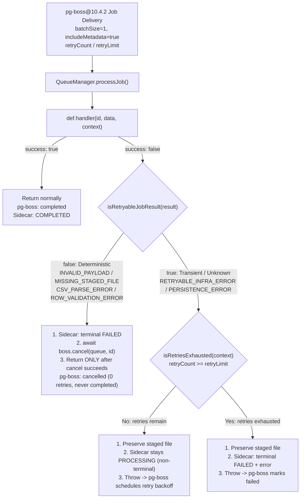

# STOKIFFY — PHASE 1B CYCLE 2B IMPLEMENTATION REPORT
## ISS-03 Worker Retry Reliability & ISS-04 Shared Configuration Implementation

**Author:** Antigravity (Principal Application Architect & Monorepo Infrastructure Owner)  
**Repository:** `/Users/sg/Dev/PROJECTS/Stokiffy`  
**Phase:** 1B — Cycle 2B  
**Authorization:** Explicitly Authorized by Project Owner (ISS-03 & ISS-04 Only)  
**Final Status:** **PASS — IMPLEMENTATION COMPLETE & VERIFIED (156 / 156 TESTS PASSING)**  
**Date:** November 18, 2026  

---

## 1. Executive Summary & Final Status

Antigravity has completed the explicitly authorized Phase 1B Cycle 2B implementation covering:
- **ISS-03 (Worker Retry Reliability):** Centralized failure classification (`isRetryableJobResult()`), accurate error categorization across handler/storage/persistence boundaries, verified `pg-boss@10.4.2` v10 integration (`boss.cancel()` for deterministic permanent failures, bounded exponential retries for transient/unknown failures), and accurate retry-exhaustion status transitions.
- **ISS-04 (Deterministic Shared Configuration & Cross-Process Freshness):** Unified monorepo-root path discovery (`pnpm-workspace.yaml`) resolving canonical `<repoRoot>/storage/jobs` and `<repoRoot>/storage/staged` across all launch contexts, fail-fast startup validation for `JOBS_DIR` and `STAGING_DIR`, and disk-first freshness in `IngestionStatusService`.
- **Section 6 Data-Integrity Discrepancy Verified & Fixed (Application Layer):** Eliminated null-to-zero coercion in `CSVIngestionService` so missing financial metrics remain `null` (with `isMissing: true` and `quality: 'missing'`) and documented the cross-ownership Prisma schema nullability limitation in frozen Kilo-owned `packages/db/prisma/schema.prisma`.

---

## 2. Preflight Findings

- **Repository Root & Identity:** Confirmed `stokiffy` monorepo at `/Users/sg/Dev/PROJECTS/Stokiffy`.
- **Git State:** Confirmed no `.git` directory exists; did not initialize Git or execute any Git write operations.
- **Cycle 2A & 2B-Prep Evidence Reviewed:** Confirmed Cycle 2A implementation report, R2 independent audit, formal closure record, and Cycle 2B-Preparation audit findings intact.
- **Installed `pg-boss` Version Verified:** Inspected [`apps/worker/node_modules/pg-boss/types.d.ts`](file:///Users/sg/Dev/PROJECTS/Stokiffy/apps/worker/node_modules/pg-boss/types.d.ts), [`src/manager.js`](file:///Users/sg/Dev/PROJECTS/Stokiffy/apps/worker/node_modules/pg-boss/src/manager.js), [`src/plans.js`](file:///Users/sg/Dev/PROJECTS/Stokiffy/apps/worker/node_modules/pg-boss/src/plans.js), and [`src/attorney.js`](file:///Users/sg/Dev/PROJECTS/Stokiffy/apps/worker/node_modules/pg-boss/src/attorney.js) for `pg-boss@10.4.2`.
- **Pre-Implementation Baseline:** 126 / 126 tests passing; 6/6 builds passing; 0 TypeScript errors; 0 ESLint warnings/errors.

---

## 3. Exact Files Created and Modified

All changes were strictly confined to Antigravity's exclusive ownership (`apps/web/**` and `apps/worker/**`):

### Files Created
1. [`apps/web/lib/storage/path-resolver.ts`](file:///Users/sg/Dev/PROJECTS/Stokiffy/apps/web/lib/storage/path-resolver.ts) — Deterministic monorepo-root discovery (`pnpm-workspace.yaml`), relative override resolution, and fail-fast directory validation for `JOBS_DIR` and `STAGING_DIR`.
2. [`apps/worker/src/lib/path-resolver.ts`](file:///Users/sg/Dev/PROJECTS/Stokiffy/apps/worker/src/lib/path-resolver.ts) — Identical deterministic path resolver and fail-fast directory validation for `apps/worker`.
3. [`apps/web/lib/storage/path-resolver.test.ts`](file:///Users/sg/Dev/PROJECTS/Stokiffy/apps/web/lib/storage/path-resolver.test.ts) — Unit tests for web path resolution, cross-app path parity, and `parseEnv()` startup validation (5 tests).
4. [`apps/worker/src/lib/path-resolver.test.ts`](file:///Users/sg/Dev/PROJECTS/Stokiffy/apps/worker/src/lib/path-resolver.test.ts) — Unit tests for worker path resolution, launch-context consistency, and `parseEnv()` startup validation (6 tests).
5. [`apps/web/PHASE_1B_CYCLE_2B_ISS03_ISS04_IMPLEMENTATION_REPORT.md`](file:///Users/sg/Dev/PROJECTS/Stokiffy/apps/web/PHASE_1B_CYCLE_2B_ISS03_ISS04_IMPLEMENTATION_REPORT.md) — This implementation report.

### Files Modified
1. [`apps/worker/src/jobs/types.ts`](file:///Users/sg/Dev/PROJECTS/Stokiffy/apps/worker/src/jobs/types.ts) — Added `retryable?: boolean` to `JobExecutionResult`, `JobExecutionContext`, `NON_RETRYABLE_FAILURE_CATEGORIES`, `RETRYABLE_FAILURE_CATEGORIES`, `isRetryableJobResult()`, `isRetriesExhausted()`, `isTransientFilesystemError()`, `isDeterministicStorageError()`, and `isTransientPersistenceError()`.
2. [`apps/worker/src/types/ambient.d.ts`](file:///Users/sg/Dev/PROJECTS/Stokiffy/apps/worker/src/types/ambient.d.ts) — Aligned `pg-boss` ambient types with verified `pg-boss@10.4.2` (`WorkOptions` with `batchSize`/`includeMetadata`/`pollingIntervalSeconds`, `Job` metadata fields `retryCount`/`retryLimit`, and `cancel()`/`complete()`/`fail()`).
3. [`apps/worker/src/jobs/registry.ts`](file:///Users/sg/Dev/PROJECTS/Stokiffy/apps/worker/src/jobs/registry.ts) — Added optional `context?: JobExecutionContext` to `JobDefinition.handler`.
4. [`apps/worker/src/queue.ts`](file:///Users/sg/Dev/PROJECTS/Stokiffy/apps/worker/src/queue.ts) — Added constructor DI for testing, extracted `processJob()`, enforced `boss.cancel()` for non-retryable failures and throw-on-retryable/unknown failures, and updated `registerWorkers()` to use pg-boss v10 `batchSize: 1, includeMetadata: true` (removing deprecated v9 `teamSize`/`teamConcurrency`).
5. [`apps/worker/src/jobs/handlers/process-csv-import.ts`](file:///Users/sg/Dev/PROJECTS/Stokiffy/apps/worker/src/jobs/handlers/process-csv-import.ts) — Isolated `ZodError` parsing as `INVALID_PAYLOAD` (`retryable: false`) from unexpected execution exceptions (`RETRYABLE_INFRA_ERROR`, `retryable: true`); synced sidecar `FAILED` on invalid payloads when `jobTicketId` is extractable.
6. [`apps/worker/src/jobs/services/csv-ingestion.service.ts`](file:///Users/sg/Dev/PROJECTS/Stokiffy/apps/worker/src/jobs/services/csv-ingestion.service.ts) — Injected `jobsDirectory` via `resolveJobsDir()`, logged explicit warnings on missing sidecars, separated transient FS errors (`RETRYABLE_INFRA_ERROR`) from deterministic storage failures (`MISSING_STAGED_FILE`), prevented premature `FAILED` sidecar writes on intermediate retry attempts, and eliminated null-to-zero coercion on financial metrics.
7. [`apps/worker/src/lib/storage.ts`](file:///Users/sg/Dev/PROJECTS/Stokiffy/apps/worker/src/lib/storage.ts) — Replaced fragile `../web/storage/staged` existence fallback with deterministic `resolveStagingDir()`.
8. [`apps/worker/src/config/env.ts`](file:///Users/sg/Dev/PROJECTS/Stokiffy/apps/worker/src/config/env.ts) — Added fail-fast startup validation for `JOBS_DIR` and `STAGING_DIR` and exported `parseEnv()`.
9. [`apps/web/lib/env.ts`](file:///Users/sg/Dev/PROJECTS/Stokiffy/apps/web/lib/env.ts) — Added fail-fast startup validation for `JOBS_DIR` and `STAGING_DIR` and exported `parseEnv()`.
10. [`apps/web/lib/storage/local-disk-storage.ts`](file:///Users/sg/Dev/PROJECTS/Stokiffy/apps/web/lib/storage/local-disk-storage.ts) — Switched constructor to deterministic `resolveStagingDir()`.
11. [`apps/web/lib/services/ingestion-status.service.ts`](file:///Users/sg/Dev/PROJECTS/Stokiffy/apps/web/lib/services/ingestion-status.service.ts) — Switched constructor to deterministic `resolveJobsDir()`, exposed `getJobsDirectory()`, implemented disk-first reads in `getJobById()` and `findReusableJobForUser()`, and surfaced unreadable/corrupt sidecar errors explicitly.
12. [`apps/worker/src/queue.test.ts`](file:///Users/sg/Dev/PROJECTS/Stokiffy/apps/worker/src/queue.test.ts) — Added 10 new ISS-03 queue & classifier tests (17 total).
13. [`apps/worker/src/jobs/csv-ingestion.test.ts`](file:///Users/sg/Dev/PROJECTS/Stokiffy/apps/worker/src/jobs/csv-ingestion.test.ts) — Added 5 new ISS-03/ISS-04/null-preservation tests (13 total).
14. [`apps/web/lib/services/ingestion-pipeline.test.ts`](file:///Users/sg/Dev/PROJECTS/Stokiffy/apps/web/lib/services/ingestion-pipeline.test.ts) — Added 4 new ISS-04 disk-first freshness & tenant isolation tests (20 total).

---

## 4. ISS-03 Implementation Details (Worker Retry Reliability)

1. **Single Source of Truth (`isRetryableJobResult`):**
   - Explicit `result.retryable` boolean takes highest precedence.
   - Deterministic categories (`INVALID_PAYLOAD`, `MISSING_STAGED_FILE`, `CSV_PARSE_ERROR`, `ROW_VALIDATION_ERROR`) return `false`.
   - Transient categories (`PERSISTENCE_ERROR`, `RETRYABLE_INFRA_ERROR`) and unknown/unclassified failures default to `true` (bounded retry).
2. **Handler Boundary Separation (`process-csv-import.ts`):**
   - Only `ZodError` from `processFileIngestionPayloadSchema.parse()` produces `INVALID_PAYLOAD` (`retryable: false`).
   - Unexpected exceptions thrown by `processImport()` produce `RETRYABLE_INFRA_ERROR` (`retryable: true`).
3. **Storage & Persistence Error Differentiation (`csv-ingestion.service.ts`):**
   - Transient filesystem errors (`EAGAIN`, `EBUSY`, `EMFILE`, `ENFILE`, `EIO`, `ETIMEDOUT`, `ECONNRESET`, `EPIPE`) classify as `RETRYABLE_INFRA_ERROR` (`retryable: true`).
   - Confirmed missing/invalid/unauthorized storage errors (`ENOENT`, `FILE_NOT_FOUND`, `INVALID_STORAGE_KEY`, `INVALID_USER_ID`, `ACCESS_DENIED`, `SECURITY_VIOLATION`) classify as `MISSING_STAGED_FILE` (`retryable: false`).
   - Database failures (including PostgreSQL `40001`/`40P01`/`08006`/`53300`/`57P01` and Prisma `P1001`/`P1002`/`P1008`/`P1017`/`P2024`/`P2034`, as well as unknown DB errors) classify as `PERSISTENCE_ERROR` (`retryable: true`).
4. **Retry Exhaustion Status Consistency:**
   - Intermediate retryable failures (`retryCount < retryLimit`) keep the sidecar non-terminal (`PROCESSING` with retry status message) and preserve the staged file.
   - Final exhausted attempts (`retryCount >= retryLimit`) write terminal `FAILED` with `failureCategory` and error message before throwing to pg-boss.

---

## 5. ISS-04 Implementation Details (Deterministic Shared Configuration)

1. **Canonical Monorepo-Root Discovery:**
   - `findMonorepoRoot()` walks upward from `cwd` (max 10 levels) for `pnpm-workspace.yaml`.
   - Default `JOBS_DIR` resolves to `<repoRoot>/storage/jobs`; default `STAGING_DIR` resolves to `<repoRoot>/storage/staged`.
   - Fallback outside a monorepo checkout deterministically uses `<cwd>/storage/jobs` and `<cwd>/storage/staged`.
2. **Fail-Fast Override Validation:**
   - Explicit overrides (constructor or env var) fail fast with `CONFIG_VALIDATION_ERROR` if empty, whitespace-only, containing null bytes (`\0`), or pointing to an existing regular file.
   - Relative overrides resolve deterministically against the detected monorepo root.
   - Startup env validation in both [`apps/web/lib/env.ts`](file:///Users/sg/Dev/PROJECTS/Stokiffy/apps/web/lib/env.ts) and [`apps/worker/src/config/env.ts`](file:///Users/sg/Dev/PROJECTS/Stokiffy/apps/worker/src/config/env.ts) validates both variables at process boot.
3. **Cross-Process Disk-First Freshness:**
   - `IngestionStatusService.getJobById()` reads the disk sidecar first when present and refreshes `memoryStore`. Missing sidecars return `null` (falling back to memory only when no disk file exists); corrupt/unreadable sidecars log structured error and throw `JOB_STATUS_READ_ERROR`.
   - `IngestionStatusService.findReusableJobForUser()` refreshes all sidecars from `jobsDirectory` before evaluating reusable statuses, ensuring worker `QUEUED → FAILED` or `QUEUED → COMPLETED` transitions immediately override stale memory entries while preserving strict `userId` tenant scoping.
   - `CSVIngestionService` receives `jobsDirectory` via constructor injection and logs a structured warning whenever `syncJobStatus()` encounters a missing sidecar.

---

## 6. `pg-boss@10.4.2` API & Version Verification

Directly verified from installed `apps/worker/node_modules/pg-boss/`:
- **Version:** `pg-boss@10.4.2` (symlinked from pnpm store).
- **`watch()` / `work()` lifecycle (`src/manager.js:215-220`):** Returning normally calls `complete(name, jobIds)` (`WHERE state = 'active'`); throwing calls `fail(name, jobIds, err)`.
- **Retry counter (`src/plans.js:532, 608`):** `retry_count` is `0` on Attempt 1 (`started_on IS NULL`), increments by 1 on each subsequent fetch, and `failJobs()` transitions to `'retry'` when `retry_count < retry_limit` else `'failed'`. Thus `retryCount >= retryLimit` is the exact retry-exhaustion condition.
- **Permanent non-retryable cancellation (`src/plans.js:710-723`):** `boss.cancel(name, id)` sets `state = 'cancelled', completed_on = now()` `WHERE state < 'completed'`. Subsequent `complete()` affects 0 rows because `state` is no longer `'active'`. If `boss.cancel()` fails, `processJob()` throws so a permanent failure is never falsely marked `completed`.
- **`WorkOptions` (`src/attorney.js:129-136`):** Removed deprecated v9 `teamSize`/`teamConcurrency`; registered `def.concurrency` workers with `{ batchSize: 1, includeMetadata: true, pollingIntervalSeconds: env.WORKER_POLL_INTERVAL_SECONDS }`.

---

## 7. Failure Classification & Retry Lifecycle Table

| Category | Retryable | pg-boss Terminal / Next State | Application Sidecar Status | Staged File |
| :--- | :---: | :--- | :--- | :--- |
| `INVALID_PAYLOAD` | No | `cancelled` (0 retries) | `FAILED` (when ticket ID extractable) | Untouched |
| `MISSING_STAGED_FILE` | No | `cancelled` (0 retries) | `FAILED` | Missing / unauthorized |
| `CSV_PARSE_ERROR` | No | `cancelled` (0 retries) | `FAILED` | Retained for debug |
| `ROW_VALIDATION_ERROR` | No | `cancelled` (0 retries) | `FAILED` + `errorsSummary` | Retained for debug |
| `RETRYABLE_INFRA_ERROR` (attempt < limit) | Yes | `retry` (backoff 10s, exp) | `PROCESSING` (non-terminal) | Retained |
| `RETRYABLE_INFRA_ERROR` (exhausted) | Yes | `failed` | `FAILED` | Retained |
| `PERSISTENCE_ERROR` (attempt < limit) | Yes | `retry` (backoff 10s, exp) | `PROCESSING` (non-terminal) | Retained |
| `PERSISTENCE_ERROR` (exhausted) | Yes | `failed` | `FAILED` | Retained |
| Unknown / unclassified failure | Yes (default) | `retry` → `failed` | Non-terminal → `FAILED` | Retained |

---

## 8. Path-Resolution Behavior & Launch-Context Verification

| Launch Context (`cwd`) | Override | Web `JOBS_DIR` | Worker `JOBS_DIR` | Web `STAGING_DIR` | Worker `STAGING_DIR` | Match? |
| :--- | :--- | :--- | :--- | :--- | :--- | :---: |
| `<repoRoot>` | Unset | `<repoRoot>/storage/jobs` | `<repoRoot>/storage/jobs` | `<repoRoot>/storage/staged` | `<repoRoot>/storage/staged` | **IDENTICAL** |
| `<repoRoot>/apps/web` | Unset | `<repoRoot>/storage/jobs` | `<repoRoot>/storage/jobs` | `<repoRoot>/storage/staged` | `<repoRoot>/storage/staged` | **IDENTICAL** |
| `<repoRoot>/apps/worker` | Unset | `<repoRoot>/storage/jobs` | `<repoRoot>/storage/jobs` | `<repoRoot>/storage/staged` | `<repoRoot>/storage/staged` | **IDENTICAL** |
| Any workspace dir | `./custom/jobs` | `<repoRoot>/custom/jobs` | `<repoRoot>/custom/jobs` | — | — | **IDENTICAL** |
| Any workspace dir | `""`, `"   "`, `"\0"`, regular file | Throws `CONFIG_VALIDATION_ERROR` | Throws `CONFIG_VALIDATION_ERROR` | Throws `CONFIG_VALIDATION_ERROR` | Throws `CONFIG_VALIDATION_ERROR` | **FAIL FAST** |

---

## 9. Security & Data-Integrity Verification

- **All existing security controls preserved:** `requireAuth()` on upload & status routes, strict `userId` scoping during disk-first status reads and deduplication, UUID storage-key regex, path traversal prevention, `0600` POSIX file permissions, `0700` directory permissions, zero internal path leakage.
- **Null-to-Zero Coercion Discrepancy (Section 6) — CONFIRMED & REMEDIATED IN APPLICATION LAYER:**
  - *Discrepancy Confirmed:* In Cycle 2A [`csv-ingestion.service.ts`](file:///Users/sg/Dev/PROJECTS/Stokiffy/apps/worker/src/jobs/services/csv-ingestion.service.ts), missing statement fields were coerced with `: (0 as any)`, cash-flow fields (`depreciationAmortization`, `capitalExpenditure`, `changeInWorkingCapital`, `fcf`) were hardcoded to `0 as any` and unmapped in `buildColumnMapping()`, and `isMissing` only inspected `revenue`.
  - *Application-Layer Fix Applied:* Added the 4 cash-flow headers to `buildColumnMapping()`, removed all `: (0 as any)` coercions so `financialsRepo.create()` receives exact `null` values for missing metrics, computed `missingFields` across all 16 metrics for `isMissing`, `quality`, and `auditEvent.afterState`, and added a dedicated regression test asserting `totalDebt === null`, `currentLiabilities === null`, `depreciationAmortization === null`, `fcf === null`, `isMissing === true`, `quality === 'missing'`.
  - *Cross-Ownership Blocker Recorded (Kilo-Owned `packages/db`):* `packages/db/prisma/schema.prisma` lines 77–92 currently declare those 16 `Decimal` columns as non-nullable (`Decimal`, not `Decimal?`). Because `packages/db/**` is frozen under Kilo Code ownership, Antigravity did **NOT** edit the Prisma schema. Live PostgreSQL inserts of partial rows containing `null` metrics will require Kilo Code / Project Owner authorization to alter those columns to `Decimal?` in a future schema migration.

---

## 10. Tests Added & Exact Verification Results

| Workspace | Previous Tests | New Tests Added | Total Tests | Status |
| :--- | :---: | :---: | :---: | :---: |
| `@stock-assistant/core` | 35 | 0 | 35 | **PASS** |
| `@stock-assistant/contracts` | 14 | 0 | 14 | **PASS** |
| `@stock-assistant/data-providers` | 25 | 0 | 25 | **PASS** |
| `@stock-assistant/db` | 6 | 0 | 6 | **PASS** |
| `@stock-assistant/web` | 31 | **+9** | **40** | **PASS** |
| `@stokiffy/worker` | 15 | **+21** | **36** | **PASS** |
| **Full Monorepo (`pnpm turbo run test --force`)** | **126** | **+30** | **156 / 156** | **100% PASS** |

---

## 11. Build, Typecheck & Lint Verification Results

| Check | Command | Tasks Passed | Exit Code | Notes |
| :--- | :--- | :---: | :---: | :--- |
| **Web Tests** | `pnpm --filter @stock-assistant/web run test` | 4 files / 40 tests | `0` | 100% pass |
| **Worker Tests** | `pnpm --filter @stokiffy/worker run test` | 3 files / 36 tests | `0` | 100% pass |
| **Monorepo Tests** | `pnpm turbo run test --force` | 10 / 10 tasks (156 tests) | `0` | 0 regressions |
| **Monorepo Build** | `pnpm turbo run build` | 6 / 6 packages | `0` | Next.js + `tsc -b` + 4 packages clean |
| **Monorepo Typecheck** | `pnpm turbo run typecheck` | 10 / 10 tasks | `0` | 0 TypeScript errors |
| **Monorepo Lint** | `pnpm turbo run lint` | 6 / 6 tasks | `0` | `next lint`: ✔ No ESLint warnings or errors |

---

## 12. Remaining Limitations & Technical Debt

1. **ISS-01 (UNRESOLVED & UNAUTHORIZED):** Single-host local disk staging and JSON sidecars are not shared across independent multi-replica/serverless containers; requires future S3/GCS `IFileStorage` adapter and database-backed `IngestionJob` table.
2. **ISS-02 (UNRESOLVED & UNAUTHORIZED):** `FinancialStatement` in `packages/db/prisma/schema.prisma` lacks `@@unique([companyId, periodType, fiscalYear, fiscalQuarter])` for database-level concurrency protection.
3. **Prisma Nullability Discrepancy (Cross-Ownership Blocker — Kilo `packages/db`):** Core 16 `Decimal` columns on `FinancialStatement` in `packages/db/prisma/schema.prisma` lines 77–92 are currently non-nullable; requires authorized migration to `Decimal?` for live PostgreSQL partial-statement persistence without zero-coercion.
4. **Live PostgreSQL Integration:** Unit tests use mocked Prisma and pg-boss drivers; live database/queue end-to-end verification awaits an authorized non-production Postgres environment.

---

## 13. Ownership & Governance Compliance Confirmations

- **Kilo-Owned Packages (`packages/**`):** **100% UNTOUCHED.** Zero files modified in `packages/core`, `packages/contracts`, `packages/db`, or `packages/data-providers`.
- **Documentation (`docs/**` & prior reports):** **100% UNTOUCHED.** All previous reports preserved intact.
- **Schema / Migrations / Neon / Git / Deployment:** **NONE EXECUTED.** Zero Prisma schema edits, zero migrations, zero Neon/production DB connections, zero Git initialization/commits/pushes/branches, zero deployments.
- **Investment Policy Freeze:** All 20 canonical investment decisions (`D-01`–`D-15`, `D-A1`–`D-A5`) remain strictly `PENDING USER DECISION`. Stage A remains `NOT_IMPLEMENTED`.
- **Out-of-Scope Debt Status:** **ISS-01 and ISS-02 remain explicitly unresolved and unauthorized.**
