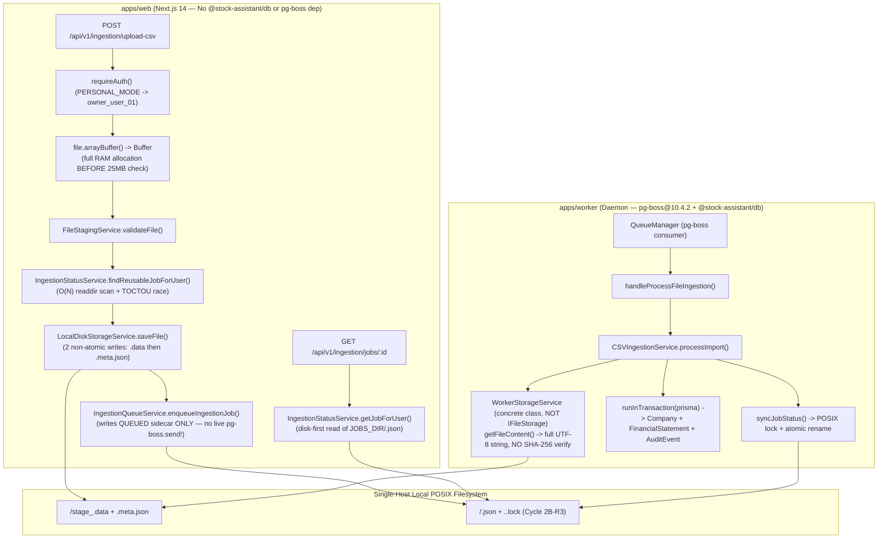
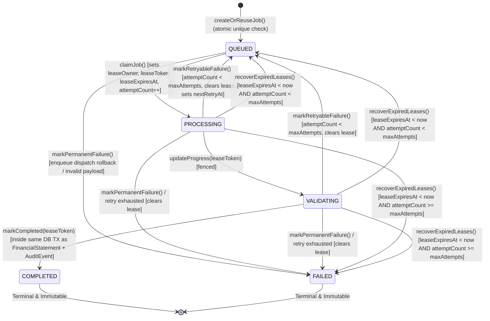
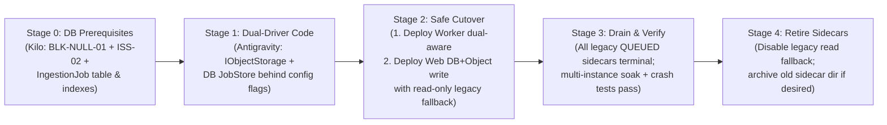

# STOKIFFY — PHASE 1B ISS-01 READINESS AUDIT REPORT
## Shared Object Storage & Durable Job-State Readiness Assessment

**Agent:** Antigravity  
**Role:** Principal Application Architect & Monorepo Infrastructure Owner  
**Phase / Scope:** Phase 1B — ISS-01 Readiness Audit (Shared Storage & Durable Job-State Persistence)  
**Repository:** `/Users/sg/Dev/PROJECTS/Stokiffy`  
**Execution Mode:** STRICT READ-ONLY ARCHITECTURE & READINESS AUDIT  
**Implementation Authorization:** NOT GRANTED (Readiness Audit Only)  
**Date:** 2026-11-18  
**Executive Verdict:** **READY WITH CONDITIONS**

---

## 1. Executive Verdict

### **Verdict: READY WITH CONDITIONS**

Stokiffy's single-host CSV ingestion pipeline (Cycles 2A, 2B, 2B-R2, 2B-R3; **177 / 177** monorepo tests passing) has clean separation of concerns, deterministic retry classification, and verified single-host cross-process sidecar safety. However, **multi-instance deployment is not yet supported** and ISS-01 implementation is **gated on 6 concrete technical and governance prerequisites**:

| Gate ID | Prerequisite | Owner | Blocking Impact |
| :---: | :--- | :---: | :--- |
| **G-1** | Authorize and add `IngestionJob` Prisma model, partial unique index, and `IngestionJobRepository` in `@stock-assistant/db` (plus baseline migration verification — `20261115000000_init/` is currently empty). | Kilo Code + Project Owner | Hard blocker for durable cross-instance job state and atomic deduplication. |
| **G-2** | Remediate **BLK-NULL-01** (`packages/db/prisma/schema.prisma:77-92`): migrate 16 `FinancialStatement` `Decimal` columns to `Decimal?`. | Kilo Code + Project Owner | Hard blocker for live PostgreSQL persistence of partial CSV rows without `23502` `NOT NULL` errors. |
| **G-3** | Remediate **ISS-02** (`packages/db/prisma/schema.prisma:112`, plus evaluate `Company` line 64): add DB-level uniqueness on `FinancialStatement` (handling `NULL` `fiscalQuarter`) and `Company(userId, symbol)`. | Kilo Code + Project Owner | High-risk concurrency blocker under multi-worker retries / simultaneous uploads. |
| **G-4** | Wire live queue/job dispatch between `apps/web` and `apps/worker` (`apps/web/lib/queue/ingestion-queue.service.ts:54-58` currently does **not** dispatch to `pg-boss`; `apps/web/package.json` lacks `@stock-assistant/db` and `pg-boss`). | Antigravity + Project Owner | Hard blocker for end-to-end runtime execution across web and worker processes. |
| **G-5** | Unify storage abstraction across `apps/web` (`IFileStorage`) and `apps/worker` (`WorkerStorageService` does not implement `IFileStorage`) and add worker-side SHA-256 verification. | Antigravity | Required to plug in provider-neutral object storage without application coupling. |
| **G-6** | Project Owner design sign-off on: (a) object-storage protocol class (without committing to a paid vendor now), (b) upload transport for serverless payloads >4.5 MB vs 25 MB CSV cap, (c) `pg-boss` producer vs DB-polled claim model, and (d) retention TTLs. | Project Owner | Required before authorizing implementation cycle. |

No implementation work has started. All 20 canonical investment policy decisions remain `PENDING USER DECISION` and Stage A remains `NOT_IMPLEMENTED`.

---

## 2. Current Architecture & Verified Limitations (Source-Level Inspection)

Direct inspection of `apps/web/**`, `apps/worker/**`, and `packages/**` verified the exact current runtime architecture and surfaced several concrete limitations beyond prior reports:



### Verified Source-Level Gaps

| # | Component & File Location | Verified Behavior Today | Multi-Instance / Production Limitation |
| :---: | :--- | :--- | :--- |
| **1** | `apps/web/lib/queue/ingestion-queue.service.ts:52-58` | Calls `statusService.createJob(jobRecord)` and returns immediately; contains comment noting pg-boss is not connected. | **No live web-to-worker queue dispatch.** Web and worker are not yet connected through a live broker in runtime. |
| **2** | `apps/web/package.json:15-24` & `apps/web/next.config.mjs` | Neither `@stock-assistant/db`, `@stock-assistant/contracts`, `@prisma/client`, nor `pg-boss` is declared in `apps/web/package.json`; no `serverComponentsExternalPackages` configured. | Web cannot access PostgreSQL or `IngestionJobRepository` until workspace dependency and Next.js server-external bundling are authorized. |
| **3** | `apps/web/lib/services/ingestion-status.service.ts:72-92` | `createJob()` catches sidecar write failures and only emits `logger.warn()`, still returning the `QUEUED` record. | Silent persistence loss on write error; `enqueueIngestionJob()` rollback block (`line 67`) is never triggered if sidecar creation fails. |
| **4** | `apps/web/lib/services/ingestion-status.service.ts:189-232` | `findReusableJobForUser()` reads and parses **every** `.json` file in `JOBS_DIR` on every upload (`O(N)` disk I/O) before `stageFile()` writes a new file. | Unbounded directory growth (no TTL/pruning), degrading latency, and a **check-then-act (TOCTOU) race** allowing duplicate concurrent uploads to pass deduplication. |
| **5** | `apps/web/lib/storage/local-disk-storage.ts:75-76` | Writes `.data` then `.meta.json` sequentially via `writeFile()` without atomic rename or cleanup on partial failure. | Crash/error between writes leaves orphaned `.data` file invisible to `getMetadata()`. |
| **6** | `apps/worker/src/lib/storage.ts:21-121` | Concrete `WorkerStorageService` class; does **not** implement `IFileStorage`; lacks `exists()` and `getFileBuffer()`; `CSVIngestionService` depends on the concrete class (`csv-ingestion.service.ts:45`). | Cannot swap local disk for shared object storage without refactoring worker storage DI. |
| **7** | `apps/worker/src/jobs/services/csv-ingestion.service.ts:246` | Calls `storage.getFileContent()` (full UTF-8 string in RAM) and proceeds directly to CSV parsing **without verifying SHA-256** against `payload.sha256Hash` or metadata. | Silent data corruption or storage-tampering risk goes undetected prior to DB persistence. |
| **8** | `apps/web/app/api/v1/ingestion/upload-csv/route.ts:63-67, 124` | Allocates `Buffer.from(await file.arrayBuffer())` before checking `MAX_FILE_SIZE_BYTES`; generates 12-hex-char `jobId` (`job_${crypto.randomUUID().slice(0, 12)}`). | Memory spike / OOM DoS risk on oversized uploads; 48-bit ID entropy should be widened to full UUIDv4/CUID2 for multi-instance global uniqueness. |
| **9** | `apps/worker/src/jobs/services/csv-ingestion.service.ts:534-549` | Deletes staged file *only* on `COMPLETED`; permanent-failure files (`CSV_PARSE_ERROR`, `ROW_VALIDATION_ERROR`, exhausted retries) remain on disk forever. Also commits DB transaction (`line 492`) separately from marking job `COMPLETED` (`line 543`). | Storage leaks on failed/abandoned uploads; crash between line 492 and line 543 leaves DB populated while job status remains `VALIDATING`. |
| **10** | `apps/worker/src/jobs/registry.ts:15-23` & `queue.ts:201-214` | Configures `retryLimit: 3, retryDelaySeconds: 10, retryBackoff: true` but does not configure `expireInSeconds` or an application-level lease/fencing token. | Zombie worker after crash/stall can race with a re-delivered attempt across instances. |
| **11** | `apps/web/lib/storage/sidecar-store.ts` & `apps/worker/src/lib/sidecar-store.ts` | Single-host POSIX `O_CREAT \| O_EXCL` lockfiles + `process.kill(pid, 0)` + `rename(2)`. | Verified safe on a single POSIX host (Cycle 2B-R3), **fundamentally non-portable across separate containers/hosts or serverless functions**. |

---

## 3. Shared Storage Abstraction Assessment (Workstream A)

### 3.1 Audit of Current `IFileStorage` Interface

Inspecting `apps/web/lib/storage/file-storage.interface.ts`:

```ts
export interface StoredFileDescriptor {
  storageKey: string;
  originalFileName: string;
  fileSizeBytes: number;
  sha256Hash: string;
  mimeType: string;
  userId: string;
  stagedAt: string;
  fileType: string;
  absolutePath?: string; // <-- Local filesystem leakage
}

export interface IFileStorage {
  saveFile(content: Buffer | Uint8Array, options: SaveFileOptions): Promise<StoredFileDescriptor>;
  getFileBuffer(storageKey: string, userId: string): Promise<Buffer>;
  getFileStream(storageKey: string, userId: string): Promise<Readable>;
  getMetadata(storageKey: string, userId: string): Promise<StoredFileDescriptor | null>;
  exists(storageKey: string, userId: string): Promise<boolean>;
  deleteFile(storageKey: string, userId: string): Promise<boolean>;
}
```

### 3.2 Assessment Against Workstream A Criteria

| Assessment Criterion | Current State | Verdict & Required Evolution |
| :--- | :--- | :--- |
| **Provider-neutrality (no app-level coupling)** | Mostly clean on web, **broken on worker** (`WorkerStorageService` does not implement `IFileStorage`). `StoredFileDescriptor.absolutePath` leaks local FS assumptions. | Remove `absolutePath` from the shared descriptor contract; define a single canonical `IObjectStorage` contract consumed by **both** `apps/web` and `apps/worker`. |
| **Upload, download, streaming, delete, metadata, exists** | `saveFile` accepts only `Buffer \| Uint8Array` (no streaming upload). Worker lacks `exists()` and `getFileBuffer()`. | Support `Buffer \| Uint8Array \| Readable` (with `contentLength`) on `putObject`, `getObjectStream`, `getObjectBuffer`, `headObject` (metadata + existence), and idempotent `deleteObject`. |
| **Cross-instance staging & consumption** | Fails across hosts today (`LocalDiskStorageService` + `STAGING_DIR`). | Plugging an object-storage adapter (e.g., standard S3-compatible protocol adapter or self-hosted object store for staging/prod, while retaining `LocalDiskStorageService` for single-host local dev) enables independent web and worker instances with zero shared disk. |
| **Storage key independence from local FS** | Keys are `stage_<uuid>` (flat, no directory traversal, no user filename). Good base, but lacks tenant namespace and lifecycle prefix. | Adopt provider-neutral hierarchical opaque keys: `tenants/<safeUserId>/ingestion/<yyyy>/<mm>/<uuidv4>.csv`. Never embed user filenames or sequential IDs. Validate key grammar strictly before any storage call. |
| **File ownership & tenant isolation** | Enforced via `.meta.json` sidecar comparison (`descriptor.userId !== userId`). In object storage, separate `.meta.json` objects double network round-trips and risk drift. | Enforce **two-layer ownership**: (1) **Authoritative DB check** — web and worker derive `(storageKey, userId, sha256Hash)` exclusively from the tenant-scoped `IngestionJob` row; (2) **Key-prefix + object-native metadata check** — `storageKey` MUST start with `tenants/<userId>/` AND object custom metadata `x-stokiffy-user-id` MUST equal `userId`. |
| **Checksum verification before processing** | Web computes SHA-256 (`FileHashService`); worker **does not verify** downloaded bytes against expected hash. | Pass `expectedSha256` on `putObject` (enabling transport integrity where supported) and verify streaming SHA-256 in worker (`crypto.timingSafeEqual`) before CSV parsing. Mismatch fails deterministically (`CHECKSUM_MISMATCH`, non-retryable). |
| **Incomplete uploads & abandoned staged objects** | No handling for partial uploads, failed-job retention, or orphaned objects if web crashes after `saveFile()` before job creation. | (1) Add storage-level TTL lifecycle rule on `tenants/*/ingestion/*` prefix (e.g., 7–14 days hard safety net) + abort incomplete multipart uploads after 24h; (2) Track `stagedObjectDeletedAt` on `IngestionJob`; (3) Run periodic cleanup in worker `system-maintenance` queue for terminal/orphaned staged objects. |
| **Error classification coupling** | Worker currently parses error message strings (`FILE_NOT_FOUND`, `ACCESS_DENIED`) and POSIX codes (`EAGAIN`, `EIO`) in `apps/worker/src/jobs/types.ts:126-157`. | Introduce typed `StorageError` with normalized `code`: `'NOT_FOUND' \| 'ACCESS_DENIED' \| 'INVALID_KEY' \| 'CHECKSUM_MISMATCH' \| 'TRANSIENT_UNAVAILABLE' \| 'TIMEOUT' \| 'INTERNAL'`, so `isRetryableJobResult()` works identically across local disk and any object-storage backend. |

### 3.3 Proposed Provider-Neutral Storage Contract

*(No paid cloud provider or SDK is selected; local disk and any future object-storage protocol adapter implement the exact same interface.)*

```ts
export type StorageErrorCode =
  | 'INVALID_KEY'
  | 'INVALID_USER_ID'
  | 'ACCESS_DENIED'
  | 'NOT_FOUND'
  | 'CHECKSUM_MISMATCH'
  | 'PAYLOAD_TOO_LARGE'
  | 'TRANSIENT_UNAVAILABLE'
  | 'TIMEOUT'
  | 'INTERNAL';

export interface ObjectDescriptor {
  storageKey: string;          // Opaque key: tenants/<userId>/ingestion/<YYYY>/<MM>/<uuid>.csv
  userId: string;
  originalFileName: string;    // Display metadata only; never used in storageKey
  contentType: string;
  contentLength: number;
  sha256Hash: string;          // 64-char lowercase hex
  fileType: string;
  etag?: string;               // Optional opaque version/ETag from backend
  createdAt: string;           // ISO-8601
}

export interface PutObjectInput {
  userId: string;
  storageKey?: string;         // Optional pre-allocated key; generated if omitted
  body: Buffer | Uint8Array | Readable;
  contentLength: number;
  contentType: string;
  originalFileName: string;
  sha256Hash: string;
  fileType: string;
}

export interface IObjectStorage {
  readonly providerName: string; // e.g., 'local-disk' | 'object-store'
  putObject(input: PutObjectInput): Promise<ObjectDescriptor>;
  getObjectStream(storageKey: string, userId: string): Promise<{ stream: Readable; descriptor: ObjectDescriptor }>;
  getObjectBuffer(storageKey: string, userId: string, maxBytes?: number): Promise<{ buffer: Buffer; descriptor: ObjectDescriptor }>;
  headObject(storageKey: string, userId: string): Promise<ObjectDescriptor | null>;
  exists(storageKey: string, userId: string): Promise<boolean>;
  deleteObject(storageKey: string, userId: string): Promise<boolean>;
}
```

> [!NOTE]
> **Optional Presigned Capability (Interface Segregation):** If a future serverless web deployment requires direct browser-to-storage uploads to bypass serverless HTTP body caps (e.g., 4.5 MB vs 25 MB CSV limit), a separate optional interface `IPresignedUploadStorage` (`createPresignedUpload(...)`) can extend `IObjectStorage` without leaking presigned-URL concepts into worker code or `LocalDiskStorageService`.

---

## 4. Proposed Durable Job-State Model & Lifecycle (Workstream B)

*(Schema design proposed for Kilo Code's ownership in `packages/db/prisma/schema.prisma`. Zero schema edits or migrations were made in this audit.)*

### 4.1 Proposed `IngestionJob` Database Model (Conceptual Specification)

| Field | Proposed DB Type | Nullable | Purpose & Constraints |
| :--- | :--- | :---: | :--- |
| `id` | `String @id @default(cuid())` | No | Globally unique job ticket ID (replaces 48-bit `job_<12hex>`). |
| `userId` | `String` (FK → `User.id`) | No | Strict tenant owner; indexed and enforced on every query. |
| `status` | `String` (or Prisma enum) | No | Canonical status: `'QUEUED' \| 'PROCESSING' \| 'VALIDATING' \| 'COMPLETED' \| 'FAILED'`. Default `'QUEUED'`. |
| `queue` | `String` | No | Logical queue name (default `'file-ingestion'`). |
| `externalQueueJobId` | `String?` | Yes | Optional `pg-boss` job UUID for broker-to-DB correlation. |
| `storageProvider` | `String` | No | `'local-disk'` or `'object-store'` (enables mixed-mode rollout). |
| `storageKey` | `String` | No | Provider-neutral key (`tenants/<userId>/ingestion/...`). |
| `fileName` | `String` | No | Sanitized original display filename. |
| `fileSizeBytes` | `Int` | No | Verified byte count (`1..26214400`). |
| `mimeType` | `String` | No | Normalized MIME type. |
| `fileType` | `String` | No | `'GENERIC_CSV'` (default). |
| `sha256Hash` | `String` (64 hex chars) | No | Content integrity & tenant-scoped deduplication key. |
| `attemptCount` | `Int @default(0)` | No | Incremented atomically on each worker claim. |
| `maxAttempts` | `Int @default(3)` | No | Maximum bounded retry budget (aligned with `JOB_REGISTRY`). |
| `leaseOwner` | `String?` | Yes | Active worker identity (`<hostname>:<pid>:<instanceUuid>`). |
| `leaseToken` | `String?` | Yes | Per-attempt UUIDv4 fencing token required for all in-flight updates. |
| `leaseExpiresAt` | `DateTime?` | Yes | UTC timestamp after which an unresponsive worker's lease is eligible for recovery. |
| `lastHeartbeatAt` | `DateTime?` | Yes | Updated during long-running parsing/persistence. |
| `nextRetryAt` | `DateTime?` | Yes | Backoff timestamp for queued retry scheduling. |
| `processedCount` | `Int?` | Yes | Total CSV data rows inspected. |
| `validRowCount` | `Int?` | Yes | Valid rows persisted. |
| `warningsCount` | `Int?` | Yes | Row validation error/warning count. |
| `errorsSummary` | `Json?` | Yes | Bounded array of `RowValidationError` (recommend capping stored entries at 100 + total count to bound row size). |
| `failureCategory` | `String?` | Yes | `INVALID_PAYLOAD \| MISSING_STAGED_FILE \| CHECKSUM_MISMATCH \| CSV_PARSE_ERROR \| ROW_VALIDATION_ERROR \| PERSISTENCE_ERROR \| RETRYABLE_INFRA_ERROR \| LEASE_EXHAUSTED`. |
| `message` | `String?` | Yes | Sanitized human-readable progress message. |
| `error` | `String?` | Yes | Sanitized error summary (no stack traces, no credentials, no paths). |
| `enqueuedAt` | `DateTime @default(now())` | No | Upload/enqueue timestamp. |
| `startedAt` | `DateTime?` | Yes | First worker claim timestamp. |
| `updatedAt` | `DateTime @updatedAt` | No | Last state update timestamp. |
| `completedAt` | `DateTime?` | Yes | Terminal `COMPLETED` timestamp. |
| `failedAt` | `DateTime?` | Yes | Terminal `FAILED` timestamp. |
| `stagedObjectDeletedAt` | `DateTime?` | Yes | Tracks confirmed deletion of staged object for cleanup auditing. |
| `retentionExpiresAt` | `DateTime?` | Yes | Optional archival/pruning horizon for old terminal records. |

### 4.2 Required PostgreSQL Constraints & Indexes

1. **Atomic Tenant-Scoped Deduplication (Raw SQL Partial Unique Index in Migration):**
   ```sql
   CREATE UNIQUE INDEX ingestion_jobs_user_sha256_reusable_uidx
     ON "IngestionJob" ("userId", "sha256Hash")
     WHERE status IN ('QUEUED', 'PROCESSING', 'VALIDATING', 'COMPLETED');
   ```
   *Why partial unique index:* Eliminates the TOCTOU duplicate-upload race across unlimited web instances at the database level while automatically allowing a user to re-upload the exact same CSV once a previous attempt reaches `FAILED`—preserving exact Cycle 2A/2B deduplication semantics!
2. **Tenant Lookup & History:** `@@index([userId, enqueuedAt(sort: Desc)])` and `@@index([id, userId])`.
3. **Lease Recovery & Claiming:** `@@index([status, leaseExpiresAt])` and `@@index([status, nextRetryAt])`.
4. **Staged Object Cleanup Sweeper:** `@@index([status, stagedObjectDeletedAt, updatedAt])`.

### 4.3 Job Lifecycle State Machine & Fencing Rules



**Atomic Fencing Rule:** Every worker state mutation (`updateProgress`, `renewLease`, `markCompleted`, `markRetryableFailure`, `markPermanentFailure`) executes a conditional update:
`UPDATE "IngestionJob" SET ... WHERE id = $1 AND "leaseToken" = $2 AND status IN ('PROCESSING', 'VALIDATING')`.
If `affectedRows === 0`, the worker knows its lease was revoked/expired or the job is already terminal, and aborts immediately—preventing split-brain or terminal-state regression across any number of workers.

### 4.4 API Compatibility, Audit Events & Retention

- **API Compatibility (`POST /api/v1/ingestion/upload-csv` & `GET /api/v1/ingestion/jobs/[id]`):** All existing response fields (`jobId`, `status`, `queue`, `fileName`, `fileSizeBytes`, `sha256Hash`, `fileType`, `enqueuedAt`, `updatedAt`, `completedAt`, `processedCount`, `validRowCount`, `warningsCount`, `errorsSummary`, `message`, `error`, `isDuplicate`) map 1:1 to `IngestionJob` with **zero breaking API changes**.
- **AuditEvent Integration:** Append-only `AuditEvent` entries (existing `AuditRepository.create()`):
  - `CSV_INGESTION_QUEUED` (optional, on new job creation — `entityType: 'IngestionJob'`, `entityId: job.id`).
  - `CSV_INGESTION_COMPLETED` (already written per company/row; augment `afterState` with `ingestionJobId` and `sha256Hash`).
  - `CSV_INGESTION_FAILED` (terminal failure record with `failureCategory`, `attemptCount`, sanitized `error`).
  - `CSV_INGESTION_LEASE_RECOVERED` (operational audit when expired lease is reclaimed after worker crash).
- **Retention & Cleanup:**
  - `COMPLETED` staged object: deleted immediately after DB commit (`stagedObjectDeletedAt` recorded); if delete fails transiently, sweeper retries deletion idempotently.
  - Terminal `FAILED` staged object: retained for a configurable debug TTL (e.g., 7 days), then deleted by `system-maintenance` sweeper (`stagedObjectDeletedAt` set).
  - `IngestionJob` DB rows: retained for configurable audit horizon (e.g., 90 days) without impacting upload latency (dedup uses indexed SQL, not `readdir()`).

---

## 5. Web / Worker / Database Interface Contracts (Workstream C)

Keep persistence details strictly inside `@stock-assistant/db` and shared DTOs/enums inside `@stock-assistant/contracts`, so domain and application services remain decoupled from Prisma and storage SDKs:

### 5.1 Proposed Repository Interface (`@stock-assistant/db`)

```ts
export type IngestionJobStatus = 'QUEUED' | 'PROCESSING' | 'VALIDATING' | 'COMPLETED' | 'FAILED';

export interface CreateIngestionJobInput {
  id?: string;
  userId: string;
  storageProvider: string;
  storageKey: string;
  fileName: string;
  fileSizeBytes: number;
  mimeType: string;
  fileType: string;
  sha256Hash: string;
  queue: string;
  maxAttempts?: number;
  message?: string;
}

export interface CreateOrReuseJobResult {
  job: IngestionJobDTO;
  isDuplicate: boolean;
}

export interface ClaimedIngestionJob {
  job: IngestionJobDTO;
  leaseToken: string;       // Fencing token required for all subsequent updates
  leaseExpiresAt: Date;
}

export interface JobProgressUpdate {
  status: 'PROCESSING' | 'VALIDATING';
  message?: string;
  processedCount?: number;
  validRowCount?: number;
  warningsCount?: number;
}

export interface JobCompletionSummary {
  processedCount: number;
  validRowCount: number;
  warningsCount: number;
  errorsSummary?: RowValidationError[];
  message?: string;
}

export interface JobFailureDetails {
  failureCategory: IngestionFailureCategory;
  error: string;
  retryable: boolean;
  nextRetryAt?: Date;
  processedCount?: number;
  validRowCount?: number;
  warningsCount?: number;
  errorsSummary?: RowValidationError[];
}

export interface IIngestionJobRepository {
  /**
   * Atomically creates a QUEUED job or returns an existing reusable job
   * (QUEUED/PROCESSING/VALIDATING/COMPLETED) for (userId, sha256Hash)
   * using the PostgreSQL partial unique index (catches P2002 -> re-reads active row).
   */
  createOrReuseJob(input: CreateIngestionJobInput): Promise<CreateOrReuseJobResult>;

  /**
   * Claims a specific QUEUED job (when triggered by pg-boss) or next eligible QUEUED job
   * (via FOR UPDATE SKIP LOCKED when DB-polled), incrementing attemptCount and issuing a leaseToken.
   * Returns null if already claimed, in backoff, or terminal.
   */
  claimJob(params: {
    jobId?: string;
    workerId: string;
    leaseDurationMs: number;
    now?: Date;
  }): Promise<ClaimedIngestionJob | null>;

  /** Extends leaseExpiresAt while leaseToken matches (prevents premature recovery on large files). */
  renewLease(jobId: string, leaseToken: string, extendMs: number, now?: Date): Promise<boolean>;

  /** Fenced non-terminal progress update (PROCESSING / VALIDATING). Returns false if lease lost. */
  updateProgress(jobId: string, leaseToken: string, update: JobProgressUpdate): Promise<boolean>;

  /**
   * Fenced terminal COMPLETED transition. Supports running inside the caller's Prisma transaction
   * (tx) so FinancialStatement inserts, AuditEvent, and IngestionJob=COMPLETED commit atomically.
   */
  markCompleted(jobId: string, leaseToken: string, summary: JobCompletionSummary): Promise<boolean>;

  /**
   * Fenced failure handler:
   * - If retryable && attemptCount < maxAttempts -> transitions to QUEUED, clears lease, sets nextRetryAt.
   * - Otherwise -> transitions to terminal FAILED, clears lease, sets failedAt.
   */
  markFailedOrRetry(
    jobId: string,
    leaseToken: string,
    details: JobFailureDetails
  ): Promise<{ transitionedTo: 'QUEUED' | 'FAILED' | 'IGNORED' }>;

  /** Marks an unclaimed QUEUED job FAILED (e.g., web queue-dispatch rollback or malformed payload). */
  failQueuedJob(jobId: string, userId: string, details: Pick<JobFailureDetails, 'failureCategory' | 'error'>): Promise<boolean>;

  /** Sweeps expired leases (leaseExpiresAt < now) -> re-queues if retries remain, else marks FAILED (LEASE_EXHAUSTED). */
  recoverExpiredLeases(params: { now?: Date; limit?: number }): Promise<{ requeuedIds: string[]; failedIds: string[] }>;

  /** Strict tenant-scoped read for GET /api/v1/ingestion/jobs/[id]. */
  findByIdForUser(jobId: string, userId: string): Promise<IngestionJobDTO | null>;

  /** Strict tenant-scoped reusable duplicate check by (userId, sha256Hash). */
  findReusableByUserAndHash(userId: string, sha256Hash: string): Promise<IngestionJobDTO | null>;

  /** Records confirmed deletion of staged object and finds terminal jobs needing object cleanup. */
  markStagedObjectDeleted(jobId: string, deletedAt?: Date): Promise<void>;
  findPendingObjectCleanup(params: { completedBefore: Date; failedBefore: Date; limit?: number }): Promise<Array<{ id: string; userId: string; storageKey: string; storageProvider: string }>>;
}
```

### 5.2 Architectural Win: Atomic Completion Transaction
In the current implementation (`apps/worker/src/jobs/services/csv-ingestion.service.ts:369-549`), `FinancialStatement` rows commit at line 492, staged file cleanup happens at line 536, and `syncJobStatus('COMPLETED')` happens at line 543. With `IngestionJobRepository` operating on the same PostgreSQL transaction (`tx`), `markCompleted()` commits **atomically inside `runInTransaction`** alongside `Company`, `FinancialStatement`, and `AuditEvent`—eliminating split-brain crashes completely. Staged object deletion then runs as an idempotent post-commit side effect backed by `stagedObjectDeletedAt` + sweeper retry.

---

## 6. Tenant Security & Idempotency Design (Workstream E — Security)

| Threat / Risk Area | Verified Current Posture | Required ISS-01 Security Control |
| :--- | :--- | :--- |
| **Cross-tenant IDOR (`jobId` & `storageKey`)** | `getJobForUser()` returns `null` → 404. `LocalDiskStorageService` checks `.meta.json` `userId`. However, `PERSONAL_MODE=true` hardcodes `owner_user_01` (`apps/web/lib/auth.ts:27`). | Enforce `WHERE id = $1 AND "userId" = $2` in SQL on every web read/rollback; derive `storageKey` exclusively from the DB row (never trust client-supplied keys); namespace object keys as `tenants/<userId>/ingestion/<YYYY>/<MM>/<uuid>.csv`; preserve uniform 404 `RESOURCE_NOT_FOUND` on mismatch; note multi-user auth (`PERSONAL_MODE=false`) must be wired before multi-tenant production exposure. |
| **Storage key & job ID predictability** | `storageKey` uses 128-bit UUIDv4 (`stage_<uuid>`); `jobId` uses truncated 48-bit UUID (`job_${uuid.slice(0,12)}`). | Use full CUID2 / 128-bit UUIDv4 for both `IngestionJob.id` and `storageKey` suffix; never include user filenames in object keys. |
| **Signed URL scope & expiry** *(if direct upload ever adopted)* | Not currently used; CSP `connect-src 'self'` (`apps/web/next.config.mjs:49`). | If direct browser-to-object upload is ever approved: single-object `PUT` only, TTL ≤ 300s, enforced `Content-Length` ≤ 25 MB, enforced SHA-256 checksum header, private bucket (no public read/list ACL), never persist signed URLs in DB/logs/API responses, explicitly scope CSP `connect-src` to exact storage origin. Server-proxied streaming upload avoids exposing storage endpoints to browsers altogether. |
| **Checksum integrity** | Computed in web (`FileHashService`), **not verified in worker**. | Compute SHA-256 during upload/staging, persist in `IngestionJob.sha256Hash`, and verify via streaming hash + `crypto.timingSafeEqual` in worker before parsing. Fail permanently (`CHECKSUM_MISMATCH`) on divergence. |
| **File size & content validation (DoS defense)** | `upload-csv/route.ts:63-64` reads full `file.arrayBuffer()` into RAM *before* checking 25 MB limit; worker buffers full UTF-8 string. | Enforce `Content-Length` / streaming byte-counter cap (25 MB) *before* buffering in `upload-csv/route.ts` (return HTTP 413 on overflow); retain extension, MIME, null-byte, and delimiter checks; consider streaming line parsing for CSVs near 25 MB. |
| **Concurrent duplicate upload idempotency** | `findReusableJobForUser()` + `saveFile()` + `createJob()` is non-atomic (TOCTOU race across concurrent requests/replicas). | Reserve/insert `IngestionJob` via partial unique index `(userId, sha256Hash) WHERE status IN ('QUEUED','PROCESSING','VALIDATING','COMPLETED')`. If two identical uploads race: loser hits `P2002`, deletes its temporary staged object (if already uploaded) or never uploads if reserving first, and returns the winning `IngestionJob` with `isDuplicate: true` (HTTP 202). |
| **Sensitive data in logs** | `queue.ts` already omits raw payload secrets; however, `RowValidationError.value` can contain raw CSV cell content and DB errors could echo fragments. | Never log storage credentials, signed URLs, `DATABASE_URL`, or raw CSV rows; cap/truncate `RowValidationError.value` (e.g., ≤ 64 chars) before persisting to `errorsSummary` or logging; keep stack traces gated to non-production (`apps/web/lib/logger.ts:57`). |

---

## 7. Multi-Instance Reliability & Deployment Topology (Workstreams E & F)

### 7.1 Failure & Concurrency Reliability Design

1. **Worker Crash & Lease Expiration:**
   - Every claimed job receives `leaseExpiresAt = now + leaseDurationMs` (e.g., 120s) and a unique `leaseToken`.
   - Workers send periodic lease heartbeats (`renewLease`) every `leaseDurationMs / 3` while processing large CSVs.
   - If a worker process crashes (`SIGKILL` / OOM / host failure), `system-maintenance` (or a lightweight timer in every worker replica running `recoverExpiredLeases()`) reclaims expired rows once `leaseExpiresAt < now`:
     - If `attemptCount < maxAttempts` → resets to `QUEUED` (releasing lease, scheduling retry).
     - If `attemptCount >= maxAttempts` → marks terminal `FAILED` (`failureCategory: 'LEASE_EXHAUSTED'`) and emits `AuditEvent`.
   - Align `pg-boss` `expireInSeconds` with `leaseDurationMs` (if using `pg-boss` as trigger) so broker and DB lease timers stay coherent.
2. **Zombie Worker & Duplicate Processing Protection:**
   - Because every DB state update requires `WHERE id = $1 AND leaseToken = $2`, a stalled worker that wakes up after lease expiry fails its conditional update and stops.
   - Combined with **ISS-02** (`FinancialStatement` uniqueness) and `Company(userId, symbol)` uniqueness, even an overlapping DB write cannot produce duplicate financial statements or duplicate companies.
3. **Retry Exhaustion & Poison Jobs:**
   - Preserves Cycle 2B deterministic classification: `INVALID_PAYLOAD`, `MISSING_STAGED_FILE`, `CHECKSUM_MISMATCH`, `CSV_PARSE_ERROR`, `ROW_VALIDATION_ERROR` fail immediately on Attempt 1 (0 retries, `pg-boss.cancel()`).
   - Transient failures (`PERSISTENCE_ERROR`, `RETRYABLE_INFRA_ERROR`, `UNHANDLED_EXCEPTION`) retry with exponential backoff up to `maxAttempts` (3), then transition deterministically to terminal `FAILED` without infinite requeue loops.
4. **Storage Outage & Database Outage Behavior:**
   - **Object storage unavailable on upload:** Upload fails before creating a DB job (or rolls back cleanly) and returns HTTP `503 Service Unavailable`.
   - **Object storage unavailable on worker read:** Mapped to typed `TRANSIENT_UNAVAILABLE` / `TIMEOUT` → `RETRYABLE_INFRA_ERROR` → bounded retry, staged object preserved, job stays non-terminal until retries exhaust.
   - **Database unavailable on upload:** If object was staged before DB write fails, web executes best-effort `deleteObject()` rollback (and storage TTL lifecycle rule catches any orphan if process crashes); returns HTTP `503`.
   - **Database unavailable on worker:** `runInTransaction` rolls back; transient Prisma/PostgreSQL codes (`P1001`, `P1002`, `P1008`, `P1017`, `P2024`, `P2034`, `40001`, `40P01`, `08006`, `53300`, `57P01`) trigger bounded retry.

### 7.2 Deployment Topology Capability Matrix

| Deployment Topology | **Verified Today (Post-Cycle 2B-R3)** | **Proposed After ISS-01 (+ BLK-NULL-01 & ISS-02)** | Additional Requirements |
| :--- | :--- | :--- | :--- |
| **1. Single Web + Single Worker (Shared Local Disk)** | **VERIFIED** (177/177 tests; POSIX per-job locks, atomic rename, deterministic `JOBS_DIR`/`STAGING_DIR`). *Caveat: live web→pg-boss dispatch not yet wired.* | **SUPPORTED (Dev/Workstation Mode)** using `STORAGE_DRIVER=local-disk` + `JOB_STORE_DRIVER=database` (or local dev fallback). | Wire live job dispatch (either `pg-boss` producer or DB-polled claim). |
| **2. Multiple Web + Multiple Workers (Single Host)** | **PARTIAL / UNSUPPORTED FOR PROD.** Sidecar JSON corruption & lost-update races fixed on one host (Cycle 2B-R3), **but** TOCTOU duplicate-upload race, O(N) `readdir` scan, non-atomic `.data`/`.meta.json` writes, missing live web→queue dispatch, and ISS-02 remain. | **FULLY SUPPORTED** via PostgreSQL `IngestionJob` (partial unique dedup + `leaseToken` fencing) + shared storage + ISS-02 uniqueness. | Configure shared PostgreSQL connection pool sizing across replicas. |
| **3. Multiple Containers / Multiple Hosts (Kubernetes / ECS / Fly / Render)** | **UNSUPPORTED.** Local disk (`STAGING_DIR`, `JOBS_DIR`) and POSIX locks/PIDs are node-local; web and worker on separate hosts cannot see each other's files or locks. | **FULLY SUPPORTED.** Shared `IObjectStorage` (network object store) + PostgreSQL `IngestionJob` + lease recovery + ISS-02 + BLK-NULL-01. | Shared object-storage endpoint & credentials via env secrets; graceful `SIGTERM` drain (`lifecycle.ts` already exists). |
| **4. Serverless Web (e.g., Vercel Functions) + Independent Worker Containers** | **UNSUPPORTED.** Serverless has ephemeral `/tmp`, no persistent local disk, and no long-lived `pg-boss` client pool. | **SUPPORTED WITH ARCHITECTURAL CONSTRAINTS:** (1) Shared `IObjectStorage`; (2) PostgreSQL connection pooler (e.g., PgBouncer / Neon transaction pooler) for Prisma; (3) **Upload size constraint:** Serverless platforms typically cap HTTP request bodies at 4–6 MB while Stokiffy allows 25 MB CSVs — requires either container-hosted upload endpoint or `IPresignedUploadStorage` direct upload; (4) **Dispatch constraint:** Avoid maintaining a stateful `pg-boss` daemon inside serverless functions — prefer either transactional DB-polled `IngestionJob` claiming (`FOR UPDATE SKIP LOCKED`) or stateless single-query enqueue. | Project Owner decision on serverless body limit & dispatch topology (Gate G-6). |

---

## 8. Migration & Rollout Sequence (Workstream D)

A zero-data-loss, staged rollout from local sidecars to durable database-backed job state and shared object storage:



### Stage-by-Stage Execution & Safety Controls

1. **Stage 0 — Database Schema & Repository Readiness (Kilo Code):**
   - Establish baseline Prisma migration (resolve empty `20261115000000_init/` directory cleanly).
   - Apply additive migrations: `BLK-NULL-01` (16 `Decimal?` columns), `ISS-02` (`FinancialStatement` & `Company` uniqueness after duplicate audit), and `IngestionJob` table + partial unique index.
   - Zero impact on running single-host sidecar pipeline.
2. **Stage 1 — Abstraction & Feature-Flagged Implementation (Antigravity):**
   - Introduce `IObjectStorage` (implemented by `LocalDiskStorageService` and new provider-neutral object-storage adapter) and `IIngestionJobStore` (implemented by legacy `SidecarJobStore` and new `DatabaseJobStore` wrapping `IngestionJobRepository`).
   - Controlled by explicit environment flags: `STORAGE_DRIVER=local-disk|object-store` and `JOB_STORE_DRIVER=sidecar|database-with-legacy-read|database`.
   - Default remains `local-disk` + `sidecar` until explicitly switched.
3. **Stage 2 — Safe Deployment Ordering & In-Flight Job Handling:**
   - **Step 2A (Deploy Worker First):** Worker accepts jobs from the new durable DB/queue path (`storageProvider: 'object-store'` or `'local-disk'`) while finishing any remaining in-flight single-host sidecar jobs cleanly.
   - **Step 2B (Drain Legacy Active Sidecars — Single-Host Maintenance Window or Dual-Consumer):** Before switching web to `database-with-legacy-read`, wait until zero sidecar files in `JOBS_DIR` remain in `QUEUED | PROCESSING | VALIDATING` (verifiable via read-only scan).
   - **Step 2C (Deploy Web Second):** Web creates all new uploads in `IngestionJob` + shared object storage (`storageProvider: 'object-store'`).
   - **Status Retrieval During Transition:** `GET /api/v1/ingestion/jobs/[id]` queries `IngestionJobRepository.findByIdForUser()` first; if not found and `JOB_STORE_DRIVER=database-with-legacy-read`, falls back read-only to legacy `JOBS_DIR` for pre-cutover `job_*` tickets so users never see spurious 404s for historical completed uploads.
   - **Duplicate Uploads During Transition:** Dedup checks `IngestionJob` partial unique index first. Optionally (single-host transition only), if no DB match is found, web may check legacy completed sidecars read-only (or accept a clean one-time re-ingestion guarded idempotently by `ISS-02` `FinancialStatement` uniqueness — which is cleaner and avoids cross-store coupling).
4. **Stage 3 — Verification Gate Before Removing Sidecars:**
   - Confirm zero new files written to `JOBS_DIR` and `STAGING_DIR` over a full observation window.
   - Confirm 0 active legacy sidecars (`QUEUED`/`PROCESSING`/`VALIDATING`).
   - Verify live multi-instance integration tests against a non-production PostgreSQL + object-storage test harness: concurrent duplicate uploads, concurrent worker claims, worker crash/lease recovery, checksum mismatch rejection, and staged-object cleanup.
5. **Stage 4 — Sidecar Removal & Rollback Strategy:**
   - Switch `JOB_STORE_DRIVER=database`; remove legacy sidecar fallback paths from production code (retain `LocalDiskStorageService` only as optional local developer backend if desired).
   - **Rollback Plan:**
     - *Rollback during Stage 1–2 (before removing legacy code):* Toggle `JOB_STORE_DRIVER` / `STORAGE_DRIVER` back on single-host; any jobs already committed to `IngestionJob` remain readable and durable in PostgreSQL (no data rewritten or deleted).
     - *No Destructive Data Rewrite:* Existing sidecar JSON files are never deleted or mutated during Stages 0–3; historical sidecars can remain read-only archived or optionally backfilled via an explicit, separately authorized offline script if historical ticket lookup is required.

---

## 9. Kilo-Owned vs Antigravity-Owned Changes

Zero overlapping file ownership is maintained across Workstreams A and B:

| Change Area | Owner | Exact Target Files / Packages | Scope & Responsibility |
| :--- | :---: | :--- | :--- |
| **Prisma Schema: `IngestionJob` model + indexes** | **Kilo Code** | `packages/db/prisma/schema.prisma`, `packages/db/prisma/migrations/**` | Add `IngestionJob` model, `User.ingestionJobs` relation, raw SQL partial unique index `(userId, sha256Hash)` on reusable statuses, lease/cleanup indexes. |
| **Prisma Schema: `BLK-NULL-01` (16 nullable `Decimal?` columns)** | **Kilo Code** | `packages/db/prisma/schema.prisma`, `packages/db/prisma/migrations/**` | Change lines 77–92 of `FinancialStatement` from `Decimal` to `Decimal?`; regenerate Prisma Client. |
| **Prisma Schema: `ISS-02` (`FinancialStatement` & `Company` uniqueness)** | **Kilo Code** | `packages/db/prisma/schema.prisma`, `packages/db/prisma/migrations/**` | Add DB-level uniqueness on `FinancialStatement(companyId, periodType, fiscalYear, fiscalQuarter)` with `NULL` handling for annual statements + evaluate `Company(userId, symbol)` `@@unique`. |
| **`IngestionJobRepository` & `runInTransaction` options** | **Kilo Code** | `packages/db/src/repositories/ingestion-job-repository.ts`, `packages/db/src/utils/transaction.ts`, `packages/db/src/index.ts`, `packages/db/src/**/*.test.ts` | Implement `IIngestionJobRepository` (atomic `createOrReuseJob`, `claimJob`, `renewLease`, fenced `updateProgress`/`markCompleted`/`markFailedOrRetry`, `recoverExpiredLeases`, `findByIdForUser`, cleanup queries); add optional Prisma transaction options to `runInTransaction()`. |
| **Shared Ingestion DTOs & Enums** | **Kilo Code** | `packages/contracts/src/api/ingestion.ts` (new), `packages/contracts/src/index.ts` | Export shared Zod schemas & types for `IngestionJobStatus`, `IngestionFailureCategory`, `RowValidationError`, `IngestionJobResponse`, `UploadCsvResponse` so web, worker, and db share one contract. |
| **Unified `IObjectStorage` & Object-Storage Adapter** | **Antigravity** | `apps/web/lib/storage/**`, `apps/worker/src/lib/storage/**` | Evolve `IFileStorage` → `IObjectStorage` (remove `absolutePath`, add typed `StorageError`, streaming upload/download, tenant-prefixed keys); refactor `WorkerStorageService` to consume `IObjectStorage`; add provider-neutral object-storage adapter once protocol/dependency is authorized. |
| **Web Database Job Store, Live Queue Dispatch & Upload Hardening** | **Antigravity** | `apps/web/package.json`, `apps/web/next.config.mjs`, `apps/web/lib/env.ts`, `apps/web/lib/services/file-staging.service.ts`, `apps/web/lib/services/ingestion-status.service.ts`, `apps/web/lib/queue/ingestion-queue.service.ts`, `apps/web/app/api/v1/ingestion/**` | Add `@stock-assistant/db` & `@stock-assistant/contracts` to `apps/web`, configure Next.js server externals, implement `DatabaseJobStore`, wire real queue dispatch, enforce streaming 25 MB check before buffering, widen `jobId` to CUID/UUID, preserve API envelopes. |
| **Worker Durable Lifecycle, Checksum Verification, Lease Heartbeat & Cleanup** | **Antigravity** | `apps/worker/src/config/env.ts`, `apps/worker/src/jobs/services/csv-ingestion.service.ts`, `apps/worker/src/jobs/handlers/process-csv-import.ts`, `apps/worker/src/jobs/handlers/system-maintenance.ts`, `apps/worker/src/jobs/registry.ts`, `apps/worker/src/queue.ts` | Inject `IObjectStorage` + `IngestionJobRepository`; verify SHA-256 on read; claim job with `leaseToken` + heartbeat; commit `markCompleted()` inside `runInTransaction`; remove 16 temporary `as any` casts after Kilo's `BLK-NULL-01`; wire `recoverExpiredLeases()` & expired staged-object reaper into `system-maintenance`; configure `expireInSeconds`. |
| **Governance, Dependency & Architecture Sign-Off** | **Project Owner** | N/A | Authorize Kilo schema/migration cycle, Antigravity ISS-01 implementation cycle, object-storage protocol/dependency approval, and deployment topology choices. |

---

## 10. Mandatory Dependency Analysis: Nullable Fields (`BLK-NULL-01`) & `ISS-02`

Direct inspection of `packages/db/prisma/schema.prisma` and `packages/db/src/repositories/` confirms four exact dependencies on Kilo's database layer:

### 10.1 Dependency 1 — 16 Non-Nullable `FinancialStatement` Fields (`BLK-NULL-01`)
- **Verified Evidence:** `packages/db/prisma/schema.prisma:77-92` declares `revenue`, `netProfit`, `operatingProfit`, `totalAssets`, `totalLiabilities`, `totalEquity`, `totalDebt`, `currentAssets`, `currentLiabilities`, `interestExpense`, `ebit`, `eps`, `depreciationAmortization`, `capitalExpenditure`, `changeInWorkingCapital`, and `fcf` as non-nullable `Decimal`.
- **Current Workaround:** `apps/worker/src/jobs/services/csv-ingestion.service.ts:443-458` passes `null` using temporary `as any` casts to preserve zero-coercion integrity in mocked tests.
- **ISS-01 Impact:** Once ISS-01 moves to live PostgreSQL multi-instance testing and deployment, any CSV row missing one of those 16 metrics will fail at PostgreSQL with `NOT NULL` constraint error (`23502`), causing 3 wasted retries and permanent ingestion failure.
- **Required Kilo Action:** Alter those 16 columns to `Decimal?` via authorized Prisma migration and regenerate `@prisma/client`.

### 10.2 Dependency 2 — `FinancialStatement` Compound Uniqueness (`ISS-02`) & `Company` Uniqueness
- **Verified Evidence:**
  - `packages/db/prisma/schema.prisma:112`: `@@index([companyId, periodType, fiscalYear, fiscalQuarter])` (non-unique index).
  - `packages/db/prisma/schema.prisma:64`: `@@index([userId, symbol])` on `Company` (non-unique index).
  - `packages/db/src/repositories/financials-repository.ts:16-33`: `findByCompanyAndPeriod()` does a `findFirst` check-then-insert; notice also line 29 (`...(fiscalQuarter ? { fiscalQuarter } : {})`) omits `fiscalQuarter: null` when `fiscalQuarter` is `undefined`, meaning an annual query can accidentally match a quarterly statement for the same `fiscalYear` if `periodType` matches or is misused!
- **ISS-01 Impact:** Under multi-worker execution (e.g., two different CSV uploads for the same user containing overlapping symbols/periods, or a worker crash/re-delivery before `ISS-01` lease fencing completes), application-layer `findFirst` → `create` permits duplicate `Company` and duplicate `FinancialStatement` rows.
- **PostgreSQL `NULL` Semantics Critical Detail:** For annual statements (`fiscalQuarter IS NULL`), a standard PostgreSQL `UNIQUE (companyId, periodType, fiscalYear, fiscalQuarter)` allows infinite duplicate rows because `NULL != NULL` in SQL unless PostgreSQL 15+ `UNIQUE NULLS NOT DISTINCT` or two partial unique indexes (`WHERE "fiscalQuarter" IS NULL` and `WHERE "fiscalQuarter" IS NOT NULL`) are defined in SQL migration!
- **Required Kilo Action:** Add `NULL`-safe compound uniqueness on `FinancialStatement`, fix `findByCompanyAndPeriod()` to explicitly filter `fiscalQuarter: fiscalQuarter ?? null`, and evaluate `@@unique([userId, symbol])` on `Company` (plus `findOrCreate`/conflict-safe upsert helper).

### 10.3 Dependency 3 — Future `IngestionJob` Database Model & Baseline Migration State
- **Verified Evidence:** No `IngestionJob` model exists in `packages/db/prisma/schema.prisma`; `packages/db/prisma/migrations/20261115000000_init/` is currently an empty directory (no `migration.sql`).
- **ISS-01 Impact:** ISS-01 durable job persistence cannot be implemented until Kilo authors the baseline/incremental migration adding `IngestionJob` and exports `IngestionJobRepository` from `@stock-assistant/db`.

### 10.4 Dependency 4 — Transaction Utility & Index Additions
- **Verified Evidence:** `packages/db/src/utils/transaction.ts:12-17` defines `runInTransaction(prisma, callback)` without forwarding Prisma transaction options (`maxWait`, `timeout`, `isolationLevel`).
- **ISS-01 Impact:** Multi-row CSV imports committing `Company` + `FinancialStatement` + `AuditEvent` + `IngestionJob.markCompleted()` in one transaction benefit from configurable `timeout` (Prisma default is 5000ms, which can time out on multi-hundred-row CSVs under load). Propose optional `options?: { maxWait?: number; timeout?: number; isolationLevel?: Prisma.TransactionIsolationLevel }` on `runInTransaction()`.

---

## 11. Risks, Unresolved Decisions & Implementation Prerequisites

### 11.1 Architectural & Operational Risks

| Risk | Severity | Mitigation |
| :--- | :---: | :--- |
| **Partial migration ordering (deploying ISS-01 before `BLK-NULL-01` or `ISS-02`)** | **HIGH** | Sequence Kilo's DB migration cycle (`BLK-NULL-01` + `ISS-02` + `IngestionJob`) strictly ahead of Antigravity's ISS-01 adapter cycle. |
| **Dual broker vs DB job-state divergence (`pg-boss` + `IngestionJob`)** | **MEDIUM** | Treat `IngestionJob` in PostgreSQL as the **single source of truth** for lifecycle, fencing (`leaseToken`), and API status; treat `pg-boss` purely as an optional wake-up/dispatch signal (or adopt pure DB-claimed polling via `FOR UPDATE SKIP LOCKED` if serverless web cannot host a `pg-boss` client). |
| **Serverless HTTP payload cap (~4.5 MB) vs 25 MB CSV limit** | **MEDIUM** | Decide target web runtime early: containerized Next.js supports streaming 25 MB multipart uploads directly; serverless Next.js requires `IPresignedUploadStorage` two-step upload + CSP update. |
| **Orphaned staged objects on mid-request web crash** | **MEDIUM** | Enforce bucket/prefix TTL lifecycle rule + `system-maintenance` sweeper + `stagedObjectDeletedAt` tracking. |
| **Large CSV transaction timeouts (>5s default Prisma TX timeout)** | **MEDIUM** | Extend `runInTransaction` with configurable timeout and consider chunked/batched upserts if CSVs exceed several hundred rows. |
| **`PERSONAL_MODE=true` hardcoded tenant (`owner_user_01`)** | **LOW (Single-User) / CRITICAL (Multi-User)** | Keep `userId` strictly plumbed through every layer now; require real authentication (`PERSONAL_MODE=false` with verified session provider) before multi-user external exposure. |

### 11.2 Unresolved Project Owner Decisions Required Before Implementation

1. **Decision ISS01-D1 — Storage Protocol / Adapter Class:** Approve adding a provider-neutral S3-compatible protocol adapter (compatible with self-hosted MinIO for local/CI testing and any S3-compatible object store in production, without committing to a paid vendor today) vs another open object-storage protocol, and authorize adding its client dependency to `apps/web` and `apps/worker`.
2. **Decision ISS01-D2 — Queue Dispatch Model for Web→Worker:** Choose between:
   - *Option A (Recommended for Serverless-Ready Simplicity):* Web writes `IngestionJob (status='QUEUED')` directly to PostgreSQL; worker claims jobs via `FOR UPDATE SKIP LOCKED` (zero `pg-boss` client needed in `apps/web`, atomic enqueue + job creation in a single DB write, 100% serverless-compatible).
   - *Option B (`pg-boss` Trigger + DB State):* Web writes `IngestionJob` and sends a lightweight `{ jobId }` trigger to `pg-boss` (requires adding `pg-boss`/`pg` to `apps/web` and handling outbox/dispatch failures).
3. **Decision ISS01-D3 — Target Web Runtime & 25 MB Upload Transport:** Confirm containerized web (server-streamed upload, CSP stays `connect-src 'self'`) vs serverless web (requires presigned direct upload for files >4.5 MB).
4. **Decision ISS01-D4 — Retention Windows:** Confirm staged-object retention on terminal `FAILED` (proposed: 7 days), unreferenced orphan TTL (proposed: 24 hours), and `IngestionJob` DB row retention (proposed: 90 days).
5. **Decision ISS01-D5 — Joint Cycle Sequencing:** Authorize Kilo Code's prerequisite `packages/db` + `packages/contracts` cycle (`BLK-NULL-01` + `ISS-02` + `IngestionJob` model/repository) prior to Antigravity's ISS-01 implementation cycle.

*(Reminder: All 20 canonical investment-policy decisions `D-01`–`D-15` and `D-A1`–`D-A5` remain completely untouched as `PENDING USER DECISION`, and Stage A remains `NOT_IMPLEMENTED`.)*

---

## 12. Exact Files Inspected

### Completed Cycle Reports Inspected
1. `apps/web/PHASE_1B_CYCLE_2A_CSV_INGESTION_IMPLEMENTATION_REPORT.md`
2. `apps/web/PHASE_1B_CYCLE_2A_FORMAL_CLOSURE_REPORT.md`
3. `apps/web/PHASE_1B_CYCLE_2B_ISS03_ISS04_IMPLEMENTATION_REPORT.md`
4. `apps/web/PHASE_1B_CYCLE_2B_R2_OBS_LOG_TEST_HARDENING_REPORT.md`
5. `apps/web/PHASE_1B_CYCLE_2B_R3_SIDECAR_CONCURRENCY_IMPLEMENTATION_REPORT.md`

### `apps/web` Source & Configuration Inspected
6. `apps/web/lib/storage/file-storage.interface.ts`
7. `apps/web/lib/storage/local-disk-storage.ts`
8. `apps/web/lib/storage/index.ts`
9. `apps/web/lib/storage/path-resolver.ts`
10. `apps/web/lib/services/file-staging.service.ts`
11. `apps/web/lib/services/file-hash.service.ts`
12. `apps/web/lib/services/ingestion-status.service.ts`
13. `apps/web/lib/queue/ingestion-queue.service.ts`
14. `apps/web/app/api/v1/ingestion/upload-csv/route.ts`
15. `apps/web/app/api/v1/ingestion/jobs/[id]/route.ts`
16. `apps/web/app/api/v1/analyses/stage-a/route.ts`
17. `apps/web/lib/auth.ts`
18. `apps/web/lib/env.ts`
19. `apps/web/lib/logger.ts`
20. `apps/web/package.json`
21. `apps/web/tsconfig.json`
22. `apps/web/next.config.mjs`

### `apps/worker` Source & Configuration Inspected
23. `apps/worker/src/lib/storage.ts`
24. `apps/worker/src/lib/sidecar-store.ts`
25. `apps/worker/src/lib/logger.ts`
26. `apps/worker/src/jobs/services/csv-ingestion.service.ts`
27. `apps/worker/src/jobs/handlers/process-csv-import.ts`
28. `apps/worker/src/jobs/handlers/system-maintenance.ts`
29. `apps/worker/src/jobs/types.ts`
30. `apps/worker/src/jobs/registry.ts`
31. `apps/worker/src/queue.ts`
32. `apps/worker/src/config/env.ts`
33. `apps/worker/src/index.ts`
34. `apps/worker/src/lifecycle.ts`
35. `apps/worker/package.json`

### Kilo-Owned Packages Inspected (Strictly Read-Only)
36. `packages/db/prisma/schema.prisma`
37. `packages/db/prisma/migrations/` (directory listing confirming `20261115000000_init/` is empty)
38. `packages/db/src/index.ts`
39. `packages/db/src/client.ts`
40. `packages/db/src/utils/transaction.ts`
41. `packages/db/src/repositories/company-repository.ts`
42. `packages/db/src/repositories/financials-repository.ts`
43. `packages/db/src/repositories/audit-repository.ts`
44. `packages/db/package.json`
45. `packages/contracts/src/index.ts`
46. `packages/data-providers/src/index.ts`

---

## 13. Confirmation That No Existing Files Were Modified

- **Zero** existing source files, configuration files, Prisma schemas, migrations, tests, prior reports, or `docs/**` files were modified during this audit.
- **Zero** files in `packages/**` or `docs/**` were created or edited.
- Only this authorized readiness audit report (`apps/web/PHASE_1B_ISS01_SHARED_STORAGE_DURABLE_JOB_READINESS_REPORT.md`) was created.

---

## 14. Confirmation That No Database, Git, Dependency, or Deployment Actions Occurred

- **Database / Prisma:** Zero Prisma schema edits, zero migrations created or executed, zero connections to Neon or any PostgreSQL instance.
- **Git:** Zero Git commands executed (`git init`, commit, push, branch, merge, checkout, etc.).
- **Dependencies / Cloud Providers:** Zero `pnpm install` or package edits, zero object-storage SDKs added, zero paid cloud provider selected.
- **Deployment / Destructive Operations:** Zero deployments, zero file deletions, zero data migrations or rewrites.
- **Policy & Stage A Freeze:** All 20 canonical investment-policy decisions remain `PENDING USER DECISION`; Stage A (`POST /api/v1/analyses/stage-a`) remains verified `NOT_IMPLEMENTED`.
- **Execution Stop:** Audit complete. Implementation is paused awaiting explicit Project Owner review and authorization.
